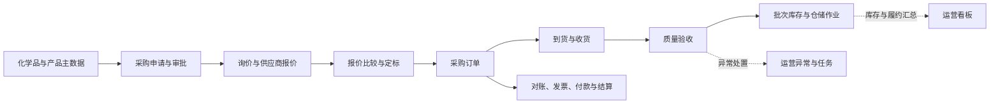
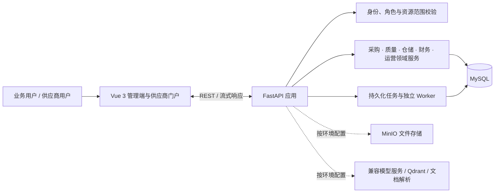

<div align="center">
  
  <h1>ChemicalOps</h1>
  <p><strong>化工业务闭环 · 可追溯运营 · 权限内智能</strong></p>
  <p>面向化工企业的全栈业务平台与场景化 Agent，连接采购、履约、质量、库存和财务协作。</p>
  <p>
    <a href="#核心能力">核心能力</a> ·
    <a href="#系统架构">系统架构</a> ·
    <a href="#本地运行">本地运行</a> ·
    <a href="#项目文档">项目文档</a>
  </p>
</div>

---

## 项目概览

ChemicalOps 将化学品采购运营中的主数据、采购申请、询价报价、采购订单、到货、质量验收、批次库存和财务协作整合在同一套业务平台中。业务通过明确的状态流转、角色授权和记录范围衔接，形成可追踪的采购到库存主链路。

平台由 Vue 3 管理端、FastAPI 服务端和 MySQL 业务数据层组成。场景化 Agent 为用户提供受权限约束的只读业务查询、资料检索和运营摘要；需要产生业务影响的操作仍由用户在既有业务流程中确认和执行。

## 界面预览

以下截图来自本地演示环境，展示产品界面与演示样本，不代表生产数据或生产运行指标。

<div align="center">
  
  <p><sub>运营总览 · 采购、库存、履约和异常指标集中呈现</sub></p>
</div>

<div align="center">
  
  <p><sub>AI 工作台 · 在业务上下文中检索信息、呈现证据与分析结果</sub></p>
</div>

## 核心能力

| 业务域 | 平台能力 |
| --- | --- |
| 主数据 | 化学品、产品规格、检测标准及供应商资料维护，为采购和质量流程提供统一业务对象。 |
| 采购协同 | 采购申请与审批、询价、供应商报价、报价比较与定标、采购订单办理。 |
| 供应商协作 | 独立门户办理受邀报价、订单确认、交期更新、发货通知、质量资料和对账协同。 |
| 到货、质量与库存 | 到货收货、质量验收、批次库存、领用、调拨、盘点、退货、FIFO 出库和效期预警。 |
| 财务协作 | 采购对账、发票登记与核验、付款申请与审批、结算确认；不代表已接入银行或税务系统。 |
| 运营管理 | 异常跟踪、任务与评论、站内通知、运营看板及履约风险观察。 |
| 文件与资料 | 管理文件元数据和业务附件；技术资料可按配置抓取、预览并进入结构化处理流程。 |
| 场景化 Agent | 业务只读查询、自然语言筛选、化学品资料问答、运营摘要、证据来源展示及采购申请草稿预览。 |

## 业务主链路



图示表达主要业务对象之间的关系；各操作是否可用，仍由具体业务状态、角色权限和记录范围决定。

## 场景化 Agent

AI 能力围绕化工采购运营场景构建，定位为业务人员的查询与分析助手：

- 使用受控的业务工具查询产品、库存和询价报价；工具执行前后由服务端校验权限和可见范围。
- 对多候选对象发起追问，并展示查询来源、适用范围和必要的结果限制。
- 通过 LangGraph 组织受限的多步只读任务，以结构化动作协议约束工具选择与参数。
- 提供化学品资料问答、运营摘要、自然语言筛选和采购申请草稿预览等工作台能力。
- 查询 Agent 不直接执行模型生成的 SQL；不自动审批、定标、入库、付款或提交采购写操作。
- 会话、任务和执行轨迹由应用持久化；模型、对象存储、向量检索及文档解析能力需按环境配置。

## 系统架构



| 层次 | 技术与职责 |
| --- | --- |
| Web | Vue 3、TypeScript、Vben Admin、Antdv Next、ECharts；承载管理端、供应商门户和 AI 工作台。 |
| API | Python、FastAPI、SQLAlchemy；实现业务规则、状态校验、授权和资源范围过滤。 |
| 数据与任务 | MySQL 保存业务数据、会话状态和持久化任务；独立 Worker 处理资料与 Agent 异步任务。 |
| Agent | LangGraph 与结构化动作协议组合受限工具；模型服务仅在环境配置后启用。 |
| 可选服务 | MinIO、Qdrant、兼容 OpenAI 的模型服务及文档解析工具；需按部署环境配置，不属于默认必需依赖。 |

## 工程设计亮点

| 设计 | 解决的问题 | 可观察的行为 |
| --- | --- | --- |
| 服务端权限与资源范围校验 | 避免把菜单显隐误当作安全控制 | 页面、动作和业务接口分别受授权约束；供应商主体从登录账号绑定关系确定。 |
| LangGraph 只读工具循环 | 让 Agent 能处理多步查询，同时限制模型可触达的业务面 | 工具白名单、结构化参数、多候选追问和来源记录由服务端流程管理。 |
| MySQL 持久任务与独立 Worker | 将长耗时资料和 Agent 工作与 Web 请求生命周期解耦 | 任务状态及执行信息持久化，工作台可跟踪异步任务。 |
| 业务来源关联 | 让查询和分析结果能够回到对应业务对象核对 | AI 查询展示来源与限制；附件、会话历史和任务结果仍需按用户权限复核。 |

以上描述实现设计与可观察行为，不代表所有角色、数据范围和部署组合均已完成浏览器验收。

## 权限与业务边界

- 前端按角色权限控制菜单、页面和操作入口；后端对接口请求独立执行认证、动作权限、记录范围及业务状态校验。
- 供应商数据范围来自当前登录账号绑定的供应商主体，不接受客户端传入主体作为授权依据。
- 列表入口不等同于明细授权；附件、统计、导出和 AI 来源应遵循对应业务记录的授权范围。
- 运营看板提供汇总视图，不因此授予底层业务记录的读写权限。
- 角色职责基线见[角色职责与三级权限矩阵](docs/角色职责与三级权限矩阵.md)；浏览器验收应结合当前验收记录，不以界面显隐替代后端安全验证。

## 本地运行

### 环境要求

- Python 3.11+
- MySQL 8+
- Node.js 22.18+
- pnpm 11（可通过 Corepack 管理）

### 配置与初始化

```powershell
python -m venv .venv
.\.venv\Scripts\Activate.ps1
python -m pip install -r backend/requirements.txt
Copy-Item .env.example .env
```

在 `.env` 中配置本地 MySQL、JWT 和管理员参数；模型、MinIO、Qdrant 等按需配置。不要提交 `.env`、真实凭据或令牌。

首次初始化数据库：

```powershell
python scripts/init_database.py
```

升级已有数据库前先查看迁移状态：

```powershell
python scripts/migrate_database.py status
python scripts/migrate_database.py upgrade
```

### 启动服务

后端开发入口会启动 API 与资料、Agent Worker：

```powershell
.\.venv\Scripts\Activate.ps1
python main.py run --env=dev
```

另开终端启动前端：

```powershell
corepack pnpm --dir frontend-design install
corepack pnpm --dir frontend-design dev:chemicalops
```

打开 [http://localhost:3000](http://localhost:3000)。后端默认地址为 `http://127.0.0.1:8888`，OpenAPI 文档为 `http://127.0.0.1:8888/docs`。资料和 Agent 默认使用 MySQL 持久化任务队列；配置和故障处理见[数据库任务队列运行说明](docs/数据库任务队列运行说明.md)。

## 测试与质量检查

```powershell
.\.venv\Scripts\python.exe -m pytest
corepack pnpm --dir frontend-design/apps/web-chemicalops run typecheck
corepack pnpm --dir frontend-design/apps/web-chemicalops run build
```

具体验收范围和已验证结果以对应测试、报告及运行环境为准；本 README 不将未执行的检查描述为通过。

## 项目结构

```text
backend/          FastAPI 应用、领域服务与 API
database/         MySQL 表结构与迁移
frontend-design/  Vue 3 管理端与供应商门户
docs/             业务、架构、接口和运行说明
scripts/          初始化、迁移与数据处理工具
tests/            后端自动化测试
main.py           后端开发启动入口
```

## 项目文档

- [项目简介与业务流程](docs/项目简介与业务流程.md)
- [角色职责与三级权限矩阵](docs/角色职责与三级权限矩阵.md)
- [数据库设计说明](docs/数据库设计说明.md)
- [接口文档](docs/接口文档.md)
- [数据库任务队列运行说明](docs/数据库任务队列运行说明.md)
- [Agent 只读任务运行与验收](docs/Agent只读任务运行与验收.md)
- [运行体验与测试指南](docs/运行体验与测试指南.md)

<div align="center">
  <sub>ChemicalOps · 让化学品运营流程更清晰、协作更可追溯</sub>
</div>
