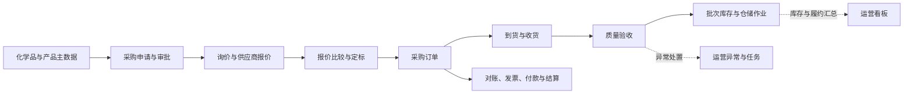
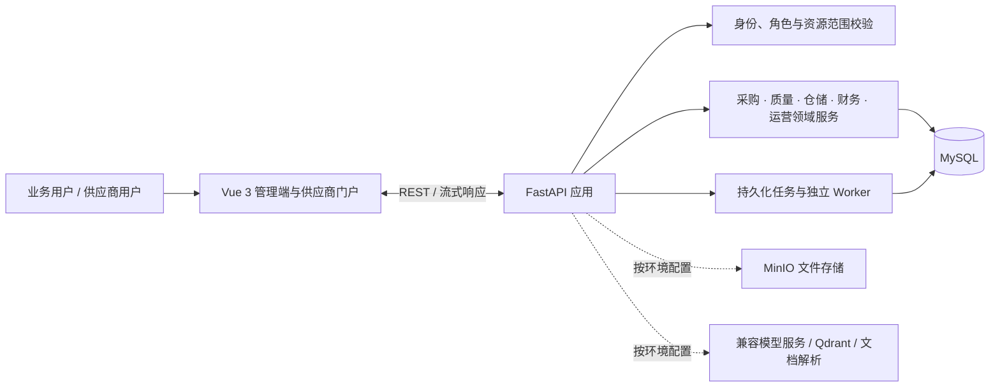

<div align="center">
  
  <h1>ChemicalOps</h1>
  <p><strong>化工业务闭环 · 可追溯运营 · 权限内智能</strong></p>
  <p>面向化工企业的全栈业务平台与场景化 Agent，连接采购、履约、质量、库存和财务协作。</p>
  <p><sub>Vue 3 · FastAPI · MySQL · LangGraph · 供应商门户 · AI 工作台</sub></p>
  <p>
    <a href="#核心能力">核心能力</a> ·
    <a href="#场景化-agent">场景化 Agent</a> ·
    <a href="#技术资料处理">技术资料处理</a> ·
    <a href="#系统架构">系统架构</a> ·
    <a href="#本地运行">本地运行</a> ·
    <a href="#项目文档">项目文档</a>
  </p>
</div>

---

## 项目概览

ChemicalOps 将化学品采购运营中的主数据、采购申请、询价报价、采购订单、到货、质量验收、批次库存和财务协作整合在同一套业务平台中。业务通过明确的状态流转、角色授权和记录范围衔接，形成可追踪的采购到库存主链路。

平台由 Vue 3 管理端、FastAPI 服务端和 MySQL 业务数据层组成。场景化 Agent 为用户提供受权限约束的只读业务查询、资料检索和运营摘要；需要产生业务影响的操作仍由用户在既有业务流程中确认和执行。

<div align="center">
  <table>
    <tr>
      <td align="center"><strong>端到端业务</strong><br /><sub>从采购申请、询报价到收货、质检与库存</sub></td>
      <td align="center"><strong>内外协同</strong><br /><sub>内部管理端与供应商专属门户</sub></td>
      <td align="center"><strong>权限内智能</strong><br /><sub>基于授权范围检索、分析并展示来源</sub></td>
    </tr>
  </table>
</div>

## 界面预览

以下截图来自本地演示环境，展示产品界面与演示样本，不代表生产数据或生产运行指标。

<div align="center">
  
  <p><sub>运营总览 · 采购、库存、履约和异常指标集中呈现</sub></p>
</div>

<div align="center">
  
  <p><sub>AI 工作台 · 在业务上下文中检索信息、呈现证据与分析结果</sub></p>
</div>

## 核心能力

| 业务域 | 平台能力 |
| --- | --- |
| 🧪 主数据 | 维护化学品、CAS 号、产品规格、单位、检测标准和供应商资料，作为采购、验收及资料处理的统一业务对象。 |
| 🛒 采购协同 | 办理采购申请及审批、询价邀请、供应商报价、报价比较与选定、采购订单审批和订单跟踪。 |
| 🤝 供应商门户 | 供应商在独立入口处理受邀询价和报价、订单确认、预计交期、发货通知、质量资料及对账回应。 |
| 📦 到货、质量与库存 | 登记到货和收货，提交质量验收；按批次管理库存，支持领用、调拨、盘点、退货、FIFO 出库和效期预警。 |
| 💳 财务协作 | 覆盖采购对账、发票登记与核验、付款申请和审批、结算确认；不代表已接入银行或税务系统。 |
| 📊 运营管理 | 汇总采购与库存运营情况，跟踪异常、任务、评论和站内通知，并提供履约及库存风险观察。 |
| 📄 文件与技术资料 | 管理业务附件；按环境配置抓取并预览 MSDS/TDS 原件，分阶段执行资料解析、质检和检索入库。 |
| ✨ 场景化 Agent | 提供权限内业务查询与多步任务、自然语言筛选、化学品资料问答、运营晨报、业务分析和需人工确认的采购申请草稿。 |

### 业务模块一览

| 工作场景 | 可办理事项 |
| --- | --- |
| 采购寻源 | 从采购需求进入询价，收集多家供应商报价，按可比较条件查看报价对比，再关联采购订单。 |
| 供应商履约 | 供应商只访问绑定主体对应的询价、订单及履约信息；报价、交期、发货和对账回应按业务状态提交。 |
| 到货与质量 | 记录到货、收货及质量结论，关联验收报告和检测明细；异常进入运营处置流程。 |
| 仓储作业 | 查看批次与可用量，办理领用申请、出入库、调拨、盘点和退货，并追踪库存流水与有效期。 |
| 研发协作 | 技术研发人员维护化学品、产品规格和检测标准，并提交本人领用申请；审批和仓库执行仍由相应角色办理。 |
| 财务结算 | 对采购记录进行对账、发票核验、付款申请和结算确认，状态及记录可回溯。 |
| 运营分析 | 从看板和业务分析入口查看异常、履约、库存或财务差异等汇总及其数据来源。 |

## 业务主链路



图示表达主要业务对象之间的关系；各操作是否可用，仍由具体业务状态、角色权限和记录范围决定。

## 场景化 Agent

AI 能力围绕化工采购运营场景构建，定位为业务人员的查询与分析助手：

- **查询业务数据：**使用受控工具定位产品、库存、询价和报价；服务端在执行前后校验权限、主体和记录范围。
- **处理连续问题：**通过 LangGraph 组织多步只读任务；当对象不明确时先让用户选择候选项，再继续查询。
- **分析与筛选：**支持自然语言筛选条件、运营晨报、多意图查询，以及库存、报价、履约和财务等业务分析视图。
- **检索化学品资料：**基于已处理的技术资料回答化学品性质和安全资料问题，并展示来源和适用范围。
- **辅助起草：**可预览采购申请草稿建议；有权限的用户明确确认后才创建草稿，仍需走原审批流程。
- **保留执行记录：**会话、任务状态及执行轨迹由应用持久化，工作台可恢复历史任务并查看结果来源。
- 查询 Agent 不直接执行模型生成的 SQL；不自动审批、定标、入库、付款或提交采购写操作。
- 模型、对象存储、向量检索及文档解析能力需按环境配置；未配置时相应能力不可用。

## 技术资料处理

技术资料页面围绕化学品和 CAS 号组织资料处理，可按权限及环境配置开展以下操作：

1. **查找并抓取原件：**选择化学品后获取可用的 MSDS/TDS 来源文件，并保存到配置的对象存储。
2. **预览与确认：**查看原始 PDF 或文本化内容，确认资料来源后再启动结构化处理。
3. **解析与检索：**提取结构化字段和章节，执行质量检查并写入业务资料库；配置向量服务后，可供资料检索使用。

抓取和解析是分开的任务阶段，结果受来源可用性、模型/解析服务和存储配置影响。资料处理入口受角色和化学品关联条件限制；资料预览或入库不等同于完成法规合规审查。

## 系统架构



| 层次 | 技术与职责 |
| --- | --- |
| Web | Vue 3、TypeScript、Vben Admin、Antdv Next、ECharts；承载管理端、供应商门户和 AI 工作台。 |
| API | Python、FastAPI、SQLAlchemy；实现业务规则、状态校验、授权和资源范围过滤。 |
| 数据与任务 | MySQL 保存业务数据、会话状态和持久化任务；独立 Worker 处理资料与 Agent 异步任务。 |
| Agent | LangGraph 与结构化动作协议组合受限工具；模型服务仅在环境配置后启用。 |
| 可选服务 | MinIO、Qdrant、兼容 OpenAI 的模型服务及文档解析工具；需按部署环境配置，不属于默认必需依赖。 |

## 工程设计亮点

| 设计 | 解决的问题 | 可观察的行为 |
| --- | --- | --- |
| 服务端权限与资源范围校验 | 避免把菜单显隐误当作安全控制 | 页面、动作和业务接口分别受授权约束；供应商主体从登录账号绑定关系确定。 |
| LangGraph 只读工具循环 | 让 Agent 能处理多步查询，同时限制模型可触达的业务面 | 工具白名单、结构化参数、多候选追问和来源记录由服务端流程管理。 |
| MySQL 持久任务与独立 Worker | 将长耗时资料和 Agent 工作与 Web 请求生命周期解耦 | 任务状态及执行信息持久化，工作台可跟踪异步任务。 |
| 业务来源关联 | 让查询和分析结果能够回到对应业务对象核对 | AI 查询展示来源与限制；附件、会话历史和任务结果仍需按用户权限复核。 |

以上描述实现设计与可观察行为，不代表所有角色、数据范围和部署组合均已完成浏览器验收。

## 权限与业务边界

- 前端按角色权限控制菜单、页面和操作入口；后端对接口请求独立执行认证、动作权限、记录范围及业务状态校验。
- 供应商数据范围来自当前登录账号绑定的供应商主体，不接受客户端传入主体作为授权依据。
- 列表入口不等同于明细授权；附件、统计、导出和 AI 来源应遵循对应业务记录的授权范围。
- 运营看板提供汇总视图，不因此授予底层业务记录的读写权限。
- 角色职责基线见[角色职责与三级权限矩阵](docs/角色职责与三级权限矩阵.md)；浏览器验收应结合当前验收记录，不以界面显隐替代后端安全验证。

## 本地运行

### 环境要求

- Python 3.11+
- MySQL 8+
- Node.js 22.18+
- pnpm 11（可通过 Corepack 管理）

### 配置与初始化

```powershell
python -m venv .venv
.\.venv\Scripts\Activate.ps1
python -m pip install -r backend/requirements.txt
Copy-Item .env.example .env
```

在 `.env` 中配置本地 MySQL、JWT 和管理员参数；模型、MinIO、Qdrant 等按需配置。不要提交 `.env`、真实凭据或令牌。

首次初始化数据库：

```powershell
python scripts/init_database.py
```

升级已有数据库前先查看迁移状态：

```powershell
python scripts/migrate_database.py status
python scripts/migrate_database.py upgrade
```

### 启动服务

后端开发入口会启动 API 与资料、Agent Worker：

```powershell
.\.venv\Scripts\Activate.ps1
python main.py run --env=dev
```

另开终端启动前端：

```powershell
corepack pnpm --dir frontend-design install
corepack pnpm --dir frontend-design dev:chemicalops
```

打开 [http://localhost:3000](http://localhost:3000)。后端默认地址为 `http://127.0.0.1:8888`，OpenAPI 文档为 `http://127.0.0.1:8888/docs`。资料和 Agent 默认使用 MySQL 持久化任务队列；配置和故障处理见[数据库任务队列运行说明](docs/数据库任务队列运行说明.md)。

## 测试与质量检查

```powershell
.\.venv\Scripts\python.exe -m pytest
corepack pnpm --dir frontend-design/apps/web-chemicalops run typecheck
corepack pnpm --dir frontend-design/apps/web-chemicalops run build
```

具体验收范围和已验证结果以对应测试、报告及运行环境为准；本 README 不将未执行的检查描述为通过。

## 项目结构

```text
backend/          FastAPI 应用、领域服务与 API
database/         MySQL 表结构与迁移
frontend-design/  Vue 3 管理端与供应商门户
docs/             业务、架构、接口和运行说明
scripts/          初始化、迁移与数据处理工具
tests/            后端自动化测试
main.py           后端开发启动入口
```

## 项目文档

- [项目简介与业务流程](docs/项目简介与业务流程.md)
- [角色职责与三级权限矩阵](docs/角色职责与三级权限矩阵.md)
- [数据库设计说明](docs/数据库设计说明.md)
- [接口文档](docs/接口文档.md)
- [数据库任务队列运行说明](docs/数据库任务队列运行说明.md)
- [Agent 只读任务运行说明](docs/Agent只读任务运行说明.md)
- [运行体验与测试指南](docs/运行体验与测试指南.md)

<div align="center">
  <sub>ChemicalOps · 让化学品运营流程更清晰、协作更可追溯</sub>
</div>
