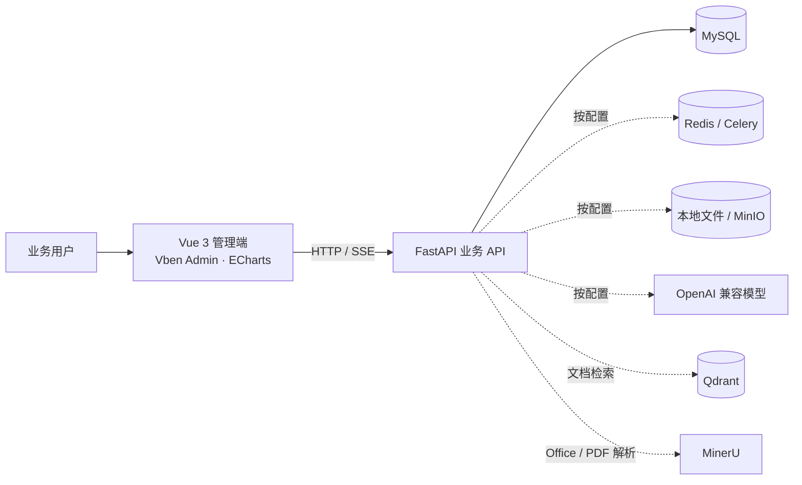
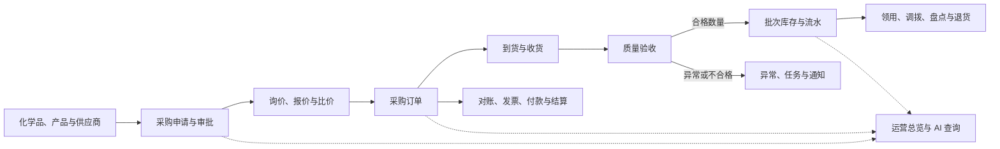
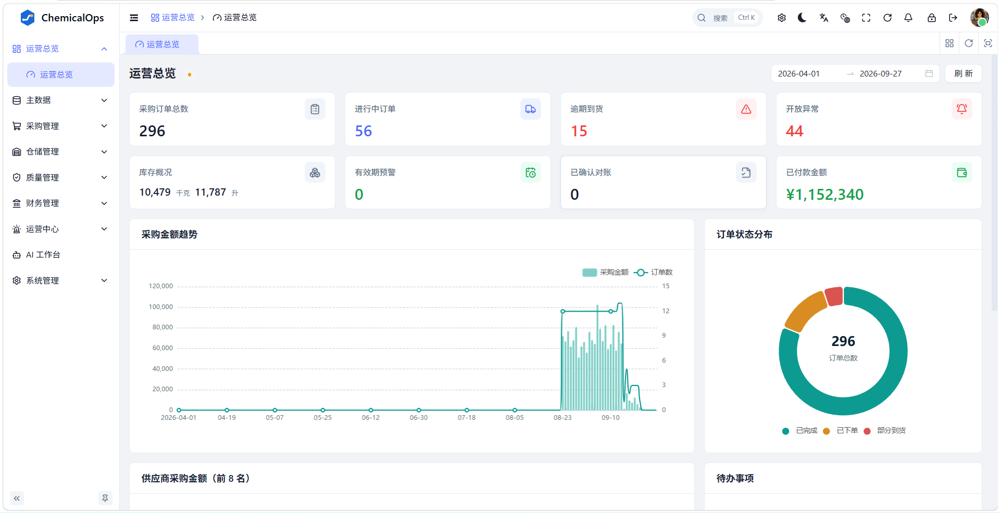
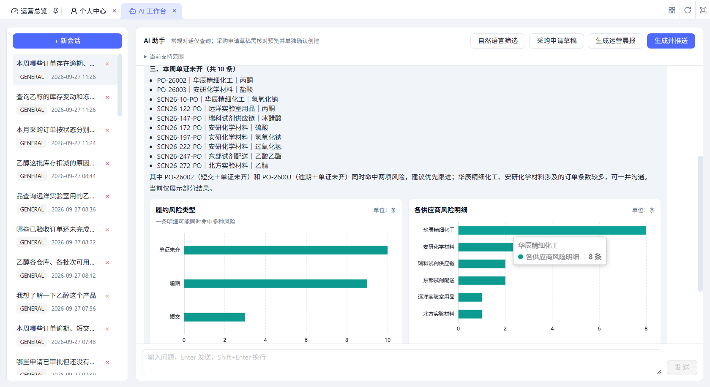

<div align="center">
  
  <h1>ChemicalOps · 化工企业运营管理平台</h1>
  <p>让采购、到货、质量、库存与财务流程连得起来</p>
</div>

<table>
  <tr>
    <th align="left">项目周期</th>
    <td>2026.09 — 至今</td>
    <th align="left">项目定位</th>
    <td>面向化工企业的采购与运营协同平台</td>
  </tr>
  <tr>
    <th align="left">核心技术</th>
    <td colspan="3">Python · FastAPI · SQLAlchemy · Vue 3 · TypeScript · Vben Admin · MySQL · ECharts</td>
  </tr>
  <tr>
    <th align="left">可选集成</th>
    <td colspan="3">Redis / Celery · MinIO · Qdrant · OpenAI 兼容模型（默认配置 DeepSeek）· MinerU</td>
  </tr>
</table>

## 项目简介

ChemicalOps 覆盖化学品采购运营中的主数据、采购申请、询价报价、采购订单、到货收货、质量验收、批次库存、仓储作业和财务对账等环节。系统提供权限管理、附件、通知、任务和运营看板；AI 工作台支持受权限约束的业务查询、图表、化学品资料问答、运营晨报、自然语言筛选与人工确认的采购申请草稿。质量验收和其他业务页面提供按需触发的辅助核对与只读分析。

项目采用前后端分离结构：Vue 管理端通过 FastAPI 接口访问 MySQL；文件、模型、检索和异步任务服务按部署需要配置。AI 查询由后端白名单、权限和只读规则约束，不直接执行模型生成的 SQL，也不代替用户审批或执行高风险写操作。

## 项目亮点

| 方向 | 项目能力 |
| --- | --- |
| 采购协同 | 采购申请与审批、询价、供应商报价、报价比较、采购订单流转及供应商门户协作。 |
| 到货与质量 | 到货计划、收货确认、质量验收；报告上传与明细级核对、产品检测标准版本及人工复核记录；验收结果关联后续库存处理。 |
| 仓储与库存 | 仓库和库位、批次余额、库存流水、冻结解冻、领用、调拨、盘点、退货及效期管理。 |
| 财务协同 | 采购对账、发票录入与人工审核、付款申请和人工付款登记、采购结算。系统不代表银行或税务系统。 |
| 运营处置 | 运营总览、异常与任务、站内通知、逾期和库存提醒及后台任务运行记录。 |
| AI 工作台 | 流式对话与会话管理；12 类白名单业务数据的只读汇总、固定订单追溯及部分明细来源；自然语言筛选、运营晨报及确认后创建采购申请草稿。报价和库存流水支持笔数统计，发票按含税金额、付款按登记金额及币种统计。 |
| 化学品资料问答 | 识别 CAS 号或化学品名称，检索已解析资料章节并提供来源信息；名称和别名识别仍需改进，向量检索和模型服务需按环境配置。 |
| 业务辅助分析 | 在批次、订单、异常、化学品、供应商、询价和盘点等业务页面查看按需计算的证据、核查建议及数据限制；分析不改变正式业务状态。 |
| 安全与可追溯 | JWT 登录、角色权限、附件访问校验、审计记录、业务状态校验和数据库迁移台账。 |

## 技术架构

| 层次 | 技术与职责 |
| --- | --- |
| Web 管理端 | Vue 3、TypeScript、Vben Admin、Antdv Next；ECharts 展示运营和 AI 查询图表。 |
| API 与业务服务 | Python、FastAPI、SQLAlchemy；按业务模块组织权限校验、流程规则和数据访问。 |
| 业务数据 | MySQL，保存业务单据、系统配置、会话和文件元数据。 |
| 实时交互 | HTTP API；AI 对话通过 SSE 增量返回回答。Redis/Celery 可按配置用于队列与后台任务。 |
| 文件与 AI 集成 | 文件默认可使用本地存储，也可接入 MinIO；模型使用 OpenAI 兼容接口；Qdrant 与 MinerU 按需启用。 |



## 核心业务链路



## 界面示意

以下为本地开发环境的界面截图。截图中的业务数据用于开发演示，不代表生产数据。

<table>
  <tr>
    <td width="50%" valign="top">
      
      <p align="center"><strong>运营总览</strong><br />采购、到货、库存风险与运营指标</p>
    </td>
    <td width="50%" valign="top">
      
      <p align="center"><strong>AI 工作台</strong><br />文字回答优先，随后呈现统计图表和查询明细</p>
    </td>
  </tr>
</table>

## 快速开始

### 环境要求

- Python 3.11 或更新版本
- MySQL 8.0 或兼容版本
- Node.js 22.18+ 与 pnpm 11+
- AI 对话、对象存储、文档解析和向量检索需要各自的服务凭据；这些集成可以按需启用

### 1. 配置 Python 环境

在仓库根目录运行：

```powershell
python -m venv .venv
.\.venv\Scripts\Activate.ps1
python -m pip install -r backend/requirements.txt
Copy-Item .env.example .env
```

按本机环境编辑 `.env`，填写 MySQL 连接信息、`JWT_SECRET_KEY`、管理员账号与密码。需要 AI 问答时，再配置模型 API 地址和密钥；资料向量检索及扫描件解析分别需要相应服务。不要把 `.env` 或真实凭据提交到仓库。

### 2. 初始化数据库

创建空的 `chemicalops` 数据库后，在已激活的虚拟环境中执行初始化：

```powershell
python scripts/init_database.py
```

已有数据库先查看迁移状态，再执行升级：

```powershell
python scripts/migrate_database.py status
python scripts/migrate_database.py upgrade
```

迁移前备份、恢复验证和演示数据准备步骤见[运行体验与测试指南](docs/运行体验与测试指南.md)。不要把含 `DROP TABLE` 的数据库快照直接用于已有数据的数据库。

### 3. 启动服务

终端一：激活 Python 虚拟环境后启动后端 API。

```powershell
.\.venv\Scripts\Activate.ps1
python main.py run --env=dev
```

终端二：安装并启动前端。

```powershell
corepack prepare pnpm@11.16.0 --activate
corepack pnpm --dir frontend-design install
corepack pnpm --dir frontend-design dev:chemicalops
```

打开 `http://localhost:3000`。后端默认运行于 `http://127.0.0.1:8888`，API 文档地址为 `http://127.0.0.1:8888/docs`。首次体验可以按[运行体验与测试指南](docs/运行体验与测试指南.md)创建管理员、准备演示数据并配置可选服务。

## 项目结构

```text
ChemicalOps/
├─ backend/app/          FastAPI 应用、权限与业务模块
├─ frontend-design/      Vben Admin 前端 Monorepo
│  └─ apps/web-chemicalops/  ChemicalOps 业务前端
├─ database/             MySQL 表结构与数据库迁移
├─ deploy/               Docker Compose 与部署配置
├─ docs/                 项目、接口、数据库与运行文档
├─ scripts/              初始化、迁移、演示数据与运维脚本
├─ tests/                后端业务与接口测试
├─ .env.example          本地环境变量模板
└─ main.py               后端开发启动入口
```

## 文档导航

| 文档 | 内容 |
| --- | --- |
| [项目简介与业务流程](docs/项目简介与业务流程.md) | 业务模块、流程关系与能力事实来源 |
| [AI 问答图表设计](docs/AI问答图表设计.md) | AI 查询范围、图表映射与展示口径 |
| [AI 工作台现状与建设方案](docs/业务数据与AI联动路线图.md) | 已实现能力、业务页面入口、限制与后续计划 |
| [AI 功能扩展进度](docs/AI功能扩展调研与候选路线图.md) | 质量报告核对、业务分析场景与候选功能 |
| [运行体验与测试指南](docs/运行体验与测试指南.md) | 初始化、演示账号、启动、测试和故障排查 |
| [数据库设计说明](docs/数据库设计说明.md) | 数据表、字段、索引和关系说明 |
| [接口文档](docs/接口文档.md) | API 路由和请求/响应说明 |
| [前端构建环境说明](docs/build-notes/前端构建环境说明.md) | pnpm、依赖、构建和常见环境问题 |

## 项目边界

- AI 业务数据查询受数据集白名单和用户权限约束，只读执行；自然语言能力不等于可查询所有业务数据。
- 采购申请草稿只有在用户预览并确认后才通过现有业务接口创建；质量报告核对及业务分析结果须由相应岗位复核。工作台尚无通用附件问答入口。
- AI 不会自动审批、下单、修改库存或执行付款。系统内的付款流程用于记录申请、审批和人工核验结果，不连接银行完成转账。
- 模型、MinerU、Qdrant、MinIO、Redis 等服务依赖部署配置；未配置的可选服务不会自动可用。
- 界面示意图中的业务内容为示例，具体页面和能力以当前代码、运行环境及权限为准。

---

<p align="center">ChemicalOps · 让化学品运营更清晰、更可追溯</p>
