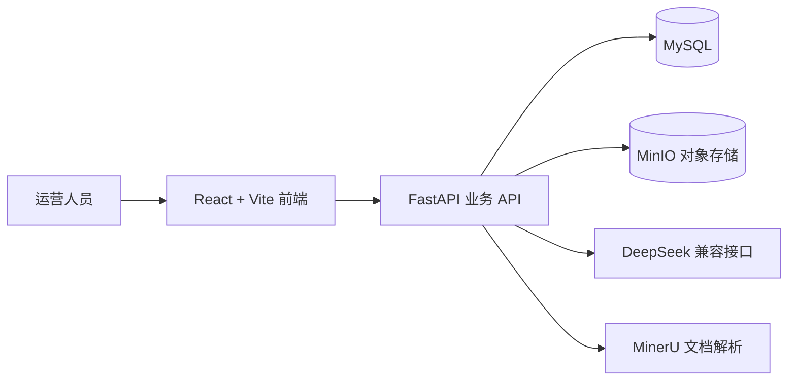
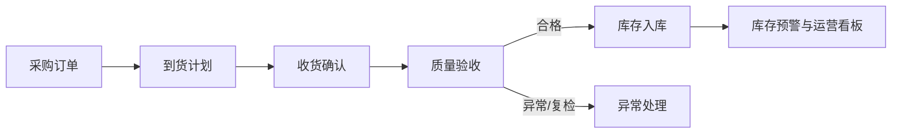
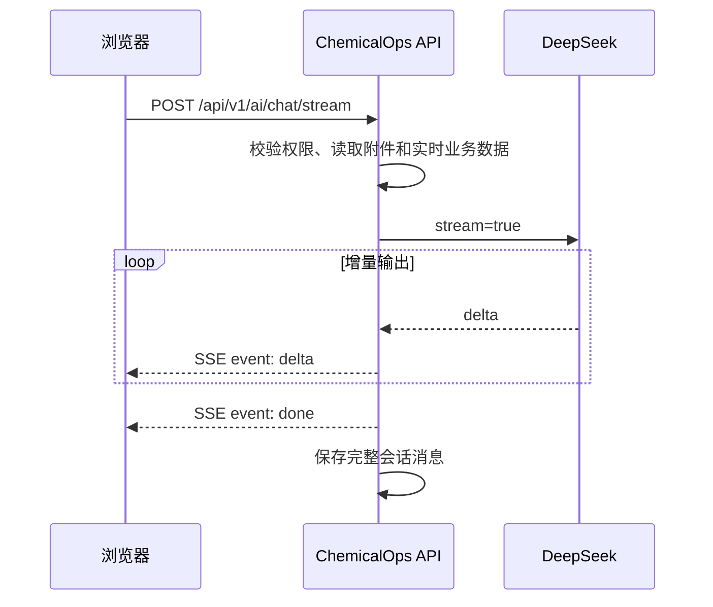
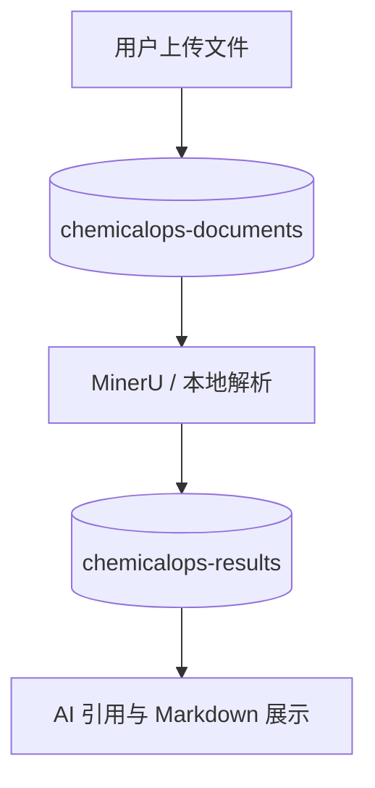

# ChemicalOps 化学品运营管理平台

ChemicalOps 是一个面向化学品采购、到货、质量、库存和供应商管理的运营平台。项目当前包含后台管理 API、运营看板、业务链路页面、AI 工作台、附件解析和 MinIO 文件存储能力。

## 项目一览



## 核心业务链路



## 已实现功能

| 模块 | 当前能力 |
|---|---|
| 运营看板 | 实时聚合指标、采购趋势折线图、订单状态饼图、统计图表和待办事项 |
| 采购管理 | 采购订单列表、详情和基础业务状态 |
| 到货与收货 | 登记到货计划、收货确认、物流信息和数量校验 |
| 质量验收 | 创建验收、提交验收结果、合格/部分合格/不合格/复检状态 |
| 库存入库 | 按验收结果进入入库流程，展示库存与批次信息 |
| AI 工作台 | 悬浮球、可拖动聊天窗、历史会话、附件上传、Markdown 渲染、SSE 流式输出 |
| 文档解析 | TXT/CSV/Markdown/JSON 本地解析，PDF/Office 通过 MinerU v4 解析，OCR 暂不启用 |
| 文件存储 | MinIO 原始文档桶与解析结果桶，私有权限和业务资源权限校验 |
| 安全能力 | JWT、角色权限、附件大小/MIME/魔数校验、可选 ClamAV、审计日志 |

## AI 工作台

AI 对话采用 SSE 流式协议：



AI 回复支持标题、列表、加粗、行内代码、代码块和换行等 Markdown 展示。

## MinIO 文件分层



默认桶规划：

- `chemicalops-documents`：原始上传文件
- `chemicalops-results`：解析后的 Markdown 结果

数据库只保存文件元数据和对象键，文件内容不写入业务表。

## 本地启动

### 1. 安装后端依赖

```powershell
uv sync
```

如果项目环境没有使用 `uv`，也可以根据 `backend/requirements.txt` 安装依赖。

### 2. 配置环境变量

复制示例配置并填写本地值：

```powershell
Copy-Item .env.example .env
```

至少需要配置数据库、JWT 密钥、AI API key，以及 MinIO：

```env
FILE_STORAGE_BACKEND=minio
MINIO_ENDPOINT=127.0.0.1:19000
MINIO_ACCESS_KEY=你的MinIO账号
MINIO_SECRET_KEY=你的MinIO密码
MINIO_DOCUMENT_BUCKET=chemicalops-documents
MINIO_RESULT_BUCKET=chemicalops-results
```

### 数据库初始化与升级

新建空数据库时运行一次；脚本会拒绝覆盖已经有表的数据，并在核心结构创建后按序应用增量迁移：

```powershell
uv run python scripts/init_database.py
```

已有数据库查看迁移状态或升级时使用统一 runner：

```powershell
uv run python scripts/migrate_database.py status
uv run python scripts/migrate_database.py upgrade
```

升级默认先生成 MySQL 逻辑备份到 `backups/mysql/`，并确认备份文件存在且非空后才开始迁移。生产环境不能跳过备份；开发/测试环境只有在确认可丢弃数据时才可显式使用 `--no-backup`。迁移版本、文件校验和、执行结果和失败记录保存在 `schema_migrations` / `schema_migration_attempts` 表中。每次迁移前会取得数据库级互斥锁；失败时记录失败原因并停止后续版本。MySQL DDL 通常不能事务回滚，因此不要直接修改已经发布的迁移文件；修复应新增后续迁移，或按恢复预案恢复备份。

生产发布流程：先在预发布环境恢复一份近期备份，确认恢复库可连接并核对关键表数据；在该恢复库执行 `status` 和 `upgrade`，检查台账中版本、校验和及执行结果；确认应用关键读写流程后，再对生产执行同一 `status` / `upgrade` 命令。恢复演练必须使用隔离数据库，禁止把生产备份导入仍在使用的数据库。发布前保存备份位置、目标版本和迁移输出；若生产升级失败，先保留现场并检查 `schema_migrations`、`schema_migration_attempts` 与实际结构，再决定继续重试或按已验证的备份恢复步骤处置。

登录保护：`/auth/login` 对同一账号与来源 IP 的失败尝试按 15 分钟窗口计数，达到 5 次后锁定 15 分钟；来源 IP 的失败尝试达到 30 次也会触发 15 分钟限制。数据库只保存账号/IP 范围的哈希，不保存登录名或 IP 原文。`/auth/logout` 会撤销该账号所有设备的现有访问令牌；修改密码、管理员重置密码或停用/锁定账号也会立即使旧令牌失效。上述功能需要先通过迁移 runner 应用 `021_auth_security`。

幂等策略：生产环境必须启用 `IDEMPOTENCY_REQUIRED=true`，所有 POST/PUT/PATCH/DELETE 写请求都须带 `Idempotency-Key`；登录和 AI SSE 流式对话明确豁免。中间件只缓存不超过 1 MiB 的 JSON 响应，并保存安全的语义响应头；流式、非 JSON、空响应或过大的响应会原样发送，标记为不可回放，同键重试将收到 409，避免重复执行副作用。处理中重试返回 409 和 `Retry-After`；请求异常、5xx 或缓存状态无法确认时，同键重试会被阻止并要求先核对业务状态。回放记录保留 24 小时。升级需先应用 `022_idempotency_response_headers`。

### 3. 启动 MinIO

项目提供 Docker 配置：

```powershell
docker compose -f deploy/docker-compose.minio.yml up -d
```

如果已有 MinIO 容器，直接使用已有端口，并在控制台创建两个私有桶即可。MinIO 控制台通常通过 `http://127.0.0.1:19001` 访问，具体以 Docker Desktop 的端口映射为准。

### 4. 启动后端

```powershell
uv run main.py run --env=dev
```

后端默认地址：`http://127.0.0.1:8888`。

### 5. 启动前端

前端基于 Vben Admin（Vue 3 + antdv-next），位于 `frontend-design/apps/web-chemicalops`。

```powershell
# monorepo 要求 pnpm >= 11，首次先激活
corepack prepare pnpm@11.16.0 --activate

corepack pnpm --dir frontend-design install
corepack pnpm --dir frontend-design dev:chemicalops
```

前端默认地址：`http://localhost:3000`，已配置代理把 `/api` 与 `/health` 转发到后端 8888。

依赖安装与构建的注意事项见 [`docs/build-notes/前端构建环境说明.md`](docs/build-notes/前端构建环境说明.md)。

## 目录结构

```text
ChemicalOps/
├─ backend/       FastAPI 后端、业务模块、权限和文件服务
├─ frontend-design/  Vben Admin monorepo，业务前端在 apps/web-chemicalops
├─ database/      数据库初始化和迁移脚本
├─ deploy/        Docker 与部署配置
├─ docs/          需求、接口、流程和实现进度文档
├─ scripts/       调度、初始化和运维脚本
├─ tests/         后端接口与业务测试
├─ .env.example   中文配置说明模板
└─ main.py        开发启动入口
```

## 重要接口

| 接口 | 说明 |
|---|---|
| `POST /api/v1/auth/login` | 用户登录 |
| `GET /api/v1/dashboard/overview` | 运营看板实时概览 |
| `POST /api/v1/files` | 上传文件 |
| `POST /api/v1/ai/chat/stream` | AI SSE 流式对话 |
| `GET /api/v1/ai/conversations` | 查询 AI 历史会话 |

完整接口说明见 [`docs/后台管理CRUD接口说明.md`](docs/后台管理CRUD接口说明.md)。

## 验证命令

```powershell
corepack pnpm --dir frontend-design build:chemicalops
uv run pytest --strict-config --strict-markers -q -rs
```

`.env`、上传文件、解析结果和前端构建产物均已加入 Git 忽略规则，不应提交到仓库。

## 当前边界

- AI 当前以查询分析和业务草稿建议为主，不直接执行订单、入库等高风险写操作。
- OCR 暂不纳入本轮实现。
- 生产环境还需要补充对象存储密钥管理、ClamAV 服务、监控告警和更细的部门/仓库数据范围。
