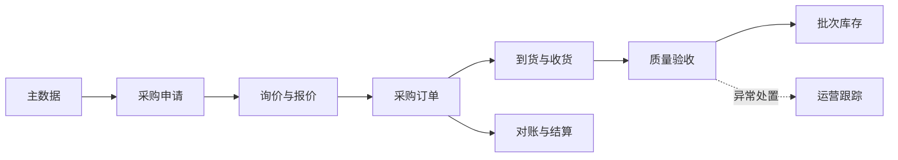
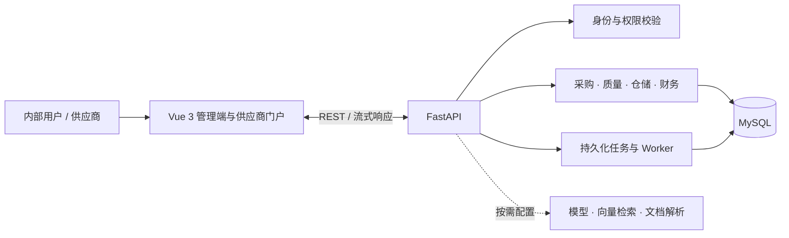

<div align="center">
  
  <h1>ChemicalOps</h1>
  <p><strong>化工业务闭环 · 可追溯运营 · 场景化智能</strong></p>
  <p>面向化工企业的全栈业务平台，连接采购、供应商履约、质量、库存与财务协作。</p>
  <p><sub>Vue 3 · FastAPI · MySQL · LangGraph</sub></p>
  <p>
    <a href="#核心业务">核心业务</a> ·
    <a href="#场景化-agent">场景化 Agent</a> ·
    <a href="#业务链路">业务链路</a> ·
    <a href="#技术架构">技术架构</a> ·
    <a href="#本地运行">本地运行</a>
  </p>
</div>

---

## 项目概览

ChemicalOps 将化学品采购运营中的主数据、采购申请、询价报价、采购订单、到货验收、批次库存和财务协作整合到统一平台。通过业务状态流转、角色授权和记录追踪，支持从采购需求到库存管理的协同作业。

平台由 Vue 3 管理端、供应商门户、FastAPI 服务端和 MySQL 数据层组成，并提供面向采购运营场景的 Agent 工作台。

<hr />

## 界面预览

以下为本地演示环境的产品界面。

<div align="center">
  
  <p><sub>运营总览 · 采购、库存、履约与异常信息</sub></p>
</div>

<div align="center">
  
  <p><sub>AI 工作台 · 业务对话、运营摘要与分析结果</sub></p>
</div>

<hr />

## 核心业务

| 业务域 | 核心功能 |
| --- | --- |
| 主数据 | 化学品与 CAS、产品规格、检测标准、供应商资料维护。 |
| 采购协同 | 采购申请与审批、询价、供应商报价、报价比较、订单办理与跟踪。 |
| 供应商门户 | 受邀报价、订单确认、交期更新、发货通知、质量资料和对账协同。 |
| 到货、质量与库存 | 到货收货、质量验收、批次库存、领用、调拨、盘点、退货、FIFO 出库和效期预警。 |
| 财务与运营 | 采购对账、发票核验、付款申请与结算；异常、任务、站内通知和运营看板。 |
| 技术资料 | 按配置抓取和预览 MSDS/TDS 原件，分阶段解析资料、检查质量并入库检索。 |

<hr />

## 场景化 Agent

Agent 工作台面向采购与运营人员，将自然语言问题转化为连贯的业务查询和分析：

- 查询产品、库存、询价与报价；遇到多个可能对象时先澄清，再继续处理。
- 汇总库存、报价、履约和财务信息，生成带有来源线索的结果与运营晨报。
- 根据自然语言生成列表筛选条件，或围绕化学品资料进行问答与检索。
- 将采购需求整理为申请草稿建议，供有权限的用户核对并确认。

Agent 由 LangGraph 编排多步任务，会话和任务进度可在工作台中查看。审批、定标、库存变更和付款仍通过相应业务流程办理。

<hr />

## 业务链路



<hr />

## 技术架构



服务端负责业务规则、角色授权和记录范围校验；模型服务、MinIO、Qdrant 等按部署环境配置。

<hr />

## 本地运行

### 环境要求

- Python 3.11+
- MySQL 8+
- Node.js 22.18+
- pnpm 11（可通过 Corepack 管理）

### 安装与配置

```powershell
python -m venv .venv
.\.venv\Scripts\Activate.ps1
python -m pip install -r backend/requirements.txt
Copy-Item .env.example .env
python scripts/init_database.py
```

在 `.env` 中配置本地 MySQL、JWT 和管理员参数。模型、对象存储及向量检索服务按需配置；不要提交 `.env` 或真实凭据。

### 启动

后端开发入口会启动 API 与资料、Agent Worker：

```powershell
python main.py run --env=dev
```

另开终端启动前端：

```powershell
corepack pnpm --dir frontend-design install
corepack pnpm --dir frontend-design dev:chemicalops
```

前端地址：[http://localhost:3000](http://localhost:3000) · API 文档：[http://127.0.0.1:8888/docs](http://127.0.0.1:8888/docs)

<hr />

## 项目文档

- [项目简介与业务流程](docs/项目简介与业务流程.md)
- [角色职责与权限矩阵](docs/角色职责与三级权限矩阵.md)
- [数据库设计说明](docs/数据库设计说明.md)
- [数据库任务队列运行说明](docs/数据库任务队列运行说明.md)
- [运行体验与测试指南](docs/运行体验与测试指南.md)

<div align="center">
  <sub>ChemicalOps · 让化学品运营流程更清晰、协作更可追溯</sub>
</div>
