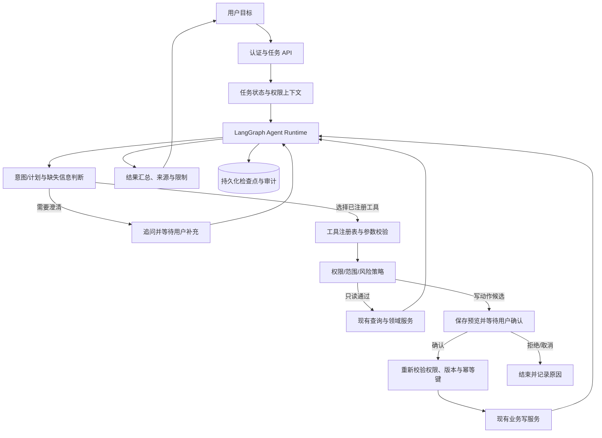

# ChemicalOps 场景化 Agent 升级方案与交付标准

> 文档版本：v1.4｜编制日期：2026-10-03｜状态：分阶段实施。阶段 0 规则与 20 条用例已建立；阶段 1 后端四工具条件循环、追问和任务 API 已实现，并部分落实阶段 2/5/6 的对象定位、快照及预算。只读工作台和固定真实模型评估已落地，16 条样本检查通过；完整阶段矩阵、确认写入及故障恢复尚未验收。
> 本方案在现有 FastAPI、LangGraph、SQLAlchemy、MySQL 与 Vue 3 能力上分阶段升级。目标是建立一个边界清楚、可追踪、可确认、可恢复的场景化业务 Agent，不以“模型能自由调用所有接口”为目标。

## 1. 目标与当前基线

### 1.1 当前已经具备的基础

- AI 工作台按意图把请求分流到化学品资料问答、业务查询及普通对话等专用流程。
- Text2SQL 使用 LangGraph 固定五节点链路：查询理解、槽位校验、查询计划构建、SQL 校验、执行。模型提供结构化查询计划，后端白名单、权限校验和 ORM 承担实际查询。
- 采购申请建议通过专用接口生成候选字段，经目录及业务 Schema 校验后返回预览；预览本身不落库。用户确认后由前端调用原采购申请接口创建草稿。
- 会话、部分查询状态及轨迹保存在 MySQL；当前查询图使用进程内 `MemorySaver`。会话记录不等于可恢复的 Agent 执行任务。
- 其他晨报、筛选解析和部分文档问答是专用提示词/API 流程，不是统一的动态工具执行循环。

- 采购只读任务已集成到原 AI 工作台聊天（独立页面移除）：四工具条件循环、产品/询价多候选追问、MySQL 轨迹快照、202 后台启动/续跑、轮询、取消与来源展示；详见 [任务运行与验收](Agent只读任务运行与验收.md)。

### 1.2 升级后要达到什么

用户可用一个目标描述启动任务。Agent 在明确的工具目录和用户权限内选择只读业务工具，按结果决定下一步，必要时追问；需要写入时生成可检查的动作预览并暂停，用户确认后由服务端重新校验并调用原业务服务。任务状态、工具输入输出摘要、来源、确认和执行结果可追溯；服务重启后可继续等待确认或安全恢复。

建议首个完整场景：**“核对指定产品的可用库存、比较可比供应商报价，并准备一份采购申请草稿。”** 先实现只读查询和草稿预览，再实现确认后创建草稿。正式提交审批、下单、库存变更、验收放行和付款不属于首个 Agent 的授权范围。

### 1.3 名称与能力声明

| 阶段 | 建议对外描述 | 成立条件 |
| --- | --- | --- |
| 当前 | 场景化 LLM 工作流 / 受约束业务查询 | 事实与当前固定图和专用接口一致 |
| 只读工具 MVP | 可调用白名单业务工具的场景化 Agent 原型 | 模型可在任务循环中选择至少两个只读工具，并根据结果继续或追问 |
| 首个完整闭环 | 带人工确认与任务恢复的采购辅助 Agent | 只读工具串联、草稿预览、确认门、持久化恢复及审计全部通过验收 |
| 后续扩展 | 多业务场景 Agent 平台 | 新场景通过工具注册和场景配置复用运行时，且各自通过权限、质量和业务验收 |

不得把“使用 LangGraph”“请求模型输出 JSON”或“存在采购草稿预览”单独作为通用 Agent 已完成的证据。

## 2. 设计原则与范围

1. **模型负责语义与选择，服务端负责权限与执行。** 模型提出工具名称和参数；后端只允许从已注册目录中解析工具，不执行模型提供的 SQL、URL、Python 或任意函数名。
2. **所有工具先按调用者权限过滤，再校验参数。** 每次调用都从认证上下文取得用户身份，不能信任模型、前端或历史任务中传入的用户 ID、部门或角色。
3. **读写能力分离。** 只读工具可在任务中执行；写工具默认关闭，并以独立的人工确认和原业务服务作为唯一写入入口。
4. **确定性业务规则不交给模型。** 数量、金额、权限、状态、阈值和业务校验由已有领域服务或规则代码计算；模型只整理、解释和提出候选值。
5. **结果带依据和边界。** 查询、比价与建议携带数据口径、来源记录、时间、缺失信息和不能推断的范围。
6. **先做一个可验证闭环。** 首期不引入多 Agent、长期记忆、MCP 或任意代码执行；只有明确的复用或业务需要再评估。
7. **可中断、可重试、可取消。** 持久化状态和幂等约束先于扩大写操作范围。

### 首期明确不包含

- 自动提交采购申请、自动审批、自动生成采购订单、自动变更库存或质量状态、登记付款。
- 任意数据库查询、任意网络访问、 shell/Python 执行、工具动态注册或模型修改权限。
- 无人监督的后台代理、多个 Agent 自由协商或自动给供应商发送消息。
- 未有数据依据的供应商排名、采购决策、节省金额或业务效率提升结论。

## 3. 目标架构

建议将运行时划分为以下职责明确的节点：

| 节点/服务 | 职责 | 不允许承担的职责 |
| --- | --- | --- |
| 任务入口 | 创建/读取任务、校验所有权、加载认证用户和场景配置 | 接受模型指定的身份或权限 |
| 计划与路由 | 把用户目标和已验证上下文转成下一步工具请求、澄清问题或完成状态 | 直接访问数据库或执行写操作 |
| 工具注册表 | 提供工具名称、说明、Pydantic 输入/输出 Schema、权限码、风险级别、超时及版本 | 将模型传入的任意函数名映射为可执行代码 |
| 策略检查器 | 检查工具是否启用、用户是否有权限、参数是否在场景范围和风险限制内 | 仅依赖模型自我约束 |
| 工具执行器 | 调用对应的领域服务，形成规范化结果和来源 | 绕开原业务服务直接修改核心业务表 |
| 确认节点 | 保存不可变候选动作快照，等待用户确认/拒绝 | 把“模型说用户同意”当作确认 |
| 恢复与终止 | 从持久化检查点恢复、处理重试、取消、超时和人工介入 | 对不确定的写操作盲目重试 |
| 结果汇总 | 用工具返回的证据生成摘要，展示来源、数据口径和限制 | 把工具未返回的事实补成确定结论 |

### 3.1 首期工具目录

工具名称是建议值，落地时应复用已有领域服务，并对照真实 API/权限码定稿。

| 工具 | 风险 | 输入与输出重点 | MVP 可用范围 |
| --- | --- | --- | --- |
| `inventory.query_available` | 只读 | 产品/关键词、仓库范围；可用量、单位、批次摘要、来源与统计时点 | 用户有权查看的库存；明确单位和可见仓库范围 |
| `supplier_quotes.compare` | 只读 | 产品、单位、必要筛选；报价、币种、报价日期、交期、供应商与来源 | 仅比较业务上可比的报价；异币种不直接合并，缺少口径时追问或分组 |
| `purchase_request.preview` | 无写入的候选生成 | 用途、产品/自由文本物料、数量、单位、预算与日期；候选字段、缺项、警告 | 复用当前采购草稿候选生成及目录校验 |
| `purchase_request.create_draft` | 写入，必须确认 | 任务 ID、候选动作版本、确认凭据、幂等键；新草稿业务编号及状态 | 仅创建 `DRAFT`，不得提交审批；调用原采购申请创建服务 |

每个工具应有显式的输入/输出 Schema、权限码、数据范围说明、是否写入、可重试策略、超时、审计摘要和版本。工具返回结果须携带来源记录 ID 或可访问来源入口；无来源的字段要标注为推断/候选或不返回。

### 3.2 模型接口兼容策略

当前模型适配使用 OpenAI 兼容 HTTP 请求。实施前应针对已配置模型验证其原生工具调用、结构化输出、流式返回及错误格式。Agent Runtime 对上层提供统一的“下一步动作”结构；下层可使用原生 tool calling，也可使用受 Schema 约束的 JSON 动作请求。无论模型协议如何，工具解析、权限检查和执行必须留在服务端。模型输出无法解析、工具不存在或参数无效时，按可恢复错误处理，不自动猜测替代写入。

## 4. 分阶段升级与验收

所有阶段均须提供 **MVP** 和阶段完成条件。表中的比例和样本数是建议验收门槛，须在开发前冻结测试集、口径和责任人；不是当前项目已有结果。涉及权限、越权和未确认写入的安全用例必须全部通过，不以平均分抵消失败。

### 阶段 0：需求边界与基准用例

**升级内容**

- 固定首个场景、支持角色、数据范围、单位和报价比较口径。
- 明确“缺信息要追问”“无权限要拒绝”“无报价/无库存证据要说明”等终止行为。
- 为每条用例保存预期工具序列、输入、期望结果、来源记录和是否应该产生副作用。

**MVP**：20 条经人工审核的采购任务用例，覆盖正常流程、缺字段、产品歧义、无报价、异币种报价、无库存权限、无写权限、用户拒绝、模型无效输出和重复提交。可先使用固定开发数据。

**阶段交付标准**：每条用例有唯一编号、角色、初始数据、预期行为、核验方法和通过状态；数值预期由数据库/业务规则核对；用例集带版本及数据来源说明。验收门槛建议为安全用例 100% 通过，正常/澄清行为至少 90% 符合预期；未通过项须列明且阻断对应场景开放。

### 阶段 1：Agent Runtime 与只读工具循环

**升级内容**

- 增加统一任务状态、受限动作协议、工具注册表、计划/路由循环和最大步数限制。
- 模型可以从白名单中选择工具，工具结果返回后可选择下一工具、追问或完成。
- 保留当前 Text2SQL 图；将稳定、可复用的只读业务查询封装为 Agent 工具，而不是让模型直写 SQL。

**MVP**：实现任务级对话入口；至少开放库存查询与供应商报价查询两个只读工具；限制单轮配置的模型决策次数（当前默认 12、配置上限 24）；所有无效工具名、越权请求和超限请求安全终止。

**阶段交付标准**：模型可根据“先查库存，再找可比报价”串行调用两个只读工具并汇总结果；每个工具执行前权限检查、执行后保存结果摘要和来源；Agent 不能调用目录外工具、任意 SQL 或写操作；连续工具失败有可读错误与停止条件。步骤上限、超时和返回条数可配置且有默认安全值。

### 阶段 2：任务理解、追问与结构化计划

**升级内容**

- 从自由文本抽取采购用途、目标产品、数量、单位、仓库范围、交期和比较偏好。
- 对产品别名、目录匹配和单位换算使用确定性目录/规则；存在歧义时请求用户选择。
- 计划中区分用户明确提供、目录匹配、规则推导和模型候选字段，并保留来源。

**MVP**：支持一个产品、一个采购用途、一个数量/单位的库存查询和报价比较；任一必填项缺失时返回具体追问，不生成虚构字段。

**阶段交付标准**：计划使用有版本的 Pydantic Schema；对 20 条边界用例报告字段准确率及澄清正确率；高风险关键字段（产品、数量、单位、币种、用户和仓库范围）必须通过后端重新校验；低置信匹配不自动合并产品；模型输出与用户原始输入可区分。

### 阶段 3：证据化结果与跨工具汇总

**升级内容**

- 统一工具结果格式：业务对象、来源 ID/入口、数据时间、筛选口径、单位/币种、返回范围、截断信息和限制。
- 对库存与报价执行可比性校验，交给后端规则计算可用库存、报价差额或分组；模型只说明差异和来源。
- 追问后将新信息合并到任务计划，同时展示计划变化，防止丢失已确认条件。

**MVP**：显示库存结果卡片和至少两家可比供应商的报价表；所有展示字段可回到业务记录，异币种或不同单位明确分开或要求补充换算规则。

**阶段交付标准**：固定样本中金额、数量和单位计算与领域服务/数据库期望值一致；每条结论的来源可展开；无法比较项说明具体原因；模型不得编造缺失报价、库存或来源。建议至少 30 个场景样例，来源正确率与关键数值一致率 100%，建议/解释的事实依据人工抽核通过率不低于 95%。

### 阶段 4：草稿预览、人工确认与受控写入

**升级内容**

- 将当前采购申请候选生成纳入任务状态；用户可以编辑用途、物料、数量、单位、预算和期望日期。
- 将即将写入的数据保存为带版本的动作预览；确认页面清晰展示字段、来源、警告和创建后的状态。
- 用户确认后由独立确认 API 重新读取用户权限、候选版本、产品/单位有效性和任务状态，再调用原业务服务创建 `DRAFT`。
- 审批提交仍由原采购流程处理，不由 Agent 绕过。

**MVP**：支持单张采购申请草稿；预览不会写入核心业务表；用户可以修改后确认或拒绝；仅有 `procurement.requests.write` 或系统管理员角色可创建草稿。

**阶段交付标准**：没有有效用户确认记录时写入次数为 0；过期/已修改预览必须重新确认；确认端重新校验权限；同一候选动作的重复确认只创建一张草稿；拒绝和取消无业务副作用；创建结果回传真实草稿 ID/编号、`DRAFT` 状态和原单据链接；全流程审计可关联到用户、Agent 任务、工具调用及业务单据。以上安全用例 100% 通过后才可启用写工具。

### 阶段 5：持久化、恢复、取消和幂等

**升级内容**

- 将 Agent 检查点从进程内 MemorySaver 转为适合部署环境的持久化方案；评估 LangGraph SQLAlchemy/MySQL Checkpointer 与当前版本兼容性，或使用自有任务表保存必要状态。
- 保存任务状态、Schema 版本、节点/步骤、待确认候选版本、工具调用摘要、错误类别、重试次数及最后更新时间。
- 区分只读重试和写操作：只读操作可按策略重试；写操作需以幂等键、动作版本与唯一约束去重。
- 提供继续、取消、失败后安全重试和过期任务处理。

**MVP**：任务可在服务重启后恢复到“待用户补充”“待用户确认”或“可继续”的正确状态；一项写操作使用唯一幂等键。

**阶段交付标准**：在工具前、工具后、等待确认、确认写入前后分别模拟进程中断；恢复后状态与审计一致；成功写入不能因恢复或客户端重试重复创建；不确定写结果进入人工核查状态，不能盲目重放；用户只能查看/取消自己的任务，管理员按授权范围操作；保存期限、清理策略和失败任务提示已明确。

### 阶段 6：权限、安全与审计

**升级内容**

- 工具目录绑定现有 RBAC 权限码与资源范围；对每次工具执行实施服务端鉴权。
- 将用户输入、检索文档、业务字段视为不可信内容；防提示注入、工具参数污染和来源文本中的指令。
- 限制工具调用次数、返回行数、单步/整任务耗时、模型 token 与并发；对模型服务失败提供有限重试和固定安全降级。
- 日志采用必要摘要与敏感数据脱敏；审计记录身份、工具、参数摘要、结果来源、决策和确认事件。

**MVP**：只读工具可在开发环境对至少采购、仓储和财务三类角色执行权限回归；写工具仅支持草稿并默认关闭配置，未经明确环境开关不得上线启用。

**阶段交付标准**：越权工具请求、跨部门数据探测、伪造确认、提示注入、超时、超限和日志敏感字段用例全部通过；权限变更后任务恢复时按新权限重新鉴权；Agent 输出引用受当前用户权限约束；不记录 API Key、完整附件原文或不必要的敏感字段；有速率、超时、费用/Token 上限告警和关闭 Agent 的总开关。

### 阶段 7：工作台任务交互

**升级内容**

- 将普通会话与有状态 Agent 任务区分显示，提供任务进度、当前等待原因、工具调用摘要、来源卡片和结果状态。
- 支持补充信息、修改草稿、确认、拒绝、取消和从失败点安全重试。
- SSE 只传递面向用户的状态事件，不把内部提示词、密钥、敏感工具参数或任意原始异常直接返回。

**MVP**：单个任务页面内可看到“查询库存 / 比较报价 / 等待补充 / 草稿待确认 / 已创建”等步骤；刷新页面后任务状态可恢复；用户可从来源卡片打开可见业务记录。

**阶段交付标准**：关键任务状态有明确文案和下一步操作；等待确认的内容与将要创建的业务字段完全一致；错误给出可行动说明和任务 ID；键盘、窄屏和加载/空/失败态可用；无权限来源不显示记录标识或内容；前端提示不将草稿说成已提交、已批准或已下单。

### 阶段 8：评估、观测与生产交付

**升级内容**

- 建立离线任务评估集及每次版本的回归报告，记录工具选择、参数、澄清、来源、答案、权限拒绝和副作用。
- 采集任务成功/停止原因、工具错误、人工修改/拒绝、确认耗时、端到端延迟和 Token/成本；区分模型输出质量与真实业务效果。
- 编写部署、迁移、密钥配置、限流、监控、备份恢复、回滚与事故处置说明。

**MVP**：离线评估脚本可以重复运行；服务端指标按场景与工具统计；可通过配置关闭写能力和整个 Agent。

**阶段交付标准**：发布候选版本绑定代码版本、模型名/配置、工具 Schema 版本、测试集版本和报告；核心成功率、工具选择/参数准确率、来源正确率、安全拦截、重复写入、失败恢复、延迟与成本均有口径和结果；真实用户/业务数据只在获得授权的范围内评估；有回滚演练记录及值班/负责人；不得以模拟数据结果声称生产收益。

## 5. 总体 MVP 与最终交付定义

### 5.1 可演示 MVP（只读 Agent）

可由用户输入一个采购意图；Agent 能追问缺失产品/数量/单位，调用库存与报价两个只读工具，根据结果汇总可核对的候选方案并展示来源；越权时拒绝；无数据时说明范围；全流程记录步骤和工具结果。此版本不产生采购申请记录。

**通过条件：**阶段 0 至 3 的验收通过；安全用例全过；无确认前写入为零；用固定任务集可以重复得到符合规则的结果。项目展示时只能称为“只读工具型 Agent MVP”。

### 5.2 首个完整业务 MVP（确认后创建草稿）

在只读 Agent 基础上，用户可编辑采购申请草稿预览并明确确认；后端二次校验权限、候选版本和幂等键，通过现有业务服务创建 `DRAFT`。页面显示真实单据链接；用户继续在原采购流程提交审批。

**通过条件：**阶段 0 至 7 中与首期范围相关的验收全部通过，阶段 8 的离线评估、监控和回滚准备完成；确认与拒绝、取消、重复提交、权限变更、来源变化和服务重启场景逐一通过。完成前不得宣称 Agent 已能自动完成采购或审批。

### 5.3 可扩展的场景化 Agent 平台

除采购首场景外，第二个业务场景通过相同任务状态、工具 Schema、策略校验、确认节点、审计和评估接口接入；可以独立配置允许的工具、角色、最大步骤、确认级别和输出样式，不复制一套互不兼容的 Agent Runtime。

**最终交付标准**

- 至少两个经业务验收的场景复用同一 Agent Runtime；每个场景有独立权限和评估结果。
- 工具目录、输入输出 Schema、版本、负责人和风险等级均有登记；不支持未登记工具。
- 每项建议和写入均可关联输入、计划、工具调用、来源、权限结果、用户决策和业务单据。
- 任务可以追问、等待、恢复、取消和安全失败；写动作遵循人工确认、二次鉴权、版本校验及幂等。
- 持续评估报告区分任务完成度、参数/工具正确性、来源质量、回答质量、安全性、运行成本和真实业务结果；不把其中一项混写成“准确率”。
- 有可复现部署/迁移/回滚流程、监控告警、日志脱敏、数据保留策略、故障降级和关闭开关。
- 业务负责人、产品负责人和技术负责人分别签署业务口径、用户体验与运行安全验收；所有未通过项有责任人和关闭条件。

## 6. 统一验收矩阵

| 类别 | 必测行为 | 建议通过标准 |
| --- | --- | --- |
| 工具选择 | 查询库存、比较报价、生成预览；拒绝不相关或未注册工具 | 固定测试集中预期工具序列至少 90% 正确；未注册工具执行 0 次 |
| 关键参数 | 产品、数量、单位、仓库、币种、预算 | 关键字段不得静默猜测；缺失/歧义应追问或停止 |
| 业务口径 | 可用库存、报价单位/币种、数据范围 | 确定性结果与领域服务期望值一致；不可比时不得混算 |
| 来源 | 行级记录、时间、筛选条件、权限内跳转 | 核心结论来源正确率 100%；无权来源泄漏 0 次 |
| 确认写入 | 未确认、拒绝、确认、过期预览、重复确认 | 未确认/拒绝/取消写入 0 次；重复确认生成重复单据 0 次 |
| 安全与权限 | 越权、提示注入、伪造角色、越权追问、数据探测 | 必测安全用例全部通过；权限仅以后端当前授权为准 |
| 故障恢复 | 模型失败、工具超时、数据库断连、服务重启 | 状态准确；可重试操作按策略恢复；不确定写入转人工检查 |
| 质量与效果 | 成功/追问/拒绝/来源/用户修改 | 分指标报告样本量、时间范围和数据来源；未验证业务收益不得估算 |
| 运行成本 | 延迟、Token/费用、并发、超限 | 有预算阈值、告警和总开关；超限后停止而非无限循环 |

## 7. 建议的实现顺序与阶段门

1. 冻结采购场景、角色权限、报价可比口径和阶段 0 测试集。
2. 实现统一任务状态和只读工具循环；完成库存、报价工具及来源规范。
3. 加入缺项追问、目录消歧、单位/币种边界和跨工具汇总。
4. 接入持久化任务检查点，演练等待、失败、取消和恢复。
5. 接入草稿预览和单独确认 API；通过全部安全/幂等测试后才开放写工具开关。
6. 完成工作台任务交互、指标、评估报告、部署/回滚文档和业务验收。
7. 首场景运行稳定并形成评估证据后，再选第二场景验证 Agent Runtime 复用能力。

当前下一轮优先补齐阶段 0～3 的完整验收矩阵和至少 30 个来源/数值场景，再实施阶段 4 的预览确认、阶段 5 的幂等与运行恢复。v1.3 的 16 个固定任务检查与工作台局部验收是开发证据，不替代全部阶段门。

每个阶段完成后再进入下一阶段；如果上一阶段关键安全用例未通过，写能力和受影响场景保持关闭。模型厂商或模型版本变化时，应重新运行结构化输出、工具动作、拒答、权限及任务评估，不以 API 兼容作为行为等价证据。

## 8. 交付清单

- [ ] 场景说明：用户、入口、目标、范围、数据口径、拒绝条件和不可执行动作。
- [ ] 工具目录：工具说明、输入/输出 Schema、权限、风险、版本、超时、重试和负责人。
- [ ] Agent Runtime：任务状态机、模型适配、动作路由、最大步骤、错误分类和安全终止。
- [ ] 业务集成：库存/报价只读服务复用；采购草稿写操作走人工确认与原业务服务。
- [ ] 数据库与恢复：迁移、检查点、动作快照、幂等约束、保留/清理策略及恢复演练。
- [ ] 前端交互：任务步骤、来源、追问、编辑、确认、拒绝、取消、重试和权限错误态。
- [ ] 安全：权限矩阵、提示注入/越权用例、日志脱敏、限流、超时、成本预算和关闭开关。
- [ ] 评估：固定测试集、版本记录、自动报告、人工抽核及失败项关闭记录。
- [ ] 运维：部署说明、环境配置、监控告警、备份恢复、回滚步骤和负责人。
- [ ] 文档同步：功能实际落地后更新《项目介绍与成果（STAR）》《项目简介与业务流程》及直接相关 AI 功能文档；规划能力与已实现能力分开，保留日期和验证范围。

## 9. 变更记录

2026-10-03 实施入口见 [采购 MVP 业务规则与验收用例](Agent采购MVP业务规则与验收用例.md) 与 [任务运行与验收](Agent只读任务运行与验收.md)。本轮工具/运行时/既有相关回归 84 项通过；C18/C19 的追问、消歧与多工具控制流已验证，模型返回使用替身，并增加本地 MySQL 认证任务 API 验证。不能据此认定真实模型任务质量或所有阶段通过；该 v1.2 记录保留为历史范围。v1.3 已接入只读工作台并提供离线真实模型评估，最新范围见 [任务运行与验收](Agent只读任务运行与验收.md)；确认写入、幂等、运行中断恢复和完整阶段矩阵继续实施。等待任务持久化续跑已支持，不等于故障自动恢复。

| 日期 | 版本 | 变更 |
| --- | --- | --- |
| 2026-10-03 | v1.0 | 建立场景化 Agent 升级规格，基于当前固定 LangGraph 查询图、专用 LLM 流程及采购草稿确认能力，定义只读工具 MVP、确认后写入闭环、持久化恢复、安全评估和最终交付标准。 |
| 2026-10-03 | v1.1 | 建立首场景规则及 20 条验收用例，完成库存/报价只读工具、鉴权与参数护栏；记录专项与相关回归 62 项通过，模型循环及确认恢复未完成。 |
| 2026-10-03 | v1.4 | 移除独立任务页，将只读任务集成进原聊天输入/回复和会话历史；后台更新本轮助手消息，历史摘要重新鉴权；相关回归 94 项、前端 11 项及类型/构建通过，未重跑固定真实模型题集。 |
| 2026-10-03 | v1.3 | 接入只读工作台、后台 202 启动/续跑及固定真实模型评估；16 条任务适用检查通过，后端相关 90 项、前端状态/图表 9 项与类型/构建通过；完整阶段矩阵、C20 与持久化运行恢复继续实施。 |
| 2026-10-03 | v1.2 | 实现后端四工具模型条件循环、对象定位与追问、MySQL 任务轨迹、版本续跑与取消；相关回归 84 项通过，明确真实模型质量、工作台及完整采购闭环未验收。 |
