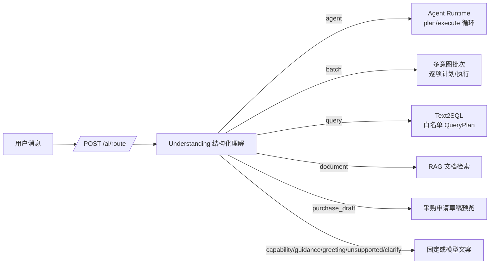

# ChemicalOps Agent 功能专项排查报告

> 排查对象：AI 工作台、语义路由、只读采购 Agent、多意图批次、Text2SQL、文档问答、采购申请草稿、任务管理与评测。
>
> 排查基线：`22b2c39`（2026-10-21）。本报告原始问题证据按该基线记录；后续页面上下文能力进展见 0.1 节。排查方式：代码走查、定向回归测试、离线护栏执行、历史评测证据复核；未调用真实模型，未修改业务数据，未做浏览器验收。
>
> 结论先行：这是一个**边界清楚、工程护栏做得不错、但场景覆盖窄且意图识别存在结构性缺口**的企业内部 Agent。只读库存/报价主链路可用，权限、证据、确认写入等关键边界基本成立；当前最需要处理的不是“再加一个 Agent”，而是先修好**意图分类法与执行路径不一致、澄清状态不持久、任务生命周期不完整、结果上下文会溢出、评测证据已过期**这几类问题，再谈企业级能力扩展。

---

## 0. 结论摘要

| 维度 | 结论 |
| --- | --- |
| 意图识别 | 生产入口已从关键词分类切换为模型结构化理解，方向正确；但 `route` 由子任务数量推导，导致同一请求可能走 Agent 或批次两条路；能力目录、权限、澄清状态没有进入路由上下文；订单号识别与生产编号格式不匹配。 |
| Agent 功能 | 四个只读工具、`plan → execute` 循环、服务端消歧、证据约束、草稿确认写入都真实存在；但上下文上限、双执行路径、关键词聚合、错误码 UX、任务中心续跑/取消、同步数据库阻塞等会影响可用性与规模化。 |
| 企业级差距 | 缺统一能力目录、工具平台治理、澄清状态机、操作知识库、在线评测/反馈闭环、AI 审计、租户/数据分级、工具级超时与幂等、并行只读、写操作分阶段开放。 |
| 质量门禁 | 本次定向运行 AI/Agent 测试为 **525 passed / 3 failed**；历史 120 场景评测和 31 条路由评测均早于当前代码/提示词，不能直接作为当前结论。 |
| 总体判断 | 适合作为“受控只读采购助手 + 人工确认草稿”的 MVP；距离企业级“可运营、可评测、可审计、可扩展”的 Agent 平台还有明显差距。 |

### 0.1 当前落实状态（2026-10-22 更新）

> 本节是排查后的实施回填，不修改第 2、3 节的问题证据；原始条目保留，便于追溯“当时为什么这样判断”。最新代码状态以本节、当前工作区和 Git 提交为准。

| 条目 | 当前状态 | 证据/说明 |
| --- | --- | --- |
| IR-01 路由执行契约 | 已落地，双执行语义仍未统一 | `d8e8d88` 增加 `execution_mode` 与跨字段校验，`route` 不再按子任务数量推断；但 Agent 与批次的业务语义仍是两套（AG-02 未关闭） |
| IR-03 / IR-04 能力与权限感知 | 已落地 | `capabilities.py` 按当前 RBAC 生成 `CapabilityManifest`，路由上下文与执行器共用权限事实源；`test_ai_capability_manifest.py` 通过 |
| IR-05 澄清状态 | 已落地 | `8ef759d` 实现版本化 `pending_clarification`、一次性消费、过期/撤权/切换处理；`test_ai_clarification_state.py` 通过 |
| IR-06 真实订单号 | 工作区已修复，待提交 | `order_trace.py` 支持 `PO20261021000001`、`PO-...`、`PO_...`，不再隐式改写；新增生产格式与 `POST` 误匹配回归 |
| IR-02 / IR-07 / IR-08 / IR-09 / IR-10 / IR-11 / IR-12 / IR-14 | 未完成 | 多分类器、自然语言取消、操作知识、业务时区、路由指标、写守卫、槽位扩展、草稿映射仍需逐项处理 |
| IR-13 评测证据 | 未完成 | 历史路由/120 场景报告仍早于当前提示词与运行时；发布前必须重跑并更新 hash |
| AG-01 上下文溢出 | 已落地 | `agent_runtime._planner_view` 独立限制明细和来源；`_fit_planner_context` 对完整序列化请求分层裁剪历史、记忆和结果，并对格式修复重试重新校验字符预算。100 行库存、多步骤大结果、多轮历史、证据 totals 保留和极小预算失败均有回归；Agent Runtime、候选与摘要相关测试 65 项通过。完整证据仍保留在任务轨迹；未做真实模型评测 |
| AG-02 Agent/批次双语义 | 已落地，保留双编排器 | 新增 `product_query_policy.py`、共享产品族候选判定和 `product_query_summary.py`；库存/报价日期与单位槽位在两路执行前共用澄清规则，候选、库存 totals 与确定性摘要共享策略。相关 Agent、批次、候选及查询隔离回归 111 项通过；未做真实模型评测 |
| AG-03 聚合“全选” | 已落地 | `d8e8d88` 改为 `slots.aggregate_products`，删除“全部/汇总”子串判断；新增“不要全部”回归 |
| AG-04 错误码恢复建议 | 已落地 | 前端 `TASK_ERROR_HELP` 覆盖 Agent 当前全部任务级错误码，包括权限/数据范围变化后的 `RESULT_UNAVAILABLE`；`RUNTIME_ERROR` 指向安全重试和重复失败时提供任务编号，`CONTEXT_LIMIT` 给出分段查询条件。`task-view.test.ts` 覆盖全部任务级错误码，12 项通过 |
| AG-05 | 已落地 | `agent_runtime` 将异步图中的同步鉴权、工具 SQL、持久化、预算检查点、任务恢复和终态读取逐项交给工作线程并等待收尾；取消时不提前复用同一 Session。LLM token 结算支持异步持久化，同时保留同步调用兼容。事件循环活性、队列预算、取消/超时、权限与查询隔离回归 130 项通过；未运行真实并发基准，未量化 P95 改善 |
| AG-06 | 前端入口已补齐，待浏览器验收 | 任务中心现支持 WAITING_INPUT 继续、RUNNING 取消、FAILED 以首次问题新建查询；继续/取消仍按任务版本及本人权限走既有服务端校验。任务操作与 Agent 视图回归 20 项通过，前端类型检查此前通过；本轮本地无 API/前端服务，Docker Engine 不可用，未能进入浏览器验收 |
| AG-07 任务创建能力校验 | 已落地 | `prepare_task`/`prepare_continue`/内部路由在启动前校验本轮工具是否在当前目录内；新增“有库存无询价权限”回归 |
| AG-08 ～ AG-14 | 未完成 | 工具平台、实体解析、分析能力、附件、草稿衔接、长期记忆、审计指标仍需建设 |
| 页面上下文与全局化工助手（新增） | 采购申请/订单详情已接入，待浏览器验收 | 提交 `ee303d0` 增加全局可拖动悬浮入口与可调宽对话面板；`7205826` 将页面对象上下文接入采购申请和采购订单。`POST /ai/context/ask` 只接收问题与对象引用，服务端按当前权限重读数据；申请可追溯审批、询价/报价、订单及订单后续环节，订单复用原追溯能力。`tests/test_ai_context.py` 最近验证 11 passed、5 skipped；`vue-tsc --noEmit --skipLibCheck` 通过。尚未做浏览器验收；其他业务详情页未接入上下文问答 |
| 测试门禁 | AI/Agent 定向已绿 | 最近一次 `test_ai_*.py` + `test_agent_*.py` + 数值/评测相关：**567 passed，0 failed**；新增上下文协议 8 项通过。全量 pytest 仍有与本报告无关的环境/既有失败，见下 |

**全量测试说明**：本次全量 pytest 为 `1076 passed, 12 failed, 10 skipped`。其中文件上传和任务队列相关失败是本机 Windows 沙箱命名管道/文件权限限制；`test_finance_difference_checks` 为证据文本格式漂移；`test_evaluation_fixtures` 为冻结 manifest 的锚点 hash 与仓库文件不一致。它们不等同于本次 AI 改动失败，但在 CI/发布前仍需单独处理。前端 `task-view` 单测因本机 vitest 启动时子进程 `EPERM` 未能执行，未计入通过。`pnpm run typecheck` 在 HEAD 已有 `query-chart-plans.ts(285)` 未使用参数错误，本次新增的 API 与抽屉组件无类型错误；该文件未修改，属于既有问题。

---

## 1. 现状图谱：入口、分类与执行器

### 1.1 一条消息实际经过的链路



前端在发送前先调用 `/ai/route`，把后端签发的 `route_token` 传给 Agent 或聊天接口；后端消费 token，避免重复理解。这个设计避免了“浏览器猜意图”，是正确的。

### 1.2 分类法并不只有一套

| 位置 | 形态 | 用途 | 风险 |
| --- | --- | --- | --- |
| `routing.understand` | 模型 + JSON Schema + `Understanding` | 生产统一路由 | 主分类器，但缺权限/能力/澄清状态 |
| `evaluation.classify_intent` | 关键词表 | 离线兼容回归 | 仍是测试和离线评测的一部分，容易让人误以为在生产 |
| `order_trace.extract_order_trace_no` | 正则 + 关键词 | 订单跨模块追溯 | 真实 PO 号不匹配，见 IR-06 |
| `text2sql._fixed_plan_before_model` / `_fallback_query_plan` | 关键词 + 固定计划 | 高频分析查询兜底 | 与路由能力目录不一致，见 IR-03 |
| `nl_filters.parse_filters` | 独立模型提示词 | 列表筛选解析 | 独立 schema、独立错误处理 |
| `drafts.propose_purchase_request_draft` | 独立模型提示词 | 采购申请字段整理 | 独立流程，未与 Agent 结果衔接 |

这些分类器共同构成“意图识别”，但它们对“什么算查询、什么算指导、什么算支持范围”的边界并不完全一致。

### 1.3 执行器能力

| 执行器 | 能力 | 边界 |
| --- | --- | --- |
| Agent Runtime | 产品定位、库存查询、询价定位、报价比较；最多 12 步；追问/续跑/取消 | 只读；最多 4 个工具；单次上下文 18,000 字符 |
| 多意图批次 | 最多 6 个子任务；依赖阻塞；部分结果；产品/询价候选持久化 | 与 Agent 有重复逻辑；日期/单位条件会被拒绝或忽略 |
| Text2SQL | 19 个白名单数据集；固定查询 + 模型 QueryPlan；权限校验 | 依赖模型规划；特殊数据集不进入路由能力目录 |
| 文档问答 | 检索 + 引用 | 独立入口；Agent 循环内不能调用 |
| 草稿预览/确认 | 字段整理、版本快照、10 分钟 TTL、一次性确认、创建 `DRAFT` | 同步确认接口；不与 Agent 任务结果自动衔接 |

---

## 2. 意图识别专项排查

### 2.1 结论

意图识别不是“模型不准”这么简单。当前问题主要在**分类结果与执行能力之间的契约**：

1. `route` 由 `sub_tasks` 数量推导，而不是由稳定的意图/执行策略决定。
2. 路由模型不知道当前用户能访问哪些工具、仓库、数据集。
3. “澄清”没有持久化状态，下一轮只能靠最近 8 条消息猜。
4. 订单号、日期、能力目录等关键输入存在代码级不一致。
5. 评测证据与当前提示词/运行时代码已不一致。

### 2.2 问题清单

| 编号 | 级别 | 问题 | 主要证据 | 影响 |
| --- | --- | --- | --- | --- |
| IR-01 | P1 | 路由类别由子任务数量推导，同一请求可能走不同执行器 | [schema.py:385](../backend/app/modules/ai/schema.py#L385-L401)、[test_ai_routing.py:51](../tests/test_ai_routing.py#L51)、[evaluate_intent_routing.py:29](../scripts/evaluate_intent_routing.py#L29) | 同一句“查乙醇库存并比较报价”在单元测试走 Agent、在评测样本走批次；行为、澄清、证据、日期处理不一致 |
| IR-02 | P1 | 多套分类器/分类法并存 | [service.py:76](../backend/app/modules/ai/service.py#L76-L104)、[order_trace.py:45](../backend/app/modules/ai/order_trace.py#L45-L51)、[text2sql.py:1110](../backend/app/modules/ai/text2sql.py#L1110-L1178)、[nl_filters.py:278](../backend/app/modules/ai/nl_filters.py#L278-L311) | 边界漂移，难以做统一评测和统一治理 |
| IR-03 | P1 | 路由能力目录与可执行数据集不一致 | [catalog.py:54](../backend/app/modules/ai/catalog.py#L54-L72) 排除 6 个特殊数据集；[text2sql.py:1242](../backend/app/modules/ai/text2sql.py#L1242-L1260) 又能执行它们 | 模型可能把系统实际能答的问题判成“不支持/需澄清” |
| IR-04 | P1 | 路由不知道用户权限与资源范围 | [routing.py:138](../backend/app/modules/ai/routing.py#L138-L178)；权限检查在 [text2sql.py:873](../backend/app/modules/ai/text2sql.py#L873-L900)、[agent_tools.py:301](../backend/app/modules/ai/agent_tools.py#L301-L310) | 先路由到不存在的权限，再在计划/工具阶段失败；用户看到“请使用 Agent 入口”后被 403 |
| IR-05 | P1 | 澄清没有持久化状态 | [routing.py:97](../backend/app/modules/ai/routing.py#L97-L135) 只读取消息/`memory`/`query_plan`；`conversation_store` 没有 `pending_clarification` | “按到货日期”只能靠 8 条消息上下文绑定；长会话/并行任务下会丢失，无法强制“只回答待澄清项” |
| IR-06 | P1 | 真实采购订单号无法触发订单追溯 | [order_trace.py:28](../backend/app/modules/ai/order_trace.py#L28-L51) 要求 `PO[-_]`；[purchase_orders/service.py:154](../backend/app/modules/purchase_orders/service.py#L146-L158) 生成 `PO{YYYYMMDD}{id:06d}` | 新生产订单“为什么没结算”不会走追溯，落到没有 `po_no` 过滤的 Text2SQL；测试使用合成 `PO-26001`，掩盖了问题 |
| IR-07 | P1 | 自然语言“取消查询”不会取消任务 | [routing.py:141](../backend/app/modules/ai/routing.py#L140-L146)；[service.py:99](../backend/app/modules/ai/service.py#L99-L101)；真正取消在 [agent_runtime.py:1082](../backend/app/modules/ai/agent_runtime.py#L1082-L1110) | 用户看到“已取消”，`WAITING_INPUT` 任务仍在；后续消息可能继续旧任务；任务中心又不能续跑/取消 |
| IR-08 | P2 | `guidance` 与 `capability` 缺少真实操作知识 | [service.py:373](../backend/app/modules/ai/service.py#L373-L382)；[agent_prompt.py:121](../backend/app/modules/ai/agent_prompt.py#L121-L189) | 操作指导可能编造系统按钮/页面；功能介绍对所有用户列出同一批能力，不管权限 |
| IR-09 | P1 | 相对日期使用服务器本地日期，不是业务时区 | [routing.py:149](../backend/app/modules/ai/routing.py#L149)；[agent_prompt.py:78](../backend/app/modules/ai/agent_prompt.py#L78-L86)；[text2sql.py:1116](../backend/app/modules/ai/text2sql.py#L1110-L1178)；业务时区定义在 [core/time.py:17](../backend/app/core/time.py#L17-L34) | 容器 TZ=UTC 且上海时间 00:00–08:00 时，“今天/本月”会差一天/一个月；逾期判断也会受影响 |
| IR-10 | P2 | 路由提示词是单体大规则集，缺少置信度/路由指标 | [routing.py:32](../backend/app/modules/ai/routing.py#L32-L94)（约 4,153 字符） | 规则难维护、难评测；低置信/歧义无法观测；无路由分布、澄清率、拒绝率指标 |
| IR-11 | P2 | 写操作守卫是关键词黑名单，且与语义路由分离 | [llm.py:46](../backend/app/modules/ai/llm.py#L46-L79) | “不要帮我创建，只告诉我怎么做”会被误拦；英文写操作可能漏拦；与 `purpose=unsupported` 的响应不一致 |
| IR-12 | P2 | `Slots` 结构过窄，批次顶层槽位被忽略 | [schema.py:323](../backend/app/modules/ai/schema.py#L323-L339)；批次只用 `task.slots`（[multi_intent.py:89](../backend/app/modules/ai/multi_intent.py#L89-L95)） | 供应商、订单号、状态、批次、项目等条件只能留在自由文本里；顶层 `limit/warehouse` 容易丢；下游重复解析 |
| IR-13 | P1 | 路由/Agent 评测证据已过期 | 当前 `ROUTING_PROMPT` SHA-256 为 `839f63be…`，历史 93/93 报告为 `0164ab10…`；当前 runtime 为 `3a96205e…`，120 场景报告为 `d2e012db…` | 不能把历史 100%/99.67% 当作当前代码结论；发布前必须重跑 |
| IR-14 | P2 | `purchase_draft` 在聊天 `Intent` 映射中落为 `unsupported` | [schema.py:268](../backend/app/modules/ai/schema.py#L268-L278)、[service.py:102](../backend/app/modules/ai/service.py#L102-L104) | 直接调用 `/ai/chat` 并携带 `purchase_draft` route token 时，返回“不支持”，与项目能力矛盾；前端只是绕开了 |

### 2.3 重点问题详述

#### IR-01：同一句请求，Agent 与批次的结果不一样

`Understanding.route` 的判定是：

```python
if len(self.sub_tasks) > 1:
    return "batch"
if tasks <= {"inventory", "quotes"}:
    return "agent"
```

而 `Understanding.normalize` 又要求：只要输出了 `sub_tasks`，其 `kind` 集合必须与 `tasks` 完全一致。于是：

- `tasks=[inventory, quotes]`、无子任务 → `agent`（可构造，但不符合“query 输出子任务”的提示词约定）。
- `tasks=[inventory, quotes]`、一个 `inventory` 子任务 → **校验失败**。
- `tasks=[inventory, quotes]`、两个子任务 → `batch`。

生产提示词要求“单项查询也输出一条 sub_tasks”，所以组合查询在正常模型输出下几乎必然进入 `batch`；`agent_goal=inventory_and_quotes_query` 和 Agent 的组合查询路径基本只能由 `/agent/tasks` 直接入口触达。`tests/test_ai_routing.py:51` 与 `scripts/evaluate_intent_routing.py:29` 的期望差异，正是这个结构的直接体现。

**影响**：同一句话，用户从普通聊天输入和从“采购只读查询”入口输入，可能得到不同的执行器、不同的澄清行为、不同的日期/单位处理，甚至不同的候选选择方式。

**建议**：把 `route` 从“子任务数量”改为显式的执行策略，例如在 `Understanding` 增加 `execution_mode`，或直接按 `purpose + tasks` 固定映射；组合查询统一交给 Agent 或统一交给批次，二选一，删除另一条路径的死代码。验收用例应包含“同一问题分别走两个入口”的矩阵。

#### IR-03 / IR-04：模型在“不知道自己能做什么”的情况下做路由

路由只收到 `catalog_prompt()` 的静态白名单，且该白名单刻意排除了 6 个固定数据集：

- `approved_requests_without_rfq`
- `weekly_order_risks`
- `inventory_by_batch`
- `accepted_orders_finance_gaps`
- `supplier_quote_delivery_profile`
- `inventory_movement_trace`

但这些数据集在 `text2sql._fixed_plan_before_model` 中有真实的固定查询实现。结果是：**能执行的能力没有告诉路由模型**；而路由提示词又要求它“执行前确认每项指标都能由注入的 metrics/outputs/derived_outputs 覆盖”。这会产生两类误判：

1. 把实际可执行的固定查询判成“数据不足/需要澄清”；
2. 把需要特定权限的数据集判成可执行，到了执行阶段才失败。

同时，路由函数签名 `understand(question, context, settings)` 没有 `user/db`，无法知道用户是否有 `warehouse.inventory.read`、`procurement.rfqs.read` 等权限。`prepare_task` 只检查“有产品权限 + 库存或询价二选一”，并不校验用户本轮 `decision.tasks` 是否与可用工具匹配。

**建议**：构造按用户过滤的 `CapabilityManifest`（工具 + 数据集 + 资源范围 + 功能开关），作为路由的系统上下文；路由输出只能引用 manifest 中的能力；当能力存在但权限不足时，返回明确的“无权限”而不是 `clarify`；当能力不存在时，返回“系统暂不支持”。这比继续加提示词规则更可靠。

#### IR-05：澄清是“无状态”的

聊天澄清只发生在 `routing.understand` 返回 `purpose=clarify` 时；`_classify_chat_intent` 把 `decision.question` 作为回复文本返回，但没有把“待回答的槽位、原问题、候选口径、过期时间”写入会话状态。下一轮 `conversation_context` 只能带上最近 8 条消息、`memory`（主要来自 Agent 任务）和 `query_plan`（来自 Text2SQL）。这意味着：

- 用户答“按到货日期”时，模型必须从历史 assistant 消息里推断这是回答哪个澄清问题；
- 如果中间插入了其他问题，或消息超过 8 条，绑定关系可能丢失；
- 无法校验用户回答是否真的回答了待澄清项；
- 无法统计“澄清后解决率/放弃率”。

**建议**：新增 `pending_clarification`：

```json
{
  "id": "clr_...",
  "conversation_id": 1,
  "original_question": "本月逾期未交采购订单",
  "understanding_hash": "sha256:...",
  "slot": "date_field",
  "question": "按订单日期还是预计到货日期？",
  "options": [{"value": "order_date", "label": "订单日期"}, ...],
  "created_at": "...",
  "expires_at": "..."
}
```

下一轮先将用户输入绑定到该槽位；无法绑定或用户明确切换话题时，取消 pending 并重新路由。Agent 的 `PendingChoice` 可以复用同一套“待选择状态”抽象。

#### IR-06：真实订单号不被识别

这是本次排查中最明确的“意图识别与真实数据格式脱节”：

- 识别正则：`ORDER_NO_PATTERN = re.compile(r"\b(PO[-_][A-Z0-9][A-Z0-9-]*)\b")`；
- 生产编号：`order.po_no = f"PO{date.today():%Y%m%d}{order.id:06d}"`，例如 `PO20261021000001`；
- 直接执行结果：`PO20261021000001` → `None`；`PO_26001` → `PO-26001`（把数据库键改写了）。

因此，真实新订单的“为什么还没结算/卡在哪一步/全流程”不会进入 `trace_purchase_order`；它会落到 Text2SQL，而 `purchase_orders` 的 `QueryPlan.filters` 没有 `po_no` 这个筛选字段，无法按订单号回答。现有测试使用的是 `PO-26001` 合成格式，开发样例也大量使用 `PO-...`，所以测试覆盖不到生产格式。

**建议**：不要用“前缀 + 分隔符”的格式假设。改为：

1. 先用宽松候选提取（`PO` 后接数字/字母数字串）或直接扫描问题中的订单号片段；
2. 用数据库 `po_no` 精确查找候选，只有唯一命中才进入追溯；
3. 不做 `_` → `-` 的隐式改写；
4. 测试覆盖生产格式、历史格式、小写、空格、多个订单号、模糊片段。

#### IR-07：取消只取消了“这句话”，没有取消任务

`routing.understand("取消查询")` 直接返回 `purpose=clarify, dialogue_action=cancel`；`_classify_chat_intent` 返回 `Intent.CLARIFY`，内容“已取消本次请求。”。真正把任务置为 `CANCELLED` 的是 `/api/v1/ai/agent/tasks/{id}/cancel`。前端：

- 任务 `RUNNING` 时不允许发送新消息，只能点停止；
- 停止按钮只处理 `RUNNING` 的 Agent 任务；
- 任务 `WAITING_INPUT` 时没有停止入口，用户输入“取消查询”会走普通聊天并显示“已取消”，但任务仍是 `WAITING_INPUT`；
- 如果之后插入一条普通聊天，`currentAgent` 变成 `undefined`，旧等待任务在聊天中无法再续跑；任务中心又只有“查看/导出”。

**建议**：把“取消”做成会话级动作，绑定当前活动任务；`WAITING_INPUT` 也要能取消；任务中心补续跑/取消；如果保留自然语言取消，服务端必须真正调用 `cancel_task`，不能只返回文案。

#### IR-13：评测证据与当前代码不一致

已归档的路由评测：

- `intent-routing-stability-20261010.json`：31 条样本 × 3 轮 = 93/93，提示词 SHA-256 `0164ab10…`；
- `intent-routing.json`：16/16，提示词 SHA-256 `e8ee3262…`；
- 当前 `ROUTING_PROMPT` SHA-256：`839f63be…`。

已归档的 120 场景：

- `agent-business-120-final-20261009.json`：299/300 业务完成、59/60 安全、358/358 证据引用；
- 代码版本 `9640eec`，`working_tree_dirty=true`；
- 当前 `agent_runtime.py` SHA-256 `3a96205e…`，归档为 `d2e012db…`；当前 `PLANNER_PROMPT` 为 `fd4b4030…`，归档为 `94872ea9…`。

这些历史数据仍然有价值，但**不能作为当前 HEAD 的验收结论**。在发布前至少重跑：当前路由提示词、当前 `PLANNER_PROMPT`、当前 runtime 的 120 场景和 31 条路由样本，并把 hash 写进报告和 CI 门禁。

### 2.4 意图评测还缺什么

| 维度 | 现状 | 缺口 |
| --- | --- | --- |
| 路由类别 | 31 条合成样本，3 轮 93/93（旧提示词） | 无对抗集、无 OOD、无歧义集、无权限受限集、无多语言 |
| 澄清质量 | 只统计“是否通过” | 无澄清后解决率、追问轮数、放弃率、用户满意度 |
| 多意图 | 120 场景中主要覆盖库存/报价/安全/澄清 | 无 analytics/document 与 Agent 混合的端到端评测 |
| 真实分布 | 合成问题 | 无脱敏真实问法、无按角色/部门分层 |
| 线上指标 | 只有日志和少量 metrics | 无路由分布、澄清率、拒绝率、失败率、成本/延迟看板 |
| 回归门禁 | CI 跑 pytest/离线护栏 | 真实模型路由/Agent 评测不在 CI；提示词变更无基线对比 |

---

## 3. Agent 功能专项排查

### 3.1 已经做对的部分

先说结论：当前 Agent 的核心安全边界是可信的，不应在扩展时破坏。

| 能力 | 证据 | 评价 |
| --- | --- | --- |
| 静态工具白名单 + 统一执行入口 | [agent_tools.py:252](../backend/app/modules/ai/agent_tools.py#L252-L312) | 工具名、权限、输入/输出 Schema、资源范围集中校验；模型不能夹带身份或 SQL |
| 服务端强制多候选消歧 | [agent_runtime.py:481](../backend/app/modules/ai/agent_runtime.py#L481-L527) | 多个产品/询价不自动选第一项；候选来自本轮结果 |
| 证据步骤校验 + 确定性摘要 | [agent_runtime.py:701](../backend/app/modules/ai/agent_runtime.py#L701-L724)、[agent_runtime.py:448](../backend/app/modules/ai/agent_runtime.py#L448-L478) | `finish` 只能引用成功步骤，数值摘要由后端生成，模型不能自由写价格/库存 |
| 历史证据按当前权限重验 | [agent_runtime.py:247](../backend/app/modules/ai/agent_runtime.py#L247-L271)、[history_access.py:63](../backend/app/modules/ai/history_access.py#L63-L126) | 撤权/范围变化后旧结果不可见 |
| 草稿确认 + 一次性版本快照 | [purchase_draft_confirmations.py:30](../backend/app/modules/ai/purchase_draft_confirmations.py#L30-L81) | 未确认不写入；同一确认只创建一份；领域服务同事务 |
| Token 预算 / 并发 / 熔断 | [gateway.py:37](../backend/app/modules/ai/gateway.py#L37-L102)、[llm.py:271](../backend/app/modules/ai/llm.py#L271-L380) | 单任务累计预算、用户/模型并发、失败降级 |
| 队列 / 租约 / fencing | [agent_runtime.py:341](../backend/app/modules/ai/agent_runtime.py#L341-L389)、[agent_runtime.py:1082](../backend/app/modules/ai/agent_runtime.py#L1082-L1110) | 版本号阻止旧运行覆盖新状态；取消/重试有边界 |
| 只读工具的真实 SQL 测试 | [test_agent_read_tools.py](../tests/test_agent_read_tools.py) | 使用隔离 SQLite 真实 SQL，覆盖权限/范围/截断/报价版本 |

### 3.2 功能不足与风险

| 编号 | 级别 | 问题 | 证据 | 影响 |
| --- | --- | --- | --- | --- |
| AG-01 | P1 | 工具结果可能撑爆 18K 上下文 | [config.py:172](../backend/app/core/config.py#L169-L174)；[agent_runtime.py:420](../backend/app/modules/ai/agent_runtime.py#L418-L446)；[agent_tools.py:152](../backend/app/modules/ai/agent_tools.py#L146-L159) | 100 条库存明细时，包含该步骤的规划上下文约 40,380 字符（按真实字段构造），超过 18,000 上限，合法查询会以 `CONTEXT_LIMIT` 失败；用户只看到“请缩小范围” |
| AG-02 | P1 | Agent 与批次两套库存/报价执行逻辑 | [agent_runtime.py:481](../backend/app/modules/ai/agent_runtime.py#L481-L527)；[multi_intent.py:82](../backend/app/modules/ai/multi_intent.py#L82-L177) | 日期/单位处理不同：批次明确拒绝日期/单位（[multi_intent.py:93](../backend/app/modules/ai/multi_intent.py#L89-L95)），Agent 忽略日期；候选/证据/摘要风格不同 |
| AG-03 | P0 | 聚合“全选”由关键词子串和旧目标描述决定 | [agent_runtime.py:489](../backend/app/modules/ai/agent_runtime.py#L481-L527)；目标描述只在 new/switch/modify 更新（[agent_runtime.py:674](../backend/app/modules/ai/agent_runtime.py#L666-L690)） | 直接构造验证：“不要全部，只查分析纯”+两个同化学品规格候选 → `all_products=True`，会汇总全部规格。这是结果正确性问题 |
| AG-04 | P1 | 错误码 UX 不完整 | 服务端错误码集合见 [agent_runtime.py:808](../backend/app/modules/ai/agent_runtime.py#L800-L826)；前端帮助只覆盖 5 个（[task-view.ts:120](../frontend-design/apps/web-chemicalops/src/views/ai/workspace/task-view.ts#L120-L126)） | `REPEATED_TOOL`、`TOOL_ERRORS`、`RUNTIME_ERROR`、`INTENT_MISMATCH`、`INCOMPLETE_TASK`、`TOKEN_BUDGET_EXCEEDED` 等显示通用“请核对权限/输入/服务”提示，无法指导恢复；评测中的 B036/B116 即为此类 |
| AG-05 | P1 | 同步 SQLAlchemy 运行在 async Agent 循环中 | [agent_runtime.py:726](../backend/app/modules/ai/agent_runtime.py#L726-L784)；对比 [multi_intent.py:284](../backend/app/modules/ai/multi_intent.py#L280-L295) 使用 `asyncio.to_thread` | 工具查询/持久化阻塞事件循环；并发 Agent 或普通 API 可能互相拖慢；`asyncio.timeout` 不能中断同步 SQL |
| AG-06 | P1 | 任务生命周期不完整 | 任务中心只有查看/导出（[tasks/index.vue:31](../frontend-design/apps/web-chemicalops/src/views/ai/tasks/index.vue#L31-L49)）；`currentAgent` 只取最后一条消息（[index.vue:234](../frontend-design/apps/web-chemicalops/src/views/ai/workspace/index.vue#L230-L259)）；自然语言取消见 IR-07 | `WAITING_INPUT` 任务可能变成“孤儿”；用户只能重新查询；重复消耗模型/查询资源 |
| AG-07 | P1 | 任务创建没有校验“本轮任务是否在可用工具目录内” | [agent_runtime.py:829](../backend/app/modules/ai/agent_runtime.py#L829-L846) 只要求“产品 + 库存或询价之一” | 用户有库存无询价却问报价时，任务仍会启动，之后工具才失败；错误提示不具体 |
| AG-08 | P2 | 工具平台元数据不足 | [agent_tools.py:252](../backend/app/modules/ai/agent_tools.py#L252-L274)；`list_tools` 版本/风险硬编码 | 没有工具级超时、重试、幂等、成本、调用配额、版本迁移；新增工具需改运行时/提示词/批次多处 |
| AG-09 | P2 | 实体解析窄 | 产品搜索只做名称/编码/CAS 子串（[agent_tools.py:43](../backend/app/modules/ai/agent_tools.py#L43-L82)）；仓库要求精确名称（[agent_runtime.py:679](../backend/app/modules/ai/agent_runtime.py#L679-L688)）；询价精确编号 | 常见别名、俗名、拼音、错别字、仓库简称无法命中；只能追问，体验差 |
| AG-10 | P2 | 缺少分析/建议能力 | `finish` 只生成事实摘要（[agent_runtime.py:448](../backend/app/modules/ai/agent_runtime.py#L448-L478)）；无 Text2SQL/文档/订单追溯工具 | 只能“查数”，不能“分析为什么/建议怎么做”；与“企业采购 Agent”的定位有差距 |
| AG-11 | P2 | 附件/多模态未进入 Agent | `AIChatRequest` 支持 `attachment_file_ids`，但 Agent 任务无附件字段；`PLANNER_PROMPT` 无附件概念；前端 AI 工作台未接附件 | 无法“把报价单/库存表发给 Agent 对比”；即使路由到 Agent，附件也会被忽略 |
| AG-12 | P2 | 草稿流程与 Agent 结果脱节 | `drafts.py` 独立提示词/独立工具调用；前端通过斜杠命令进入（[index.vue:1029](../frontend-design/apps/web-chemicalops/src/views/ai/workspace/index.vue#L1029-L1042)） | 用户查完库存/报价后不能一键“基于本次证据生成采购申请预览”，需要重新输入；重复查询、证据不连贯 |
| AG-13 | P2 | 记忆窗口短且无摘要 | 路由 8 条消息（[routing.py:106](../backend/app/modules/ai/routing.py#L106-L135)）；规划 6 条（[agent_runtime.py:409](../backend/app/modules/ai/agent_runtime.py#L409-L415)）；无会话摘要/用户偏好 | 长会话忘上下文；重复问；无法形成“我的常用仓库/单位/供应商” |
| AG-14 | P2 | AI 审计/可观测性不足 | 只有 `agent_steps`/`agent_tool_calls` 等指标（[agent_runtime.py:690](../backend/app/modules/ai/agent_runtime.py#L690-L692)、[agent_runtime.py:779](../backend/app/modules/ai/agent_runtime.py#L779-L782)）；任务 payload 无模型/提示词版本；无 AI 审计日志 | 无法按路由/意图/工具/用户分析质量与成本；合规审计依赖任务表；`list_tasks` 逐任务重验有 N+1 查询（[agent_runtime.py:284](../backend/app/modules/ai/agent_runtime.py#L284-L308)） |

### 3.3 重点问题详述

#### AG-01：40K 工具结果 vs 18K 上下文

`agent_context_max_chars` 默认 18,000，且是配置上限；`_decide` 在 JSON 序列化后直接比较长度，超限抛 `CONTEXT_LIMIT`。而 `inventory.query_available` 默认最多返回 100 条明细；每条包含仓库、批次、效期、单位、数量、锁定、可用量、来源等字段。按真实字段构造一个 100 行结果，包含该步骤的规划上下文约 40,380 字符；这还不含 `recent_task_memory`、`messages`、`workflow` 的完整开销。

**影响**：用户查一个库存批次较多的产品时，工具已经成功，但下一步规划直接失败；这不是“模型不聪明”，而是上下文工程缺失。`TASK_ERROR_HELP` 只告诉用户“缩小范围”，无法解释是哪些结果导致。

**建议**：

- 给每个工具结果生成 `planner_view`：只保留 `product_id/name`、分单位合计、`total_rows/truncated`、前 N 行（如 10 行）和 `source_ids`；完整明细只用于 UI/导出；
- 规划上下文增加“结果摘要 + 可分页下钻”的提示，而不是塞全量；
- 对 `current_turn_steps` 做字符预算，优先保留最近步骤和当前未完成目标；
- 超限时降级为“已查到结果，但明细过多，请让用户确认是否按仓库/批次筛选”，而不是直接失败；
- 新增测试：100 行库存 + 多轮对话仍可完成。

#### AG-03：关键词“全部”导致错误聚合

`_resolve_candidates`：

```python
question = state.memory_state.get('goal', {}).get('description', state.messages[-1])
if product and state.selected_product is None and any(word in question for word in ('汇总', '全部', '所有', '合计')):
    aggregate = aggregate or (not result['truncated'] and bool(ids) and _inventory_family(...))
```

两个问题叠加：

1. 使用 `goal.description`，而 `goal.description` 只在 `dialogue_action in {new, switch, modify}` 时更新；续答/否定/补充时仍是旧问题。
2. 使用子串“全部”，不区分“不要全部/只看分析纯”这样的否定语义。

我用真实函数的最小状态验证过：`goal.description='不要全部，只查分析纯的库存'`，搜索结果有两个同化学品规格，`_inventory_family` 为真时，`all_products=True`、`verified_products=[1,2]`。这意味着用户明确说“不要全部”，系统仍会汇总全部规格。

**建议**：把“是否全选/汇总”变成 `Understanding.slots` 的显式字段或独立的服务端选择 API（前端已有“全选”按钮），禁止用自然语言子串推断；`goal.description` 每轮都更新，或改为 `last_user_input`；为否定/排除表达加测试。

#### AG-02：Agent 与批次不是“两套外观”，而是两套语义

| 行为 | Agent Runtime | 多意图批次 |
| --- | --- | --- |
| `date_from/date_to/unit` 槽位 | 工具无日期参数，基本忽略 | 明确返回 `WAITING_INPUT`“请确认是否使用这一口径”（[multi_intent.py:93](../backend/app/modules/ai/multi_intent.py#L89-L95)） |
| 多产品候选 | 服务端 `PendingChoice`，本轮重新检索 | 持久化 `PendingChoice`，选择后重跑 |
| 多询价候选 | 同上 | 同上 |
| 完成摘要 | `_summary` 确定性事实 | `summarize` + 可追加“行动建议” |
| 组合库存+报价 | 支持 `inventory_and_quotes_query` | 通常按两个子任务执行 |

同一个“查乙醇本月库存并比较报价”，走 Agent 会忽略“本月”，走批次会先追问口径；这不是产品设计，而是实现分叉。`docs/项目问题与后续工作.md` 的 A-P1-01 只解决了批次候选持久化，没有统一执行语义。

**建议**：抽一个共享的 `ProcurementQueryService`（产品定位、库存、询价、报价、候选、摘要），Agent 与批次都调用它；`route` 只决定“单步/多步”的编排，不决定业务口径。若短期不重构，至少在两个入口对日期/单位/组合查询做相同的显式拒绝或相同的默认口径，并加对照测试。

#### AG-04：错误码与用户恢复路径

服务端会生成 `MODEL_FORMAT_ERROR`、`STEP_LIMIT`、`CONTEXT_LIMIT`、`INVALID_EVIDENCE`、`INCOMPLETE_TASK`、`REPEATED_TOOL`、`TOOL_ERRORS`、`INTENT_MISMATCH`、`TOKEN_BUDGET_EXCEEDED`、`PERMISSION_DENIED`、`TASK_TIMEOUT`、`DATABASE_ERROR`、`MODEL_SERVICE_ERROR`、`RUNTIME_ERROR`。前端 `TASK_ERROR_HELP` 只有 5 个（权限、超时、格式、步数、上下文）。

评测失败样本：

- B036：`REPEATED_TOOL`，用户看到“本次只读任务已停止，请核对权限、输入或服务状态后重新发起”；
- B116：`RUNTIME_ERROR`，同样通用提示。

**建议**：错误码与恢复动作一一对应，例如“重复调用同一工具 → 换条件/缩小范围”“工具参数无效 → 指出哪个参数”“上下文超限 → 建议按仓库/批次筛选”“模型服务错误 → 稍后重试/切换备用模型”；把 `error_code` 和可执行建议一起返回，而不是只给字符串。补每个错误码的前端单元测试。

#### AG-05：async 里的同步数据库

`_drive_impl` 是 async，但 `plan`/`execute` 节点内部大量直接调用同步 SQLAlchemy：`_assert_running`、`_check_trace_access`、`tools.execute_tool`、`_persist`。`multi_intent` 至少把产品工具放进了 `asyncio.to_thread`，Agent 没有。同步 SQL 在事件循环中执行时，`asyncio.timeout` 只能取消 await 点，不能中断正在跑的数据库调用；并发用户会排队。

**建议**：短期将 Agent 工具/持久化包进 `asyncio.to_thread`，或统一改成异步驱动；加并发压测，观察普通 API P95 与 Agent 并发下的排队时间；把 `AGENT_TASK_TIMEOUT_SECONDS` 与数据库 statement timeout 分开配置。

#### AG-06：任务中心只有“看”，没有“管”

`/ai/tasks` 页面只有“查看/导出 CSV”；`AgentChatTask` 在任务中心以 `show-actions=false` 渲染。用户无法从任务中心续跑 `WAITING_INPUT`、取消 `RUNNING`、重试 `FAILED`。聊天中只有“最后一条消息”的任务能被 `sendAgent` 续跑；一旦插入普通聊天，旧任务失去入口。

**建议**：任务中心补“继续/取消/重试/复制查询”；后端已有 `continue`/`cancel` API，主要是前端入口和状态机；对 `WAITING_INPUT` 增加过期自动取消或提醒；任务与消息的关联改为“按 task_id 查找”，不要依赖最后一条消息。

### 3.4 企业级 Agent 需要补什么

下面的表按“企业级可用”而非“功能清单”组织。优先级：P0 立即、P1 本迭代、P2 规划。

| 能力域 | 当前 | 企业级缺口 | 优先级 | 建议 |
| --- | --- | --- | --- | --- |
| 意图与策略 | 语义路由、结构化 Schema | 能力/权限感知、澄清状态、稳定分类法、低置信处理 | P0/P1 | CapabilityManifest；`pending_clarification`；route 纯函数化；意图混淆矩阵 |
| 工具平台 | 4 个只读工具、静态注册、统一护栏 | 版本、风险、超时、重试、幂等、配额、成本、分页、审计、写工具分级 | P1/P2 | Tool Registry：`name/version/risk/permission/timeout/retry/idempotency/rate_limit/audit`；工具级超时；读写分离 |
| 编排 | 单 Agent `plan/execute` + 批次 | 确定性工作流、Supervisor–Specialist、并行只读、人工确认节点 | P2 | 先用有向工作流固化库存/报价/草稿；确有独立数据域再拆专家 Agent，不追求“多 Agent”形式 |
| 知识与数据 | Text2SQL 18 数据集、文档 RAG | 操作手册知识库、产品别名/同义词、供应商/价格历史、总成本口径 | P1/P2 | 建“操作知识库 + 引用”；产品 alias 表；报价趋势只读数据集；MOQ/交期/税率/运费口径 |
| 评测 | 30 条离线护栏、31 条路由合成、120 场景合成 | 当前 hash 基线、真实脱敏问法、对抗/OOD、在线指标、人工评审、反馈闭环 | P0/P1 | 发布前跑真实模型；CI 校验题集/提示词 hash；按意图/角色/工具分层；收集 thumbs/纠正 |
| 可观测与审计 | 部分 metrics/trace、任务表 | 路由/澄清/失败/成本看板、模型/提示词版本、AI 审计、告警、SLO | P1/P2 | 结构化事件：`route`, `intent`, `tool`, `error_code`, `tokens`, `latency`, `model`, `prompt_hash`；按用户/角色聚合 |
| 安全与治理 | RBAC、工具护栏、确认写入、脱敏日志 | 多租户/数据分级、字段级脱敏、DLP、提示注入检测、保留期/法务保留、供应商风险 | P1/P2 | 权限主体贯穿任务；敏感字段按角色脱敏；AI 审计表；可配置保留期；红队测试 |
| 可靠性 | 队列/租约/fencing、Token 预算 | 幂等任务创建、工具级超时、背压、死信/隔离、降级、SLO | P1/P2 | 任务创建加业务幂等键；每工具超时；Agent 并发与普通 API 隔离；故障注入 |
| 体验 | 聊天、候选卡、来源、任务记录 | 单一入口、流式进度、澄清表单、任务中心操作、反馈、可解释、附件、移动端/无障碍 | P1/P2 | 统一“对话 + 查询 + 草稿”工作流；clarify 选项卡；进度 SSE；错误恢复建议 |
| 扩展性 | 代码内静态注册 | 插件/SDK、模型路由、提示词版本、特性开关、国际化 | P2 | 工具 SDK；按任务难度选模型（便宜模型做路由）；提示词注册表；灰度 |
| 写入 | 采购申请草稿确认 | 修改草稿、建询价、提交审批、下单、入库、付款的分阶段开放 | P2 | 每个动作独立评审；Agent 只准备参数+证据，正式入口确认，领域服务执行，幂等/审计 |

**不建议现在做的**：为了“企业级”包装多个自由对话、自由选工具的自主 Agent。现有边界（只读、静态工具、服务端证据、人工确认）是资产；应先补确定性和可观测性，再按独立数据域/权限边界拆专家。

### 3.5 建议的实施顺序

**第 0 阶段：1–3 天（止血）**

1. 修 IR-06 的订单号识别，用生产格式 `PO{YYYYMMDD}{id}` 和数据库精确查找；补测试。
2. 修 AG-03 的“全部”子串聚合，改为显式 `aggregate`/全选 API；补“不要全部/只看分析纯”用例。
3. 修 3 个失败测试或对应实现，恢复 CI 绿灯。
4. 用当前 `ROUTING_PROMPT`/`PLANNER_PROMPT`/runtime 重跑路由与 120 场景，重写 hash；历史报告标注“旧基线”。

**第 1 阶段：1–2 周（契约与体验）**

1. `Understanding`/route 纯函数化，统一 Agent 与批次执行语义。
2. 按用户权限/工具/数据集构造 `CapabilityManifest`，路由输出只引用可用能力。
3. 持久化 `pending_clarification`，下一轮强制绑定；Agent `PendingChoice` 复用同一抽象。
4. Agent 工具结果 `planner_view` 摘要 + 字符预算；100 行库存不再触发 `CONTEXT_LIMIT`。
5. 补全错误码到恢复建议的映射；任务中心继续/取消/重试。
6. 统一 `business_today()`，去掉路由/Text2SQL 的 `date.today()`。

**第 2 阶段：1–2 月（平台化）**

1. Tool Registry：版本、风险、超时、重试、幂等、配额、审计。
2. 评测/可观测：按意图/角色/工具的看板，发布门禁，真实脱敏样本。
3. 操作知识库与产品别名；Agent 内可调用文档/分析工具。
4. 草稿流程与 Agent 证据衔接；附件进入 Agent。
5. AI 审计、保留期、敏感字段脱敏。

**第 3 阶段：季度级（业务纵深）**

1. 确定性工作流 + 必要的 Supervisor–Specialist。
2. 修改草稿 → 建询价 → 提交审批 → 下单/入库/付款，逐项评审、逐项开放。
3. 价格趋势/供应商绩效/总成本分析（先只读、可追溯，不做无依据预测）。
4. 多租户/数据分级/合规运营。

---

## 4. 其他自查发现

### 4.1 测试与质量门禁

本次在 `HEAD 22b2c39` 上定向运行 AI/Agent 相关测试：

```text
525 passed, 3 failed, 1 warning in 30.72s
```

确定性失败：

| 测试 | 现象 | 判断 |
| --- | --- | --- |
| `tests/test_ai_drafts.py::test_proposal_uses_authorized_tools_and_persists_versioned_confirmation` | 测试替身 `product` 没有 `unit_id`，实现 [drafts.py:112](../backend/app/modules/ai/drafts.py#L104-L134) 已访问 `product.unit_id` | 测试与实现漂移；需补 fixture 或调整兼容 |
| `tests/test_ai_foundation_regressions.py::test_consumption_excludes_transfers_returns_and_uses_same_inventory_scope` | 期望 `1954.000000` 文本，实际显示 `1954 条 · 单位 #2` | 展示格式变更后测试未更新 |
| `tests/test_ai_query_isolation.py::test_every_dataset_rejects_missing_or_revoked_permission[overdue_unfulfilled_orders]` | 期望“没有执行权限”，实际先命中“仅支持预计到货日期”计划形状校验 | 校验顺序与测试预期不一致；不是越权，但错误信息优先级需明确 |

这些失败不代表生产环境一定出错，但说明**当前 CI 不会绿**；对“企业级”而言这是发布门禁问题，应先修测试或实现，不能把红测试留在主干。

### 4.2 配置与文档漂移

`.env.example` 仍有：

- `AGENT_TOOL_TIMEOUT_SECONDS=30`（[.env.example:127](../.env.example#L127)）
- `AGENT_SAVE_INPUT_CONTENT=false`、`AGENT_SAVE_OUTPUT_CONTENT=false`（[.env.example:129](../.env.example#L129-L130)）

但 `Settings` 只定义到 `agent_allow_write_tools`（[config.py:169](../backend/app/core/config.py#L169-L174)），`extra="ignore"` 会静默忽略这些变量；`docs/项目问题与后续工作.md` 的 A-P2-02 还说 `AGENT_SAVE_*` 已删除。工具级超时在运行说明中也明确“尚未实现”。建议删除死配置，或真正实现并写测试；否则运维会误以为配置生效。

### 4.3 历史证据的日常失效问题

`compare_quotes` 返回 `as_of=today`（[agent_tools.py:242](../backend/app/modules/ai/agent_tools.py#L172-L249)）；历史重验的 fingerprint 只排除 `observed_at`，没有排除 `as_of`（[history_access.py:120](../backend/app/modules/ai/history_access.py#L98-L126)）。跨天后重新查看历史多意图报价结果时，`as_of` 变化会导致 fingerprint 不一致，整批历史可能被判定“权限、范围或数据已变化”而隐藏。

**建议**：明确 `as_of` 是否为证据身份的一部分；如果是，历史展示应允许“旧快照 + 变化标记”，而不是整批隐藏；如果否，fingerprint 排除 `as_of` 并单独展示快照日期。

### 4.4 其他小型问题

- `get_task` 在 Agent 关闭/权限变化时可能直接抛业务错误；`list_tasks` 则替换为不可访问提示，两者体验不一致（[agent_runtime.py:274](../backend/app/modules/ai/agent_runtime.py#L274-L308)）。
- `AIAgentTask` 只有 `user_id` 索引，任务中心按 `status/updated_at` 分页在量大时可能慢（[model.py:12](../backend/app/modules/ai/model.py#L12-L25)）。
- 前端“/ 采购只读查询”只是把 `agentMode=true` 改占位提示，实际仍由 `/ai/route` 决定；如果模型判成普通问答，仍走聊天（[index.vue:1029](../frontend-design/apps/web-chemicalops/src/views/ai/workspace/index.vue#L1029-L1042)）。入口语义与用户预期不完全一致。
- `nl_filters` 把用户问题放在 user message 中，系统提示仍是通用 `SYSTEM_PROMPT`，不是筛选专用系统提示；且没有 `response_format=json_schema`/修复重试，稳定性弱于路由和草稿（[nl_filters.py:278](../backend/app/modules/ai/nl_filters.py#L278-L311)）。
- AI 工作台没有附件上传入口；后端已具备附件解析/引用能力，Agent 任务却没有附件字段。这是一个“能力已存在但没接通”的典型。
- Agent 任务默认保留 30 天、草稿确认 10 分钟后过期、`AIQueryLog` 随会话删除，但没有可配置保留期/法务保留；任务 payload 里有供应商价格和库存明细，企业需按数据分级管理。

---

## 5. 验证记录与边界

### 5.1 本次实际执行

| 项目 | 命令/方式 | 结果 |
| --- | --- | --- |
| 定向 Agent/路由测试 | `pytest tests/test_ai_routing.py tests/test_ai_intent.py tests/test_agent_runtime.py tests/test_agent_read_tools.py tests/test_ai_multi_intent.py tests/test_ai_task_management.py` | 112 passed |
| AI/Agent 全量定向 | `pytest test_ai_*.py test_agent_*.py test_numeric_fidelity.py test_business_evaluation_metrics.py` | 525 passed, 3 failed |
| 离线护栏 | `python scripts/evaluate_ai.py` | 30/30，`intent_scope=legacy_keyword_regression_only` |
| 路由构造验证 | `Understanding` 直接构造 | `tasks=[inventory,quotes]` 无子任务 → `agent`；带一个子任务 → `ValidationError` |
| 订单号验证 | `extract_order_trace_no` | `PO-26001` → 命中；`PO20261021000001` → `None`；`PO_26001` → `PO-26001` |
| 聚合验证 | `_resolve_candidates` 最小状态 + 两个候选 | 问题含“不要全部”仍 `all_products=True` |
| 上下文估算 | 按真实字段构造 100 行库存结果 | 单步约 40,380 字符，超过 18,000 上限 |
| 评测证据复核 | 读取归档 JSON/哈希 | 120 场景/31 条路由均早于当前代码/提示词 |

### 5.2 未覆盖

- 未调用真实模型（不产生费用、不验证当前模型行为）；路由/Agent 真实模型评测需在配置 API Key 后单独执行。
- 未做浏览器验收（停止/澄清/任务中心/候选人选择交互）。
- 未连接生产数据库或真实业务数据；结论基于代码、隔离测试和历史证据。
- 未做并发压测、故障注入、多租户/代理/TLS 部署验收。
- 未对全部 19 个 Text2SQL 数据集逐条跑真实模型；本次重点在 Agent/意图链路。

### 5.3 关键文件索引

| 主题 | 文件 |
| --- | --- |
| 语义路由 | [routing.py](../backend/app/modules/ai/routing.py) |
| 分类契约 | [schema.py](../backend/app/modules/ai/schema.py) |
| 聊天分流 | [service.py](../backend/app/modules/ai/service.py) |
| Agent 运行时 | [agent_runtime.py](../backend/app/modules/ai/agent_runtime.py) |
| Agent 工具 | [agent_tools.py](../backend/app/modules/ai/agent_tools.py) |
| 多意图 | [multi_intent.py](../backend/app/modules/ai/multi_intent.py) |
| Text2SQL | [text2sql.py](../backend/app/modules/ai/text2sql.py) |
| 订单追溯 | [order_trace.py](../backend/app/modules/ai/order_trace.py) |
| 草稿/确认 | [drafts.py](../backend/app/modules/ai/drafts.py)、[purchase_draft_confirmations.py](../backend/app/modules/ai/purchase_draft_confirmations.py) |
| 前端工作台 | [index.vue](../frontend-design/apps/web-chemicalops/src/views/ai/workspace/index.vue) |
| 前端任务中心 | [tasks/index.vue](../frontend-design/apps/web-chemicalops/src/views/ai/tasks/index.vue) |
| 评测说明 | [业务场景与任务可靠性评测运行说明.md](evaluation/业务场景与任务可靠性评测运行说明.md)、[评测文件说明.md](evaluation/评测文件说明.md) |
| 历史问题清单 | [项目问题与后续工作.md](项目问题与后续工作.md) |

---

## 6. 最终建议

1. **先修正确性，再扩能力**：订单号识别、聚合“全选”、澄清状态、上下文溢出这四件事直接决定“答得对不对”；优先级高于新增工具。
2. **把“意图识别”当成执行契约，而不是提示词**：路由输出必须能被服务端验证为用户可执行的能力；不能一边让模型判断能力，一边在权限/数据集层再拒绝。
3. **统一 Agent 与批次**：同一业务口径只能有一套实现；否则评测、澄清、日期、候选都会分叉。
4. **企业级的关键不是“多 Agent”，而是“可评测、可观测、可审计、可治理”**：工具版本/超时/幂等/配额、在线指标、AI 审计、真实数据评测、数据分级，这些比再包装两个专家 Agent 更有价值。
5. **保持现有安全边界**：静态工具、服务端证据、人工确认写入、权限重验是当前项目最值得保留的部分；扩展写操作时继续沿用“Agent 准备参数与证据 → 用户在正式入口确认 → 领域服务执行”的模式。
