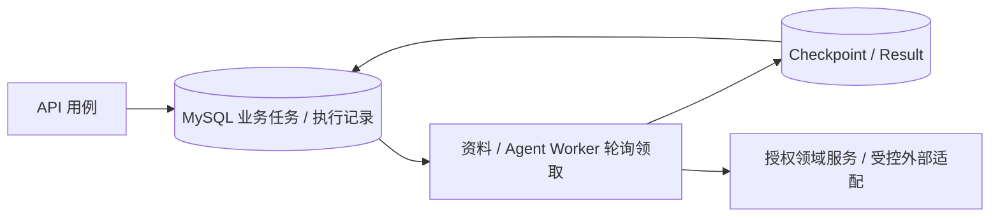

# ChemicalOps 企业级改造方案

> 本文仅保留后续建设目标与放行标准，不将目标视为已经实现。当前能力及操作入口以模块运行说明为准，具体未完成事项见改造任务清单。
> 配套：[项目介绍与成果（STAR）](项目介绍与成果（STAR）.md) · [改造任务清单](ChemicalOps-改造任务清单.md)

## 1. 定位与决策原则

ChemicalOps 面向中小型化工企业，建设采购履约与运营协同平台，兼顾全栈业务后端与场景化 Agent。确定性的服务端规则负责业务状态，AI 辅助检索、解释、草稿和流程编排。文中业务背景是设计场景，不宣称已开展真实企业生产试点。

采用模块化单体 + 独立异步 Worker，复用 FastAPI、SQLAlchemy、MySQL、Vue 3、LangGraph、MinIO 和 Qdrant。先解决业务正确性，再推进任务长期运行、AI 产品化与生产试点。Redis 仅在缓存、限流等问题有测量依据时评估；不默认引入微服务、Kubernetes、Service Mesh 或多租户 SaaS。

## 2. 当前能力与后续边界

当前默认使用 MySQL 持久任务队列、独立 Worker、Redis 可选缓存/限流、进程内 LLM Gateway，以及 Prometheus/Grafana/Alertmanager 与可选 OTel/Jaeger。当前运行方式分别见 [任务队列](数据库任务队列运行说明.md)、[Redis](Redis接入与验证.md)、[模型网关](LLM-Gateway兼容矩阵.md)、[可观测性](后端可观测性运行说明.md) 和 [告警处置](可观测性告警处置说明.md)。

已完成的本地工程化收尾从待办中移除。生产外部通知、真实容量、安全与灾难恢复仍须按对应放行标准单独验收；业务异常闭环、通用 Agent 写入及知识发布生命周期仍按 [改造任务清单](ChemicalOps-改造任务清单.md) 建设。历史数字只保留在展示文档及其原始证据中，不重复维护多份验收汇总。

## 3. 目标业务边界与模块依赖

| 业务域 | 现有入口 | 权威数据与规则 | 允许的跨域协作 |
| --- | --- | --- | --- |
| 主数据/供应商 | products、chemicals、suppliers、supplier_portal | CAS、规格、单位、供应商绑定、报价版本 | 为采购/知识提供受控查询；供应商不能自定归属 ID 绕过绑定。 |
| 采购 | purchase_requests、rfqs、purchase_orders | 申请批准量、报价选定、订单状态/数量/价格 | 调用供应商查询；接收收货数量事件，不直接写库存或财务。 |
| 履约/质量 | deliveries、quality_acceptances | 到货明细、实收/短交、检测结果及行级放行额度 | 受控更新订单履约投影；由库存服务处理放行入库。 |
| 库存 | inventory、inventory_returns、inventory_cost、replenishments | 批次、库位、余额、预留、冻结、流水和成本 | 引用质量放行；退货改变应付依据时由财务服务重建/复核来源。 |
| 财务 | finance | 对账版本、应付、票行匹配、支付与核验审计 | 读取采购/质量/退货的来源快照，不能自行改实收和库存。 |
| AI/知识 | ai、files、doc_kb | 任务、确认、证据、知识版本与 ACL | 通过工具和授权查询调用各域；禁止任意 SQL 或直接修改业务 ORM。 |
| 公共基础/执行 | core、system、task_queue、jobs | 身份、幂等、审计、执行租约、持久任务、配置 | 基础设施不定义质量放行或财务核验规则。 |

沿用 controller（API / Router）、schema、service、crud、model，不机械新增每一层。把用例编排和事务放在 Application Service；把复用状态/额度规则提取为 Domain Service；crud 承担 Repository 职责；broker、存储、模型和向量适配属于 Infrastructure。先抽离高风险跨域写入，普通只读 ORM 查询可过渡，但必须调用统一范围条件。

每个用例只能有一个事务所有者；被调用领域方法用 flush，不自行 commit。数据库事务中不等待模型或远端存储。审计和执行记录与业务写入同事务保存；外部副作用使用事务后异步或可重试补偿，不能通过多次 commit 假装整体原子。

## 4. 领域模型、状态与异常闭环

### 4.1 增量模型

复用 PurchaseRequest/Item、RFQ/Quote/Item、PurchaseOrder/Item/Event、Delivery/Item、QualityAcceptance、InventoryBatch/Balance/Transaction、FinanceReconciliation/Invoice/Payment/Settlement。新增内容以下列业务缺口为依据，最终表名及迁移编号在开发时确定：

- **质量放行明细**：引用到货行，保存实收、合格、隔离、拒收数量及检测/复检版本；量纲一致，数量守恒，不能仅靠整单 PARTIAL 决定入库量。
- **预留明细**：引用业务来源、库存余额、数量、到期时间、状态与版本；余额 locked_quantity 作为投影，由预留/释放/消耗事务维护，支持对账修复。
- **业务动作幂等记录/约束**：对来源行 + 动作类型 + 业务版本设唯一约束；与正式入库、退货、放行等副作用同事务提交。
- **受控操作确认**：保存工具/Schema 版本、用户、业务主体、参数 hash、数据版本、预览、有效期、一次性确认标识及执行结果。
- **文档发布版本与权限**：区分原件版本、发布版本和索引 generation，记录复核人、有效期、归属与 ACL；结构化属性保存原值、标准单位、条件和章节来源。

历史数据不得猜测合格数量、预留来源或发票行归属。旧版记录标明边界；回填先输出差异和待人工确认记录，再推进可重跑迁移。

### 4.2 状态机及服务端约束

下表区分实际现有状态与目标新增机制。权限同时要求动作权限码与资源范围；岗位称呼不能代替权限校验。

| 单据 | 当前状态 / 行为 | 目标转换与关键约束 | 执行角色及异常 |
| --- | --- | --- | --- |
| 采购订单 | DRAFT → APPROVING → APPROVED/REJECTED；APPROVED → ORDERED；收货后 PARTIAL/COMPLETED；下单前可 CANCELLED | 沿用状态值；明确 COMPLETED=数量履约完成，质量/财务另设投影；已下单取消剩余量通过受控变更，不删除既有到货 | 采购提交、审批人审批、采购下单；重新检查批准量和当前中选报价，供方拒绝转异常处理。 |
| 到货/收货 | IN_TRANSIT → RECEIVED → INSPECTING → ACCEPTED/EXCEPTION；REINSPECTION 回到 INSPECTING | 增加行级处置事实；登记与收货分别校验订单剩余量；单次到货实收+短交≤计划、累计实收≤批准订购量 | 供应商登记/仓库收货各走现有授权；短交、拒收、重复收货必须审计。退货由退货单承载。 |
| 质检 | PASSED/PARTIAL/FAILED/REINSPECTION；已有按行检测内容 | 增加版本化数量放行；复检不得覆盖旧结论；已入库后改判必须先冻结并走纠正流程，不能静默回写 | 质量岗位提交，必要时独立复核；待判/隔离量不能出库或进入正式应付。 |
| 对账/发票 | 对账 DRAFT/CONFIRMED/DISPUTED/CLOSED/CANCELLED；发票 DRAFT/REJECTED → SUBMITTED → VERIFIED，支持部分状态作废 | 保留先确认对账再提交核验发票；行级应付基于放行、有效退货和价格快照；提交/核验重新核对来源、匹配版本和额度 | 财务录入/匹配、独立核验，供应商可确认/争议；同人核验拒绝，已核验冲销新建受控反向单据。 |
| 库存与预留（目标新增明细状态） | 余额 quantity/locked_quantity、AVAILABLE 等状态；已有批次流水 | 预留 ACTIVE → CONSUMED/RELEASED/EXPIRED；冻结控制库存资格；可用量=可出库余额−有效锁定量，跨单位不相加 | 仓库执行、申请人提交；不足、过期、撤销与并发失败返回明确原因并保留审计。 |

统一状态规则表记录 from、action、to、权限、版本、数量/金额条件和审计字段；未知或非法转换由服务端拒绝。建议对交互式编辑引入 version 条件更新，冲突返回 409；数量/金额消耗继续使用 MySQL 行锁与唯一键。锁顺序统一为用例内约定的单据与排序后的明细，先审查现有收货、质检锁顺序差异，补死锁重试和并发测试。

### 4.3 必验业务场景

10 单位订单分两次到货 6+4；第一批合格 5、隔离 1，第二批合格 4；只允许 9 入库和按既定财务口径形成应付，隔离 1 不出库。之后退回合格批次中的 2，库存、成本、应付依据和财务差异记录一致更新；已核验发票通过冲销路径处理，不能直接修改历史匹配。另测全拒收、供方拒绝、剩余量取消、重复确认、跨供应商写入及历史版本 0。以上是待实施验收样本，不是当前通过结果。

## 5. 数据一致性与权限安全

HTTP Idempotency-Key 中间件是既有基础，不足以独自保证业务 Exactly Once。关键领域动作同时建立业务唯一键，处理“业务已提交但响应/幂等缓存未保存”的间隙；同键同参复用结果，同键异参返回冲突。金额用 Decimal，保持 0～6 位精度与舍入口径；数量保留单位，不按产品名直接合并。

授权链统一为：身份有效 → 功能权限 → 组织/部门/本人范围 → 供应商绑定 → 关联资源 → 当前状态。列表、详情、附件、导出、AI 聚合、历史证据和恢复执行均使用同一范围规则；恢复时重新鉴权，不把接收任务时的权限当作永久授权。默认单企业部署，沿用部门和供应商边界；多组织仅在真实需求出现后扩展组织字段和唯一键，新增主体数据隔离测试，不能只在前端筛选。

文件类型/大小/签名、扫描、下载归属和生产配置门禁保留现有实现并真实验证。知识内容与用户文本均作为不可信输入；不能让资料里的指令改变系统规则、工具权限或确认内容。模型仅产出参数 Schema，Text2SQL 当前已由白名单 QueryPlan + ORM 生成查询，保持禁止模型原始 SQL。日志不写密钥、原始敏感文件和完整个人资料；证据按用户范围读取，设保留期和脱敏规则。

## 6. Agent Runtime

### 6.1 当前基础与目标

现有 `plan` / `execute` 条件循环，RunState 包含 messages、trace、decisions、failures、seen_calls、已核验产品/询价对象及结构化 memory_state；四工具为 `catalog.search_products`、`supplier_quotes.find_rfq_items`、`inventory.query_available`、`supplier_quotes.compare`。MySQL 任务快照和执行 checkpoint 是恢复基础，不等同于已接入可恢复任意节点的 LangGraph 持久 Checkpointer。

| Runtime 能力 | 增量方案 | 验证要求 |
| --- | --- | --- |
| Task Management | 复用任务创建、查询、取消、WAITING_INPUT、revision 和队列预算；统一业务任务与执行代次映射、失败码和恢复入口 | 取消/撤权后迟到模型不得提交；等待用户不占 Worker 租约。 |
| Context Management | 结构化目标、候选、已核验实体、历史摘要、工具结果引用；按任务/调用设置 Token 上限和工具输出限额 | 超预算可解释停止；摘要不挟带旧库存/报价数字，续跑读取新鲜业务数据；usage 缺失标记 unknown。 |
| Tool Registry / Gateway | 复用 ToolSpec/Pydantic，增加风险等级、版本、超时、重试策略、调用 ID、权限与审计 | 非白名单或额外参数拒绝；瞬时只读故障有限重试，写副作用不盲重试。 |
| Execution Engine | 先明确 plan/execute 前后的恢复边界、Schema 迁移和去重；有需要再引入持久 Checkpointer | 模型响应、工具成功、落 checkpoint 各边界注入崩溃；未完成工具是否重执行有明确策略。 |
| HITL | 预览 → 等待确认 → 重新授权/版本校验 → 领域服务执行 → 保存结果；复用专用采购草稿经验 | 重放确认只返回原结果；过期、撤权、参数或数据版本变化必须拒绝并要求新预览。 |
| Observability | task/execution/trace/tool_call ID 贯通；记录节点耗时、调用数、Token、工具成功率与失败类型 | 不在指标标签中使用高基数任务 ID；可按 trace 查日志，Token 缺失不估算。 |

任务级重试恢复整个执行代次，复用可信 checkpoint；节点级重试只针对明确可重试的模型/只读工具，并共享总时间和次数预算，避免两层相乘放大费用。已提交业务写入不因模型失败再执行。

### 6.2 写操作风险边界

先开放采购申请草稿等可撤销操作；订单审批、库存执行、财务资金操作仍进入正式人工业务入口，不能把一次聊天确认等同审批权。写工具只调用领域服务，不能直接写 ORM。预览包含动作、对象、数量、金额、依据和风险；确认时再次核验当前用户、供应商/组织、业务状态、版本及额度。P0 规则不完整时，不以 Agent 补偿领域缺口。

## 7. MySQL 持久任务队列

MySQL 是权威状态源；API 同事务保存业务状态和执行记录，Worker 使用行锁和 SKIP LOCKED 领取到期任务，不再使用消息中间件、Dispatcher 或新的 outbox 投递记录。旧投递历史保留供追溯。

有限执行重试默认最多 3 次，退避 30/120 秒；权限/参数等永久错误直接失败，原因保存在执行记录 error_code 中。每个 Worker 分别限制资料/Agent 并发，轮询间隔可配置。历史 RabbitMQ 评测不等于当前数据库队列验收。

Worker claim 成功取得租约及递增 fencing token；提交时再次检查租约、代次与任务 revision。取消、超时、DB 断连必须停止受监督子进程。过期恢复先证明旧进程停止；不能证明时隔离、告警并保留资源锁，不自动继续。清理锁须有人工处置证据，不能以删锁解决活进程竞争。

MySQL / Qdrant / MinIO 之间没有跨系统原子事务。文档使用源 hash、稳定章节 ID、generation 与条件更新对抗重跑和迟到写；实际部署需验证 Qdrant 条件更新兼容性。外部业务接口应使用供应方幂等键/结果查询；无法确认是否已执行时记录 uncertain 并人工核对。外部模型请求可能重复计费，不承诺绝对 Exactly Once。

灰度先 documents、后 agent，每一步复测权限、取消和崩溃；回滚前排空、结束或隔离旧任务，切回 in_process 只影响新任务，不为旧任务另建执行路径。

## 8. 化学品知识服务

目标文档状态为 UPLOADED → PARSED → REVIEW_PENDING → PUBLISHED → DISABLED，解析失败单独记录；修订形成新版本，旧版保留审计。此状态机为规划，现有文件解析状态不可直接当成该生命周期。

原件由 MinIO 保存；MySQL 保存文档元数据、发布/权限版本、章节、结构化属性及来源；Qdrant 保存可重建向量索引。分类覆盖 SDS/MSDS、TDS、手册和供应商资料；名称/CAS/型号归一化后仍须保留原文和歧义。属性保存数值、单位、测试条件、来源章节及复核状态；模型抽取不能自动成为采购验收标准。

先识别入口与格式，再以 MinerU 优先处理适用资料；质量不足、扫描页或关键表格缺失时按规则触发 VL 补识，记录触发原因、页码、费用和处理版本。保留本地解析回退能力，失败不发布。结构化筛选与向量召回结合，重排组件先在评测上证明收益；不能根据名称识别成功宣布检索改善。

主体 ACL、发布状态、有效版本作为检索前过滤条件，召回后与构建上下文前再次校验 MySQL 权威状态。索引延迟不能泄漏已停用资料；发布执行分阶段切换索引版本，旧点可清理，索引 generation 不替代业务文档版本。删除原件前确认保留政策和引用需求。

引用包含文档/版本/章节/页码（可得时）和原件入口；每条关键属性或安全结论需有可访问来源，无证据或单位/条件冲突则拒答/追问。评测分别报告 CAS/型号定位、Recall@k、MRR/nDCG、人工正确性与忠实度、引用有效性、拒答和越权拒绝。建立经授权脱敏的真实业务样本与独立留出集，冻结题集/hash/模型/提示词/索引版本；人工复核与合成题回归分开，失败样本入改进集不得污染留出集。

## 9. 部署、迁移与可观测性

第一阶段使用完整 Docker / Compose：前端及反向代理、API、documents Worker、agent Worker、MySQL、MinIO、Qdrant；调度器按需求独立运行，监控作为可选 profile。开发/测试/生产使用独立配置、账号、库、桶和向量集合，固定镜像版本、资源限制、持久卷、健康检查及启动依赖。管理端口不默认对外开放，密钥经环境挂载/secret 注入，生产启动通过既有配置门禁。

已有 SQL 迁移台账、校验及重复升级测试，先保留。Alembic 作为拟议管理方式：盘点现有 schema/041 等迁移和线上基线，记录决策；若接管则建立可验证 baseline，禁止在存量库重新执行全部历史 DDL。新旧工具不能同时写迁移台账；MySQL 非事务 DDL 采用可重入分步、扩展后收缩和备份恢复方案。禁止把 Alembic autogenerate 当作可靠回滚证明。

现有 CI 含初始化/升级、pytest、编译、安全扫描、健康接口 smoke load 和前端检查/构建；尚未读取最近流水线结果。增加真实依赖服务的集成门禁、关键 E2E 和产物版本，CD 按测试→预发布→人工批准试点推进。发布前备份、兼容旧 Worker/快照，回滚先结束或隔离在途执行；数据不可逆时用恢复或前向修复。

复用 JSON 日志、Request/Trace ID、Prometheus 文本指标和 live/ready。在现有 Prometheus/Grafana、Alertmanager 和可选 OTel/Jaeger 上扩展生产观测，核验 HTTP、数据库任务、Worker、模型及工具调用的实际采集范围。监控 API 错误/延迟、数据库慢查询和锁等待、队列深度/最老任务、领取失败/租约超时/失败隔离、Agent Token/节点耗时/错误率与文档索引延迟。ready 检查按功能启用的依赖，live 不因可恢复的任务执行故障反复重启。告警有责任人、阈值、去重、处置手册和恢复通知。

MySQL SQL 备份与开发 JSONL.gz 备份格式分别管理，现有 `restore_mysql.py` 只接受 .sql，不能宣称可直接恢复验收记录中的 JSONL.gz。完整恢复覆盖 MySQL、MinIO 对象及引用一致性，Qdrant 可由已发布章节重建；保存清单/hash/版本，在独立库和桶演练核对单据、金额、权限、对象及索引。

### 建议试点目标（尚未测得）

以下为规划建议，P3 开始前按硬件、数据量、模型服务与企业需求确认，不作为当前成果或承诺。

| 项目 | 建议目标 | 测量与前提 |
| --- | --- | --- |
| 普通业务 API | 50 并发下非文件/非模型读接口 p95≤500ms、状态写接口 p95≤1s，错误率<1% | 试点代表数据、固定硬件，持续 30 分钟；鉴权、数据库和业务约束均启用，记录 p99 和资源水位。 |
| 持久任务接收/积压 | 接收 p95≤1s；健康数据库及可用 Worker 条件下领取等待 p95≤5s | 分开记录 API、数据库队列等待和执行；建议 10 个短任务/秒持续 30 分钟，再测实际资料与 Agent 并发。 |
| 可用性 | 试点月度目标 99.5% | 明确关键用户操作、监测窗口和维护口径；单节点部署仍有故障域，不能从健康 smoke 推导月度可用性。 |
| 执行恢复 | 证明旧进程停止后，恢复到可执行状态≤5 分钟 | 覆盖租约过期、重投和告警；不含模型处理时间，无法证明停止时按隔离例外统计。 |
| 数据恢复 | 建议 RPO≤24h、RTO≤2h | 基于日备份起步；在批准规模下测全链路恢复，若企业要求更低 RPO 再评估 binlog/PITR。 |
| AI 质量与延迟 | 按场景建立阈值；首版建议可回答样本人工正确率≥90%，越权/无依据高风险输出门禁零放行 | 分场景统计分母和置信范围，不能只算平均分；模型/网络延迟先测基线，不虚构统一响应时间。 |

## 10. 分阶段路线与放行门禁

| 阶段 | 当前问题与建设能力 | 主要模块/技术方案 | 依赖与风险 | 放行标准 |
| --- | --- | --- | --- | --- |
| P0 业务正确性 | 部分质量放行、预留来源、退货/冲销和授权组合不全 | 采购/履约/质量/库存/财务；统一状态规则、行级数量、锁与唯一键 | 先确定口径；历史回填、锁顺序、事务重构可能影响既有行为 | 主链路及负面/并发矩阵通过，历史财务回归不退化，浏览器代表流程核对。 |
| P1 任务可靠性 | 队列已有专项证据，长期部署与副作用恢复不足 | task_queue/jobs/ai、Compose、迁移；复用数据库任务/租约/监督并补全故障运维 | 依赖 P0 事务与幂等；数据库/Qdrant 不原子，Linux 完整 Worker 待验 | 真实依赖故障演练、受影响完整回归、启停/回滚及备份格式验证完成。 |
| P2 AI 产品化 | 通用确认、预算、发布 ACL、真实样本缺口 | ai/files/doc_kb/前端；网关、确认快照、生命周期与质量门禁 | 写工具依赖 P0/P1；文档授权及模型波动，快照升级兼容 | 撤权/版本变化/重放拒绝正确，知识隔离有效，分层真实样本评测有证据。 |
| P3 生产试点 | 无统一容量、恢复与真实角色交付证明 | 全栈、安全、监控、OTel、CD、E2E | 依赖 P0～P2；容量和恢复目标需确认，单节点故障风险显式记录 | 压测/安全/恢复/告警/发布回滚报告和真实角色签收；有失败则阻止相应能力放行。 |

执行粒度、任务编号与先后关系见 [任务清单](ChemicalOps-改造任务清单.md)。代码层改造完成后再依据新证据更新能力状态；本轮文档不自动将规划标为成果。
