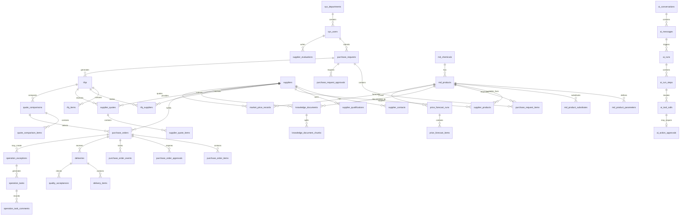

# ChemicalOps：化工采购与供应商管理系统

版本：v0.3  
文档类型：产品需求文档 + MySQL 数据库设计  
目标版本：MVP

## 1. 项目概述

ChemicalOps 是一个面向化工企业的采购与供应商管理系统。系统以业务管理为主体，覆盖化学品与产品、供应商、采购申请、询价报价、采购订单、到货验收、文件知识库、权限审批和审计等核心流程。

系统的核心业务闭环为：

```text
采购申请 → 产品与规格确认 → 询价 → 供应商报价 → 报价比较 → 采购审批
→ 采购订单 → 发货与到货 → 验收 → 供应商评价与历史沉淀
```

AI Agent 作为业务辅助能力嵌入管理页面，用于自然语言录入、产品检索、替代推荐、供应商分析、报价比较、文档参数提取和采购报告生成。AI 不直接替代采购审批，也不绕过现有业务权限和操作流程。

项目不是单纯的聊天机器人，也不是完整 ERP。第一版重点建立化工采购数据和业务流程的统一管理能力，再通过 AI 降低资料查询、产品匹配和采购分析的工作成本。

## 2. 背景与问题

化工企业采购通常同时涉及产品规格、CAS、技术文件、供应商资质、价格、MOQ、交期和质量要求。实际工作中常见问题包括：

- 化学品资料分散在 Excel、PDF、邮件和共享文件夹中
- 同一种化学品存在不同型号、纯度、包装和供应商规格
- 采购申请的技术要求不完整，容易反复确认
- 供应商报价缺少统一格式，价格、交期和 MOQ 难以比较
- TDS、SDS 和检测报告的版本及有效期缺少统一管理
- 供应商历史报价、交付和异常记录无法沉淀
- 采购人员需要跨多个表格查询产品、供应商和历史交易信息
- AI 即使能够生成文字，也缺少真实业务数据、权限约束和审批闭环

ChemicalOps 通过统一主数据、采购单据、文件和供应商履历，将“需求提出—询价比较—订单执行—到货验收—供应商评价”串成可追踪的管理流程，并让 AI 在受控范围内提供辅助。

## 3. 项目目标

### 3.1 业务目标

- 统一管理化学品、产品规格和技术文件
- 建立供应商档案、资质和供应能力台账
- 标准化采购申请、询价、报价和采购订单流程
- 提供多供应商报价的结构化比较能力
- 建立采购订单、到货验收和异常处理的状态跟踪
- 沉淀供应商价格、交付和质量表现
- 通过 AI 降低产品检索、资料提取和采购分析成本
- 让采购审批、AI 建议和关键操作具备可审计性

### 3.2 技术目标

- 构建 React + FastAPI 的前后端分离管理系统
- 使用 MySQL 作为核心业务数据库
- 使用 RBAC 管理用户、角色、部门和数据权限
- 使用结构化 AI Agent 工具调用辅助采购业务
- 支持异步文档处理、报告生成和价格分析
- 支持 SSE 推送 AI 运行进度和异步任务状态
- 使用 MinIO 保存 TDS、SDS、报价单和报告文件
- 使用 Docker Compose 提供本地和演示环境的一键部署
- 通过 Alembic 管理数据库结构变更

## 4. 目标用户

| 用户角色 | 主要职责 |
|---|---|
| 系统管理员 | 用户、角色、部门、权限和系统参数管理 |
| 采购经理 | 采购策略、审批、供应商选择和采购分析 |
| 采购员 | 创建采购申请、发起询价、维护报价和采购订单 |
| 技术/研发人员 | 确认产品规格、技术要求和替代产品 |
| 仓库/收货人员 | 登记发货、到货数量和验收信息 |
| 质量人员 | 查看技术文件、录入验收结果和质量异常 |
| 财务/业务查看者 | 查看采购订单、金额和报表，不直接修改业务数据 |
| 管理层 | 查看采购金额、供应商表现、价格趋势和异常看板 |

## 5. 核心业务流程

### 5.1 采购申请到到货验收流程

1. 业务人员或采购员创建采购申请
2. 填写产品、数量、技术要求、预算和期望到货日期
3. 系统检查产品基础资料和必要文件
4. 采购负责人审批采购申请
5. 采购员创建询价单并选择目标供应商
6. 录入或导入多家供应商报价
7. 系统比较价格、MOQ、交期、付款条件和历史表现
8. 采购员选择供应商并提交采购订单审批
9. 审批通过后生成采购订单
10. 记录供应商发货和实际到货情况
11. 收货人员登记到货数量并完成验收
12. 记录短交、质量问题或文件缺失等异常
13. 完成供应商评价，并沉淀价格、交付和质量记录

### 5.2 产品资料与知识库流程

```text
上传 TDS/SDS/检测报告/报价单
→ 记录来源、版本和有效期
→ 关联化学品、产品或供应商
→ 提取文本和关键参数
→ 人工确认结构化结果
→ 支持关键词或语义检索
```

第一版文件管理和结构化资料以人工确认结果为准。AI 提取结果必须展示来源文件和页码或段落信息，不能把未经确认的提取结果直接当作正式业务字段。

### 5.3 AI 辅助采购流程

```text
用户在管理页面提出问题或输入采购需求
→ Agent 识别意图
→ 检查当前用户和工具权限
→ 调用产品、供应商、报价、订单或文档只读工具
→ 汇总结构化数据和文件证据
→ 返回推荐、比较结果或分析报告
→ 涉及业务写入时生成草稿或待审批动作
→ 用户确认后由业务 API 执行
→ 保存完整 Agent 审计记录
```

示例问题：

> “需要采购 500 kg、纯度不低于 99% 的某化学品，请推荐满足交期要求的供应商，并比较历史价格。”

Agent 应返回匹配产品、候选供应商、报价和交期比较、历史表现、数据来源及推荐理由，而不是只返回没有证据的自然语言结论。

## 6. 功能需求

### 6.1 化学品与产品管理

#### 6.1.1 化学品基础信息

- 化学品名称、英文名称和别名
- CAS 号、化学式、分子量
- 危险性分类和基础标签
- 产品分类、应用领域和状态
- 备注和数据来源

#### 6.1.2 产品规格管理

- 产品型号、纯度、包装规格和计量单位
- 技术参数及其单位、上下限和检测方法
- 产品与化学品的关联
- 产品启用、停用和版本状态
- 产品替代关系和替代条件

#### 6.1.3 产品文件关联

- 关联 TDS、SDS、检测报告和其他技术文件
- 展示文件版本、来源、发布日期和有效期
- 标记当前有效文件
- 文件过期提醒

### 6.2 供应商管理

#### 6.2.1 供应商档案

- 供应商名称、统一标识、地区和地址
- 联系人、电话、邮箱和业务范围
- 供应商状态和合作等级
- 付款条件、默认交期和备注

#### 6.2.2 资质与供应能力

- 营业执照、认证和合规文件
- 资质有效期
- 可供应产品及对应规格
- 最小起订量、常规交期和产能备注
- 产品文件和供应商文件关联

#### 6.2.3 供应商履历

- 历史报价
- 采购订单和到货记录
- 准时交付率
- 短交、质量和文件异常记录
- 人工评价和系统评分

### 6.3 采购申请管理

- 创建采购申请主单和明细
- 选择产品或填写待确认的技术要求
- 维护数量、单位、预算和期望到货日期
- 填写用途、申请部门和紧急程度
- 上传需求附件
- 草稿、提交、审批中、已批准、已驳回、已取消状态
- 申请明细转询价单
- 跟踪申请数量、已下单数量和未满足数量
- 查看审批记录和操作日志

### 6.4 询价与报价管理

#### 6.4.1 询价单

- 根据采购申请创建询价单
- 选择多个目标供应商
- 设置报价截止时间和交付要求
- 维护询价产品、规格、数量和技术要求
- 记录询价状态

#### 6.4.2 供应商报价

- 录入供应商报价单
- 支持单价、币种、税率、MOQ、交期和付款条件
- 支持报价有效期和阶梯价格
- 上传供应商报价附件
- 记录报价版本和来源
- 支持报价撤回和重新报价

#### 6.4.3 报价比较

- 横向比较多家供应商报价
- 比较价格、总金额、MOQ、交期和付款条件
- 展示供应商历史交付和质量表现
- 记录采购员选择结果和理由
- 支持导出报价比较报告

### 6.5 采购订单管理

- 从已确认报价生成采购订单
- 维护订单明细、数量、价格、交期和收货地址
- 采购订单审批
- 订单状态：草稿、审批中、已批准、已下单、部分到货、已完成、已取消
- 记录供应商确认、发货和到货信息
- 记录订单变更及变更原因
- 关联采购申请、询价单和供应商报价
- 生成采购订单 PDF 或可打印文件

### 6.6 到货与验收管理

- 登记发货信息和预计到货日期
- 登记实际到货数量、批次和包装
- 支持部分到货和多次到货
- 记录文件是否齐全
- 记录验收结果：合格、部分合格、不合格、待复检
- 创建短交、质量、文件缺失和超期到货异常
- 关联产品、供应商、采购订单和验收记录

### 6.7 文件与知识库管理

- 上传 TDS、SDS、检测报告、报价单和资质文件
- 文件分类、版本、来源、发布日期和有效期管理
- 文件与化学品、产品、供应商、采购申请或报价关联
- 文件预览、下载和权限控制
- 文件过期和缺失提醒
- 文档解析任务状态管理
- 保存提取字段、来源页码和人工确认状态
- 后续可接入向量检索支持语义搜索

### 6.8 权限、审批和审计

- 登录、退出和密码修改
- 用户、部门和角色管理
- 菜单权限、API 权限和数据范围权限
- 采购申请审批流程
- 采购订单审批流程
- AI 建议动作审批
- 关键字段变更记录
- 登录、导出、文件访问和业务操作审计
- 敏感字段按权限返回

## 7. AI 辅助模块需求

### 7.1 Agent 定位

ChemicalOps Agent 是管理系统中的采购业务助手，负责理解自然语言、检索业务数据、提取技术资料、辅助比较和生成建议。Agent 不直接拥有绕过业务 API 的数据库写入权限。

### 7.2 只读工具

- `search_chemicals`：按名称、CAS、化学式或别名检索化学品
- `search_products`：按规格、纯度、参数和标签检索产品
- `find_substitute_products`：查找符合约束的替代产品
- `get_product_documents`：获取产品 TDS、SDS 和检测报告
- `search_suppliers`：按产品、地区、资质和状态筛选供应商
- `compare_supplier_quotes`：比较指定询价单下的供应商报价
- `get_supplier_performance`：查询供应商价格、交付和质量表现
- `get_purchase_status`：查询采购申请、询价单和采购订单状态
- `get_price_history`：查询产品历史报价和价格趋势
- `search_documents`：检索已授权的技术和采购文件

### 7.3 草稿与写入工具

AI 可以生成以下草稿，但必须经过用户确认或业务审批：

- `draft_purchase_request`：生成采购申请草稿
- `draft_rfq`：根据采购申请生成询价草稿
- `draft_quote_comparison`：生成报价比较结论草稿
- `draft_purchase_order`：根据已确认报价生成采购订单草稿
- `create_approval_request`：创建待审批动作
- `generate_purchase_report`：生成采购分析报告

### 7.4 AI 输出要求

AI 输出应尽量结构化，至少包含：

- 用户问题或任务理解
- 使用的数据范围
- 推荐或判断结论
- 关键证据
- 相关产品、供应商或单据编号
- 风险和不确定性
- 建议的下一步动作
- 数据来源或文件引用

### 7.5 AI 安全要求

- 每次 Agent 调用前校验用户身份和工具权限
- 查询结果遵守用户的数据范围权限
- AI 只能通过业务工具访问数据
- 写入操作默认生成草稿，不直接提交
- 采购订单和审批相关操作必须人工确认
- 文档解析结果必须标记为未确认或已确认
- AI API Key、文件内容和敏感字段不写入普通日志
- 保存会话、消息、运行、步骤、工具调用和审批记录
- 对无法确认的产品规格或供应商信息明确提示不确定性

## 8. 技术选型

### 8.1 前端

- React
- TypeScript
- Vite
- Ant Design
- React Router
- TanStack Query
- ECharts
- SSE 客户端

选择理由：适合企业管理后台、表格、表单、审批和数据看板场景，组件成熟，便于快速构建采购管理页面。

### 8.2 后端

- Python
- FastAPI
- SQLAlchemy 2
- Pydantic 2
- Alembic
- LangGraph

后端采用模块化单体架构，按领域拆分为 `auth`、`master-data`、`suppliers`、`procurement`、`quotations`、`deliveries`、`documents`、`operations` 和 `agent` 模块。第一版不拆微服务。

### 8.3 数据库与基础设施

- MySQL 8.0+：核心业务数据库
- Redis：缓存、分布式锁、任务队列和 SSE 状态
- Celery：异步文档解析、报告生成和价格分析任务
- MinIO：TDS、SDS、报价单、资质文件和报告文件
- pgvector/Qdrant：第一版不强制引入；需要技术文件语义检索时再增加
- Docker Compose：本地和演示环境部署

选择 MySQL 的原因：采购申请、询价、报价、订单、到货、审批和审计数据以关系模型为主，事务和索引能力足够支撑 MVP。

## 9. MySQL 数据库设计

本节保留业务层面的表清单和关系概览。完整的字段、可空性、外键、联合索引和字段说明见：

- [数据库字段设计](./数据库字段设计.md)
- [MySQL 初始化建表脚本](../database/schema.sql)

### 9.1 统一约定

- 表名使用小写蛇形命名
- 主键统一使用 `BIGINT UNSIGNED`
- 金额使用 `DECIMAL(18, 6)`
- 数量使用 `DECIMAL(18, 6)`
- 时间字段使用 `DATETIME(3)`
- 所有核心表包含 `created_at`、`updated_at`
- 可软删除或停用的主数据包含 `status`
- 业务单据使用独立的业务编号，例如 `PR-202609-0001`
- 文件内容存储在 MinIO，MySQL 只保存元数据和对象地址
- AI 生成内容必须保存来源和审计关联

### 9.2 用户与权限表

#### `sys_users` 用户表

核心字段：`id`、`username`、`password_hash`、`display_name`、`department_id`、`email`、`phone`、`status`、`last_login_at`。

#### `sys_departments` 部门表

核心字段：`id`、`parent_id`、`department_code`、`department_name`、`manager_id`、`status`。

#### `sys_roles` 角色表

核心字段：`id`、`role_code`、`role_name`、`description`、`status`。

#### `sys_permissions` 权限表

核心字段：`id`、`permission_code`、`permission_name`、`permission_type`、`resource`、`action`。

#### `sys_user_roles` 用户角色关联表

核心字段：`user_id`、`role_id`。

#### `sys_role_permissions` 角色权限关联表

核心字段：`role_id`、`permission_id`。

### 9.3 化学品与产品表

#### `md_chemicals` 化学品基础表

保存化学品通用身份信息：名称、英文名、别名、CAS 号、化学式、分子量、危险性分类、来源和状态。

#### `md_products` 产品规格表

保存企业采购和供应商实际交易的产品：产品编码、产品名称、所属化学品、型号、纯度、包装、单位、参数 JSON、状态。

#### `md_product_parameters` 产品参数表

保存可检索的结构化参数：参数名称、参数值、单位、最小值、最大值、检测方法和来源文件。

#### `md_product_substitutes` 产品替代关系表

保存主产品、替代产品、适用条件、限制条件、确认状态和备注。

#### `md_product_categories` 产品分类表

保存分类树、标签和启停状态。

### 9.4 供应商表

#### `suppliers` 供应商表

保存供应商名称、编码、统一标识、地区、地址、联系人、合作等级、状态和备注。

#### `supplier_contacts` 供应商联系人表

保存联系人姓名、职位、电话、邮箱和是否主要联系人。

#### `supplier_qualifications` 供应商资质表

保存资质类型、编号、有效期、文件 ID、审核状态和审核人。

#### `supplier_products` 供应商产品关联表

保存供应商可供应产品、供应商型号、纯度、MOQ、常规交期、供货状态和备注。

#### `supplier_evaluations` 供应商评价表

保存评价周期、价格得分、交付得分、质量得分、服务得分、总分、评价人和评价说明。

### 9.5 采购申请表

#### `purchase_requests` 采购申请主表

核心字段：`request_no`、`applicant_id`、`department_id`、`purpose`、`priority`、`budget_amount`、`expected_date`、`status`、`submitted_at`、`approved_at`。

#### `purchase_request_items` 采购申请明细表

核心字段：`request_id`、`product_id`、`requested_name`、`technical_requirements`、`quantity`、`unit_id`、`budget_price`、`expected_date`、`fulfilled_quantity`。

#### `purchase_request_approvals` 采购申请审批表

保存申请、审批节点、审批人、审批动作、审批意见和审批时间。

### 9.6 询价与报价表

#### `rfqs` 询价单主表

保存询价编号、来源采购申请、询价人、报价截止时间、交付要求和询价状态。

#### `rfq_items` 询价单明细表

保存询价产品、规格、数量、单位、技术要求和期望交期。

#### `rfq_suppliers` 询价供应商关联表

保存询价单邀请的供应商、邀请时间、响应状态和响应时间。

#### `supplier_quotes` 供应商报价主表

保存报价编号、询价单、供应商、报价日期、有效期、币种、报价状态和来源文件。

#### `supplier_quote_items` 供应商报价明细表

保存产品、供应商型号、报价数量、单价、税率、MOQ、交期、付款条件和备注。

#### `quote_comparisons` 报价比较表

保存比较编号、比较范围、选定报价、比较结论、选择理由和确认人。

#### `quote_comparison_items` 报价比较明细表

保存各报价的价格、交期、MOQ、付款条件、供应商历史评分和综合评分。

### 9.7 采购订单表

#### `purchase_orders` 采购订单主表

保存订单编号、供应商、来源报价、申请部门、订单金额、币种、交付地址、订单日期、期望到货日期和状态。

#### `purchase_order_items` 采购订单明细表

保存产品、供应商产品、订购数量、单位、单价、税率、计划到货日期和已到货数量。

#### `purchase_order_approvals` 采购订单审批表

保存审批节点、审批人、审批动作、意见和时间。

#### `purchase_order_events` 采购订单事件表

保存供应商确认、发货、延期、部分到货、完成和取消等状态事件。

### 9.8 到货与验收表

#### `deliveries` 到货记录表

保存到货单号、采购订单、供应商、发货日期、到货日期、物流信息和状态。

#### `delivery_items` 到货明细表

保存产品、批次、包装、计划数量、实际数量和短交数量。

#### `quality_acceptances` 到货验收表

保存验收单号、到货记录、验收人、验收结果、检测结果和验收时间。

#### `operation_exceptions` 采购异常表

保存异常类型、关联单据、异常等级、描述、责任部门、状态、处理期限和关闭信息。

#### `operation_tasks` 异常处理任务表

保存任务标题、负责人、优先级、截止时间、状态、来源异常和完成说明。

#### `operation_task_comments` 任务处理记录表

保存任务进展、处理人、处理内容、附件和记录时间。

### 9.9 文件与知识库表

#### `sys_files` 文件表

保存文件名、对象存储地址、文件类型、大小、哈希、上传人、访问级别和解析状态。

#### `knowledge_documents` 知识库文档表

保存文档标题、文档类型、版本、来源、发布日期、有效期、关联产品、关联供应商和确认状态。

#### `knowledge_document_chunks` 文档片段表

保存文档片段、页码、段落位置、提取文本、结构化字段和后续向量索引标识。第一版可以只使用 MySQL 进行关键词检索，向量字段作为扩展预留。

### 9.10 行情与分析表

#### `market_price_records` 历史价格表

保存产品、供应商、报价日期、价格、币种、数量区间、来源和质量状态。

#### `price_forecast_runs` 价格预测任务表

保存预测产品、训练数据范围、模型版本、预测周期、任务状态和结果文件。

#### `price_forecast_items` 价格预测明细表

保存预测日期、预测价格、上下界、置信度和解释信息。

### 9.11 AI Agent 与审计表

#### `ai_conversations` Agent 会话表

保存用户、会话标题、业务场景、权限快照和会话状态。

#### `ai_messages` Agent 消息表

保存角色、消息内容、引用来源和消息时间。

#### `ai_runs` Agent 运行表

保存模型、运行状态、开始结束时间、耗时、错误信息和输入输出摘要。

#### `ai_run_steps` Agent 步骤表

保存步骤名称、状态、输入输出摘要和耗时。

#### `ai_tool_calls` Agent 工具调用表

保存工具名、结构化参数、权限校验结果、返回摘要和执行时间。

#### `ai_action_approvals` AI 动作审批表

保存动作类型、目标对象、动作草稿、审批状态、审批人、审批意见和执行结果。

#### `sys_audit_logs` 审计日志表

保存用户、操作类型、资源、资源 ID、请求摘要、结果、IP 和时间。

## 10. 核心表关系



## 11. MVP 页面

- 登录页
- 首页采购运营看板
- 化学品列表和详情
- 产品规格和替代关系管理
- TDS/SDS/检测报告文件管理
- 供应商列表和详情
- 供应商产品、资质和联系人管理
- 采购申请列表和详情
- 采购申请审批页
- 询价单列表和详情
- 供应商报价录入页
- 报价比较页
- 采购订单列表和详情
- 采购订单审批页
- 发货与到货登记页
- 到货验收和异常处理页
- 供应商评价页
- ChemicalOps Agent 工作台
- AI 运行记录和动作审批页
- 采购金额、价格趋势和供应商表现报表
- 审计日志页

## 12. MVP 数据规模

第一版使用公开化学品基础资料和可复现的模拟采购数据，避免依赖企业内部数据：

- 50–100 个化学品
- 100–300 个产品规格
- 20–50 家供应商
- 100–300 份 TDS/SDS/报价或资质文件
- 100 条采购申请
- 100–300 条供应商报价
- 50–100 个采购订单
- 100 条到货和验收记录
- 500 条历史价格记录
- 20 条采购异常记录

采购申请、报价和历史价格使用固定随机种子生成，确保演示数据可重复。AI 推荐结果必须展示模拟数据来源，不把演示结果描述为真实企业决策。

## 13. 非功能需求

### 权限与安全

- 所有 API 进行身份认证
- 所有业务查询进行组织和角色权限校验
- Agent 工具再次校验权限
- 采购订单和审批动作必须保留审计记录
- 文件按产品、供应商和角色控制访问范围
- Webhook、文件和 AI API Key 不写入普通日志
- 敏感字段不返回给无权限用户

### 性能

- 普通列表接口 P95 小于 500ms
- Agent 首个 SSE 事件小于 2 秒
- 支持至少 20 个并发 Agent 会话
- 文档解析、报告生成和价格预测支持异步执行
- 报价比较在 MVP 数据规模下 2 秒内返回

### 可维护性

- API 使用 OpenAPI 自动生成文档
- 数据库变更必须通过 Alembic Migration
- 核心领域服务有单元测试
- 关键采购流程有 API 集成测试
- Agent 工具具有独立的输入输出 Schema
- AI 结论与业务写入操作分离

## 14. MVP 验收标准

系统能够完成以下演示：

1. 管理员创建用户并分配角色
2. 创建化学品、产品规格和产品替代关系
3. 创建供应商并维护可供应产品和资质
4. 上传并关联 TDS、SDS 或报价文件
5. 创建采购申请并提交审批
6. 根据采购申请创建询价单
7. 录入至少三家供应商报价
8. 按价格、MOQ、交期和历史表现比较报价
9. 选择报价并生成采购订单
10. 审批采购订单并记录审批意见
11. 登记发货、到货和验收结果
12. 模拟短交、质量不合格或文件过期异常
13. 用户询问符合条件的产品和供应商
14. Agent 返回推荐结果、证据和来源
15. Agent 生成采购申请或采购订单草稿
16. 用户确认后提交正式业务审批
17. 查看供应商表现和历史价格趋势
18. 查看 Agent 运行、审批和完整审计记录

## 15. 不在 MVP 范围内

- 财务、会计和应付账款结算
- 完整合同管理和法务审查
- 自动向供应商发送真实邮件或即时消息
- 自动签署采购合同
- 复杂供应链计划和 MRP
- 自动执行采购订单或无人值守审批
- 自动替代危险化学品
- AI 自动确认 TDS/SDS 的合规结论
- 实时接入所有外部行情网站
- 移动端 App
- 多工厂复杂组织隔离
- 模型训练和自建大模型

## 16. 后续迭代方向

- 供应商门户和在线报价
- 邮件或企业协同工具询价接入
- OCR 和版面解析增强
- TDS/SDS 语义检索和问答
- 供应商交付与质量风险预测
- 价格预测模型和行情数据接入
- 采购预算和合同管理
- 多工厂、多币种和多语言
- 与 ERP、WMS、财务系统对接
- Agent 评测集、回归测试和推荐效果分析
