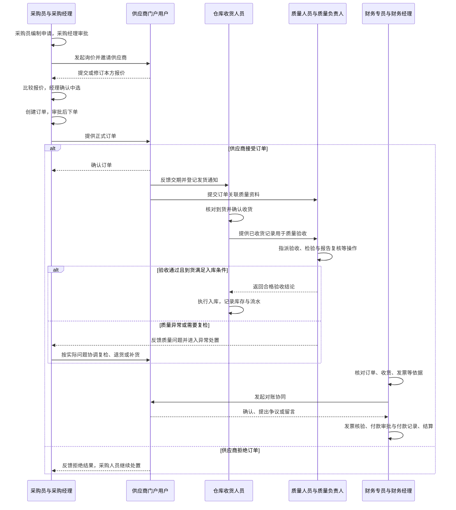
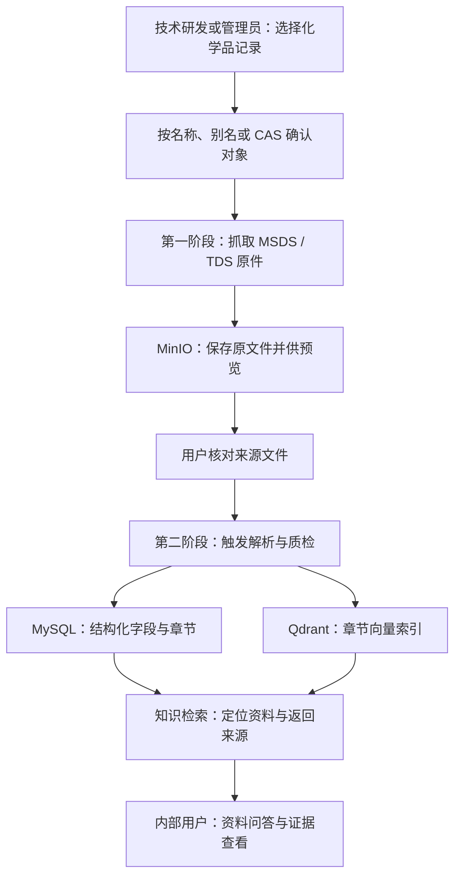
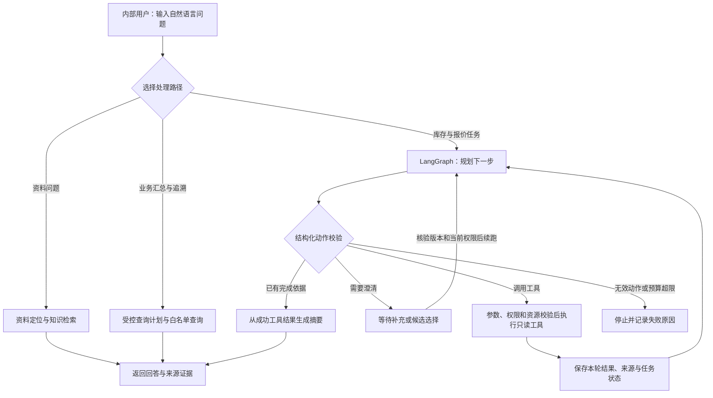
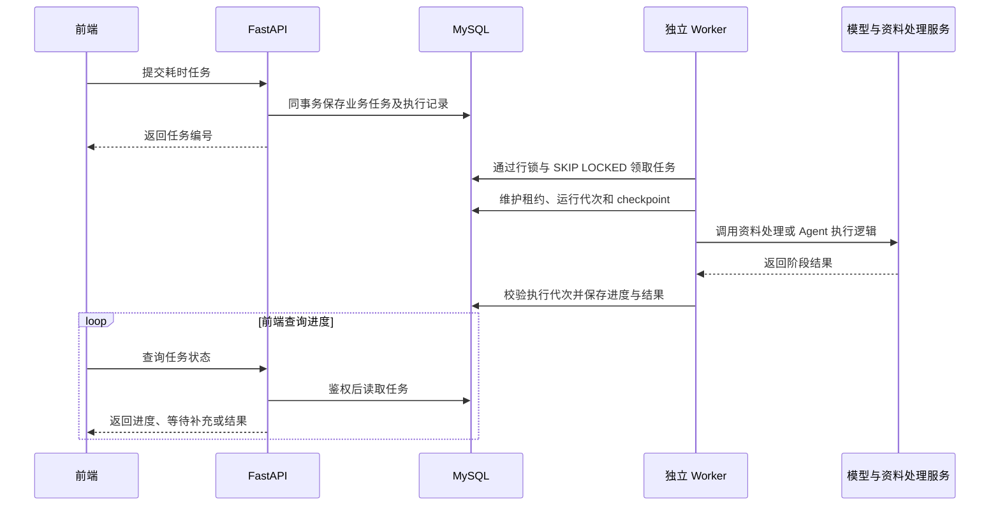

# ChemicalOps：角色协作与全流程说明

> 面试讲解版。根据当前角色种子、业务服务及 Agent 运行说明整理；角色表表示内置配置，实际访问仍取决于账号授权、资源范围和业务状态。流程图表达岗位交接关系，不表示每一步均由系统自动触发。

## 阅读主线：业务闭环与支撑能力

项目围绕“采购 → 供应商履约 → 仓库收货 → 质量验收 → 合格入库 → 财务对账与结算”展开，连接采购、供应商、仓库、质量和财务五个业务环节。技术研发提供规格、检测标准和资料，查看角色关注经营与财务信息，管理员维护用户与权限；知识库、只读 Agent 和异步任务属于支撑能力。

这条主线包含并行和异常分支：财务可按单据条件开展核对，不要求所有库存作业全部结束；质量异常进入复检、退货或补货协同。收货后不能直接跳过质量验收办理入库。

图片中对角色的归类仅用于解释业务协作。项目没有“采购协作组、研发履约组、财务管理组、系统配置组”这四个实际角色组，也没有相应的组内权限继承。系统实际定义 12 类内置角色，每个角色分别绑定权限；部门表示组织归属，与角色及图片展示归类是不同概念。

## 1. 面试时先用这一段介绍

ChemicalOps 是我独立开发的化工采购运营与 AI 协同平台，核心是把采购、供应商、仓库、质量和财务之间的业务串起来。采购员创建申请，采购经理审批并确认中选报价，供应商通过门户报价、确认订单和反馈发货，仓库收货后由质量人员验收，满足条件再入库，财务结合订单、收货、发票等信息完成对账、付款记录和结算。技术研发负责化学品规格、检测标准和技术资料，也可以申请领用；管理层通过看板和授权查询了解运营情况。在业务系统上，我接入了知识库问答和只读 Agent，帮助内部人员查资料、查库存、比较报价；耗时的资料处理和 Agent 任务通过 MySQL 持久队列交给独立 Worker 执行。

## 2. 谁在使用：完整的 12 类内置角色

| 角色 | 角色编码 | 主要职责与边界 |
| --- | --- | --- |
| 系统管理员 | SYS_ADMIN | 用户、部门、角色、权限等配置；管理技术资料和业务功能，但仍受状态、资源与数据完整性约束 |
| 采购经理 | PROCUREMENT_MANAGER | 采购申请和订单审批、报价比较与中选确认、供应商维护、采购跟进 |
| 采购员 | BUYER | 编制采购申请、发起询价、录入或查看报价、准备比较材料、创建订单并跟进；无经理审批权限 |
| 技术研发人员 | TECHNICAL | 维护化学品、产品规格、检测标准与技术资料，办理本人领用申请；不执行出库、调拨或盘点 |
| 仓库收货人员 | WAREHOUSE | 到货登记、收货、合格入库、库存维护、领用出库、调拨、盘点及退货等获准操作 |
| 质量人员 | QUALITY | 处理分配的质量验收，录入检验结果与报告，修正质量问题 |
| 质量负责人 | QUALITY_MANAGER | 创建并指派质量验收、报告复核及退回修正；与一线检验职责区分 |
| 财务查看者 | FINANCE_VIEWER | 查看获准财务记录及相关采购、收货依据，无财务办理权限 |
| 财务专员 | FINANCE_CLERK | 对账、发票录入、付款申请和结算办理；不承担财务经理的核验与审批权限 |
| 财务经理 | FINANCE_MANAGER | 财务办理、发票核验、付款审批及结算确认 |
| 管理层查看者 | MANAGEMENT_VIEWER | 查看经营看板和获准的跨模块业务信息，不作为通用审批角色 |
| 供应商门户用户 | SUPPLIER_PORTAL | 处理绑定供应商的受邀询价、正式订单、交期、发货、质量资料和对账协同 |

这些是角色而非固定的 12 个真实用户。审批职责分别落在采购经理、质量负责人和财务经理等岗位，不需要虚构一个通用“审批人员”角色。

图片顶部统一使用“参与角色（按职责归类展示）”，区分内部用户与外部供应商；供应商与采购员参与同一采购流程，不表示两者属于同一部门、同一角色组或共享权限。

当前内置配置向全部 12 类角色开放共享运营看板，包括全局订单、付款和库存成本等汇总；底层业务明细及办理权限另行控制。AI 工作台只向内部角色开放，供应商门户用户不因能看运营看板而获得 AI 工作台权限。

## 3. 核心协作图：采购如何走到履约和结算

为方便阅读，将同一业务域内的办理与审批岗位合为一个参与方，具体分工见角色表。技术研发、管理员和查看角色在下一节单独说明。

### 关键交接点怎么讲

1. **采购到供应商：**询价邀请、报价和正式订单关联，供应商只能处理本方受邀询价及本方订单，不接触其他供应商报价或内部审批信息。
2. **供应商到仓库：**发货通知复用到货与收货流程，发货数量受订单剩余量、已收数量和在途量等条件校验；登记发货不等于完成入库。
3. **仓库到质量：**已收货记录进入质量验收。质量负责人承担指派与报告复核职责，质量人员录入结果；供应商上传的质量资料与内部验收报告复核是不同业务。
4. **质量到库存：**当前入库服务要求到货状态为 `ACCEPTED`，再检查仓库范围与其他条件；不能把收到货或收到质量附件直接视为可入库。
5. **履约到财务：**财务基于关联单据核对并与供应商协同处理差异。对账并非必须等全部库存作业结束才启动，具体操作受对应单据条件控制。
6. **付款的含义：**系统支持付款申请、审批和人工登记已付款，不能讲成已经直连银行自动划款；发票核验也不能表述为已经接入税务平台。

## 4. 其他角色如何参与

### 4.1 技术研发：规格、资料和领用

技术研发维护化学品、产品规格和检测标准，为采购选品与质量验收提供基础资料。技术资料处理分为“先取得原件”和“再解析入库”两个独立阶段，用户可以先核对来源，再触发后续处理。

研发领用是另一条业务支线：研发人员办理本人领用申请，由具备相应权限的人员按流程处理，再由获准仓库人员执行出库。不能因为研发能提交领用申请，就说研发拥有完整库存台账、领用审批、出库或盘点权限。

### 4.2 管理层和财务查看者：观察业务

- 管理层查看者关注订单履约、库存、异常和财务等获准信息，用于了解运营情况；查看权不等于审批或修改权。
- 财务查看者关注财务记录及其业务依据，与财务专员办理、财务经理审批分开。
- 共享运营看板是汇总入口；点入底层明细仍需满足该页面和记录的权限。

### 4.3 系统管理员：维护协作基础

管理员配置用户、部门、角色和权限，为各岗位建立可访问功能。前端按权限展示页面和操作，后端独立校验身份、权限、资源范围及状态，不能仅靠隐藏按钮阻止越权。管理员拥有功能授权也不代表可以绕过状态机或任意读取他人的 Agent 任务。

## 5. AI 如何接入：区分三种处理路径

当前 AI 工作台同时承载资料问答、受控业务查询和库存/报价 Agent。并不是所有问题都会进入同一个 Agent 循环。

### 5.1 Agent 当前确实能调用什么

| 只读工具 | 解决的问题 | 主要边界 |
| --- | --- | --- |
| 产品定位 `catalog.search_products` | 用户口语名称对应哪些实际产品与规格 | 以本轮真实目录查询确认对象，多候选不能猜 ID |
| 库存查询 `inventory.query_available` | 已定位产品在获准范围的账面可用量 | 按单位统计，不把不同单位直接相加；账面可用不等于已确认允许领用 |
| 询价定位 `supplier_quotes.find_rfq_items` | 产品对应哪条当前可访问的询价明细 | 询价范围、状态及多候选需要核验 |
| 报价比较 `supplier_quotes.compare` | 有效最新报价有哪些、哪些可比较 | 仅满足币种、单位、税率、型号等可比条件才排序，不自动定标 |

这四个工具由模型按问题选择和循环调用，并非每次都执行四步，也不等于参考图中的四个独立业务 Agent。知识库检索属于工作台的另一条处理路径，不应画成当前四工具运行时中已注册的第五个工具。

### 5.2 用一个问题说明循环

**问题：帮我查乙醇的库存和当前报价。**

1. 模型先选择产品定位工具，服务端查询真实产品目录。
2. 如存在多个规格，任务进入等待状态，让用户选择，不猜测产品 ID。
3. 用户选择后，系统重新核验对象、当前权限和任务版本，再继续查询库存及询价明细。
4. 查询有效报价，按可比规则展示；不具备排序条件时明确说明原因。
5. 最终返回库存、报价和来源。系统不自动选中供应商、生成订单或扣减库存。

### 5.3 草稿与业务写入的准确表述

工作台存在专用采购申请草稿预览能力，与四工具只读 Agent 的运行时分开。介绍时可以说“辅助整理草稿、供用户核对”，不能说“Agent 确认后自动创建采购申请并完成后续下单”。当前 Agent 工具目录没有业务写工具，自动确认与业务写入闭环仍待开发；正式办理通过现有业务页面和接口完成。

## 6. 长任务如何执行：当前 MySQL 持久队列

资料抓取、解析与向量化，以及 Agent 异步入口，默认使用数据库队列。同步入口与可显式配置的进程内执行模式另行处理，不能把所有请求都说成异步。

- **防止重复生效：**业务状态与执行代次校验阻止旧执行覆盖新结果；文档向量写入还结合索引代次保护。不能据此承诺外部模型请求只发送一次。
- **故障恢复：**Worker 使用持久记录、租约和检查点恢复；无法证明旧执行已停止时进入隔离处置，不能直接重跑。
- **取消与续跑：**任务取消使旧执行标记失效；多候选补充后创建新执行代次，并核验任务版本与权限。
- **当前架构：**MySQL 数据库队列已替代原 RabbitMQ 与 Dispatcher 路径，新任务不再写入或消费旧 outbox；历史消息队列验收不能当成当前实现证据。

## 7. 面试按这个顺序展开

| 面试官想了解什么 | 讲哪部分 | 重点 |
| --- | --- | --- |
| 项目整体做什么 | 第 1 节概述和第 3 节协作图 | 哪些角色围绕哪些单据交接 |
| 全栈或后端做了什么 | 角色分工、业务状态、质量入库和财务边界 | 权限、关联关系、事务与合法状态流转 |
| Agent 如何工作 | 第 5 节流程与乙醇示例 | 规划循环、工具契约、多候选澄清、证据与只读边界 |
| 知识库如何建设 | 第 4.1 节资料图 | 原件、结构化章节、向量索引及来源追溯 |
| 长任务可靠性怎么保证 | 第 6 节时序图 | 持久队列、独立执行、租约、代次与恢复边界 |

## 8. 本文事实依据

以下为仓库相对路径，便于与实现对照；本文未修改现有项目展示文档或 README。

| 主题 | 主要依据 |
| --- | --- |
| 12 类角色、默认权限和 AI 工作台范围 | `scripts/seed_demo_accounts.py` |
| 职责目标与已验收边界的区别 | `docs/角色职责与三级权限矩阵.md` |
| 采购、供应商门户、财务及资料业务范围 | `docs/项目简介与业务流程.md` |
| 质量结果与入库守卫 | `backend/app/modules/quality_acceptances/service.py`、`backend/app/modules/inventory/service.py` |
| 技术资料管理角色与原件处理 | `backend/app/modules/jobs/technical_documents.py` |
| Agent 动作循环、工具及会话边界 | `docs/Agent只读任务运行说明.md`、`backend/app/modules/ai/agent_prompt.py`、`backend/app/modules/ai/agent_tools.py` |
| 报价比较与写入边界 | `docs/Agent采购MVP业务规则与验收用例.md` |
| 当前异步执行与旧架构迁移 | `docs/数据库任务队列运行说明.md`、`backend/app/modules/task_queue/` |

角色职责矩阵包含尚需逐项核对的目标数据范围；本文不据此宣称全部本人、部门或仓库隔离规则均已完成验收，也不以代码存在代替部署与生产效果证明。
