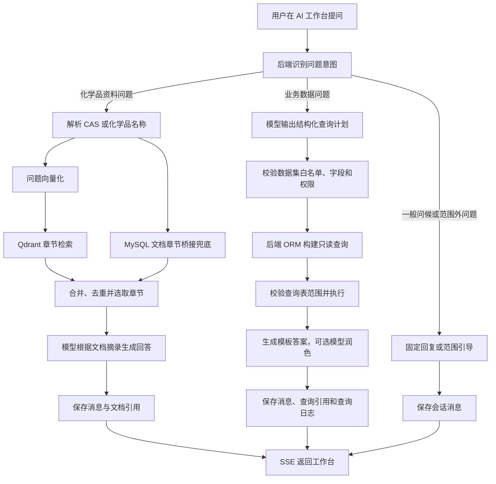
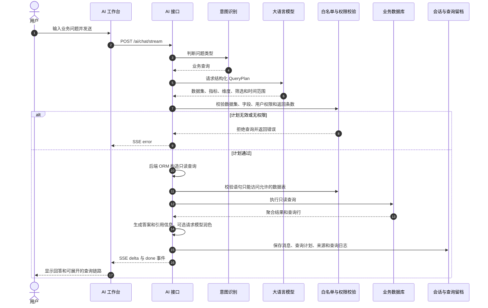
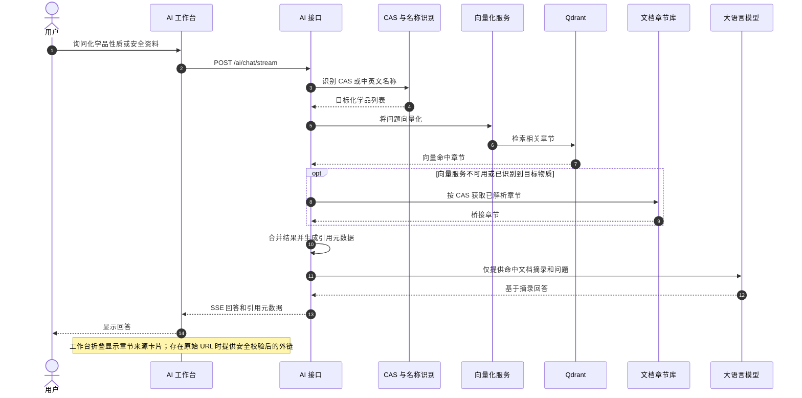

# ChemicalOps AI 工作台现状与建设方案

> 本文按代码现状说明功能边界。“已实现”指后端或前端代码已有对应能力；“可在工作台使用”指用户目前能从 AI 工作台界面直接操作。后端有接口但没有工作台入口的功能，会单独标注，避免把规划说成现成功能。

## 1. 目标与范围

AI 工作台的目标是让用户用自然语言查业务数据、查化学品资料、理解运营情况，之后再逐步支持告警和经人工确认的业务草稿。AI 输出应能说明数据来自哪里；采购、库存、质量、财务等业务数据仍由各自业务模块保存和校验。

目前已经有“会话交互 + 文档问答 + 受限业务查询”的基本框架，但还不是一个能自动跨模块处理业务的智能体。它不会自行审批、下单、改库存、付款或执行其他业务写操作。

## 2. 目前已经做了什么

### 2.1 AI 工作台界面已提供的功能

- 新建会话，查看当前用户自己的会话列表和历史消息。
- 删除自己的会话；删除后历史消息不可恢复。
- 通过流式接口发送问题并逐步显示回答。
- 对业务查询回答显示查询数据集、命中行数和查询链路；展开后可查看识别出的查询条件和服务端生成的查询语句。
- 支持常规对话、业务数据查询和化学品文档问题的意图分流。查询和文档问答由不同后端流程处理。
- 输入区域支持 Enter 发送、Shift+Enter 换行。

### 2.2 服务端已经实现的能力

| 能力 | 当前实现 | 用户能看到什么 |
|---|---|---|
| 化学品文档问答 | 按 CAS 号或中英文名称识别目标化学品；结合 Qdrant 向量检索与 MySQL 文档章节桥接；命中文档章节后将摘录交给模型回答。向量服务不可用时，对已识别化学品仍可使用章节桥接兜底。 | 工作台以默认折叠的来源卡片显示章节、CAS、文档编号、解析状态和更新时间；有 HTTP(S) 原始链接时可打开来源，并可展开章节摘录。缺少原始链接的资料只能核对知识库摘录。 |
| 业务自然语言查询 | 模型先输出受约束的 `QueryPlan`；后端按白名单把计划映射成 ORM 查询，再校验数据集、字段、权限与查询语句，只执行只读查询。查询结果可由模板生成回答，模型润色失败时使用模板兜底。 | 显示数据集、命中行数、查询口径和可折叠查询链路；来源记录默认折叠，支持直达采购订单详情或带条件打开对应申请、到货、库存及供应商列表。 |
| 查询权限 | 查询目录为每个数据集配置权限码、可用表、指标、维度、筛选项和时间字段。系统管理员按当前规则放行，其余用户需要相应权限。会话和查询状态会保存权限快照。 | 权限不足时查询被拒绝；界面没有逐条展示权限决策细节。 |
| 追问上下文 | 保存上一轮结构化查询计划；在同一会话内的部分追问可继承此前数据集和条件。 | 用户可以继续问“改成上个月”“按供应商分组”等；复杂追问不保证所有条件都能正确继承。 |
| 会话与查询留档 | 保存用户和助手消息；业务查询可保存查询状态、引用和查询日志。日志以问题摘要为主，避免在普通日志中直接记录问题全文。 | 可以重新打开自己的历史会话。 |
| 文件解析服务 | 后端请求模型时可以接受已上传文件 ID；会校验文件访问权限、扫描状态和解析结果。图片在指定模型配置下可走视觉输入，其他文件可走本地解析或配置的 MinerU 服务。 | 当前 AI 工作台没有文件选择、上传或附加入口，因此用户不能从该页面直接使用附件问答。 |
| 自然语言筛选接口 | `/ai/parse-filters` 可把自然语言转为白名单内的列表筛选参数；校验字段和枚举值，并返回解析结果，不负责执行列表查询。 | 工作台可选数据集、解析并编辑受支持条件，确认后把条件带入业务列表；目标列表不支持的时间范围等条件会明确提示，不会伪装成已生效。 |
| AI 运营晨报接口 | `/ai/briefing` 读取运营总览既有统计，让模型按快照撰写晨报；可选发送站内通知。 | 工作台可生成晨报；推送前确认接收角色。暂无晨报历史入口。推送会写入站内通知和审计记录。 |

### 2.3 业务查询目录的实际范围

当前 Text2SQL 白名单实际开放 8 类数据：

1. 采购申请
2. 采购订单
3. 到货单
4. 库存余额与批次
5. 质量验收
6. 运营异常
7. 财务对账
8. 供应商

白名单意味着模型不能任意访问数据库。它也意味着当前查询还不能完整回答询价报价、供应商产品关系、库存流水、领用、调拨、盘点、退货、补货、发票、付款、结算等明细问题。部分数据虽已有关联表和业务接口，尚未进入 AI 查询目录。

## 3. 目前没有做什么

以下事项不是当前工作台已具备的功能：

- **没有完整跨模块追溯。** 目前查询目录以单个业务数据集为主，不能稳定地从一个申请一路串到报价、订单、验收、批次、库存流水、发票和付款。
- **没有覆盖全部功能区的自然语言分析。** 例如库存领用、调拨、盘点、询价与报价、退货补货、发票付款等仍缺少查询目录与经过验证的口径。
- **逐条业务单据直达尚未全覆盖。** 首批六类查询已附带逐条来源记录；采购订单可直达详情，采购申请、到货和库存可带来源条件打开对应列表，供应商履约结果定位到供应商列表。部分源对象还没有详情路由。文档来源链接仅在资料本身提供 HTTP(S) 地址时显示。
- **没有工作台内的附件问答入口。** 后端能处理附件 ID，但前端没有附件控件，也没有统一的附件选择与引用预览流程。
- **没有主动监听业务变化。** 当前 AI 不会因为低库存、到货逾期、临期或质量待验收而自动生成事件、提醒或任务。
- **没有 AI 生成并提交业务单据。** `agent_allow_write_tools` 默认关闭，当前聊天请求也会拦截常见的创建、修改、审批、下单、入库、出库和付款指令。没有已完成的工具调用、人工审批和执行回写链路。
- **没有正式的 AI 评估与线上质量看板。** 目前虽有请求耗时、错误和查询日志等基础观测，但没有一套覆盖各业务问题、权限隔离、数值准确率、引用正确率和建议采纳率的完整评测流程。

## 4. 目前的工作链路图

图中“模型输出查询计划”不是让模型直接执行它写出的 SQL。后端根据结构化计划自行构造查询，再校验并执行只读语句。

## 5. 对应时序图

### 5.1 业务数据查询（当前已实现）

### 5.2 化学品资料问答（当前已实现）

## 6. 目标业务图：从业务事实到人工确认执行

```mermaid
flowchart LR
    subgraph Source[业务事实来源]
        PR[采购申请与询价]
        PO[订单与到货]
        QA[质量验收]
        INV[批次、库存与流水]
        FIN[对账、发票与付款]
        EX[异常、任务与通知]
        DOC[化学品与业务文件]
    end
    Source --> Read[权限受控的只读查询与检索]
    Read --> Evidence[统一证据包：来源单号、时间、口径、权限]
    Evidence --> Answer[回答、分析、来源卡片]
    Source --> Event[业务事件与定时规则]
    Event --> Detect[确定性规则：低库存、逾期、临期、短交、待验收]
    Detect --> Evidence
    Evidence --> Recommend[AI 整理原因、影响和可选建议]
    Recommend --> Inbox[工作台待办与建议列表]
    Inbox -->|用户查看来源并确认| Draft[生成业务草稿]
    Inbox -->|用户忽略或关闭| Record[记录处理决定]
    Draft --> Validate[现有业务规则、权限和字段校验]
    Validate -->|校验失败| Inbox
    Validate -->|校验通过，等待确认| Approve[人工审批/二次确认]
    Approve -->|拒绝| Record
    Approve -->|批准| ExistingAPI[调用现有业务接口执行]
    ExistingAPI --> Audit[审计日志与操作结果]
    Audit --> Source
```

目标图里的“事件队列、统一证据包、建议列表、草稿、AI 执行审批”属于后续建设内容，不是当前已经上线的模块。AI 不应绕过业务接口直接写数据库。

## 7. 用例说明

### UC-01：查询采购订单金额

- **参与者：** 有采购订单读取权限的用户。
- **前置条件：** 用户已登录；AI 服务可用；用户具有采购订单读取权限。
- **触发：** 用户询问“本季度各供应商采购订单金额是多少？”
- **主流程：** AI 识别为业务查询；模型产生数据集、金额指标、供应商分组和季度范围；后端验证字段及权限；构造只读查询并按币种处理；返回答案与查询链路。
- **异常流程：** 计划无法解析、权限不足或无匹配记录时，返回错误或空结果，不编造金额。
- **当前状态：** 后端和工作台查询链路已实现。来源记录可打开相应单据详情或按来源条件定位业务列表；部分源对象还没有详情路由，业务数据集和字段范围也有限。

### UC-02：查询到货或库存情况

- **参与者：** 有相应仓储读取权限的用户。
- **触发：** 用户询问“目前哪些到货单还在途？”或“各仓库可用库存是多少？”
- **主流程：** AI 选择到货或库存数据集，解析状态、产品、仓库和时间条件；后端校验权限，执行只读汇总后返回。
- **异常流程：** 如果问题涉及库存流水、领用、调拨或跨批次单位合并等白名单尚不支持的口径，应明确提示当前不支持，不能将不同单位的数量直接相加。
- **当前状态：** 到货单和库存余额/批次查询已进入白名单；库存流水、领用、调拨、盘点查询待扩展。

### UC-03：用化学品名称查询安全资料

- **参与者：** 已登录用户。
- **前置条件：** 文档已经解析并通过质检；知识库文档及向量服务可用，或能按 CAS 桥接章节。
- **触发：** 用户询问“乙醇的储存注意事项是什么？”
- **主流程：** 后端识别乙醇及 CAS；检索相关 MSDS/TDS 章节；合并命中摘录；模型按摘录回答；后端保存引用元数据。
- **异常流程：** 无匹配章节时告知未找到，并提示用户用 CAS 或准确名称重试；摘录不足时应承认资料不完整。
- **当前状态：** 后端检索和引用数据已实现；工作台缺少文档来源卡片、章节预览和原文件跳转。

### UC-04：沿用上一轮条件追问

- **参与者：** 正在同一会话中查询的用户。
- **触发：** 用户先问“本月订单金额”，随后问“按供应商排序”。
- **主流程：** 后端读取该会话最近一次查询计划，尝试只更新用户明确提出的条件，其余条件沿用；重新执行权限校验和只读查询。
- **异常流程：** 无法安全理解的追问不应默默改变口径；应要求用户补充或重新描述问题。
- **当前状态：** 查询计划保存及部分追问继承已实现；复杂多轮语义、上下文冲突提示还需完善。

### UC-05：把自然语言转成列表筛选

- **参与者：** 有目标业务数据集读取权限的用户。
- **触发：** 用户在采购申请列表输入“只看本月紧急且还未审批的申请”。
- **目标流程：** 页面调用 `/ai/parse-filters`；后端仅返回受支持的筛选字段和值；页面展示可编辑的条件预览；用户确认后由原列表接口执行查询。
- **异常流程：** 不支持的条件显示为未识别项，不能被悄悄丢弃或套用到其他字段。
- **当前状态：** AI 工作台已提供条件解析、编辑预览和确认后打开业务列表。尚未覆盖的字段会显示为未识别；不支持的列表时间范围会明确提示不会应用。

### UC-06：让 AI 阅读用户上传的文件

- **参与者：** 文件上传者；系统管理员可按现有规则读取。
- **触发：** 用户希望 AI 总结一份报价、检验报告或图片。
- **目标流程：** 用户在工作台选择本人有权访问的文件；服务端进行安全扫描、读取与解析；将受长度限制的内容连同来源信息交给模型；回答可引用文件和解析页/段落。
- **异常流程：** 文件扫描未通过、无权限、文件损坏或解析失败时，显示明确原因并且不把文件内容发给模型。
- **当前状态：** 后端附件处理已实现；工作台尚无附件上传/选择控件和引用预览。

### UC-07：生成并推送运营晨报

- **参与者：** 有权限的管理人员。
- **触发：** 用户请求当日运营摘要，并选择是否推送。
- **主流程：** 后端读取运营总览快照；模型只根据给定快照生成中文晨报；用户选择推送时，通知目标角色并写审计记录。
- **异常流程：** 模型不可用时返回错误，不应编造数字；推送失败应保留错误并允许安全重试。
- **当前状态：** 后端 `/ai/briefing` 和工作台生成/推送入口已实现；推送前确认系统管理员与采购经理接收范围。暂无晨报历史入口。

### UC-08：跨模块解释一笔异常订单（已实现）

- **参与者：** 采购、仓储、质量或财务用户。
- **触发：** 用户问“订单 PO-XXX 为什么还没有结算？”
- **目标流程：** 以订单号为锚点读取来源申请、选中报价、订单、到货、验收、库存/退货、财务对账、发票、付款和结算状态；各环节独立校验权限；回答由服务端按已查到的记录确定性生成，不调用模型补造业务事实。
- **异常流程：** 关联缺失或权限不足时，逐项标出不可读取或无数据的环节，不推断为已完成。
- **当前状态：** 工作台已支持“订单 PO-26001 为什么还没有结算？”这类明确订单号追溯问题。结果逐环节展示来源单号和状态，可定位订单、申请、到货、验收、库存与财务对账列表；无权限环节不查询数据，并标记为无法核验。对账、发票、付款和结算金额只按相同币种比较；结论仅依据当前用户有权读取的数据库记录。仍需补充更多追溯样例，并验证生产角色权限矩阵。

### UC-09：发现临期或低库存并提出建议（规则提醒已实现）

- **参与者：** 仓储管理员、采购人员。
- **触发：** 库存接近安全阈值、批次临期或消耗速度异常。
- **目标流程：** 业务规则先识别候选问题；AI 查询关联批次、消耗、在途订单和供应周期；生成有来源的解释和建议；用户可忽略、关闭或转成草稿。
- **异常流程：** 资料不完整或预测可信度不足时只展示事实，不输出确定性建议；同一问题需要去重，避免重复通知。
- **当前状态：** 后台定时任务（默认每 15 分钟）会扫描逾期未到货和 30 天内到期且仍有库存的有效批次，按来源单据去重创建运营异常，并向采购经理/仓储角色发送站内通知；异常中心可分派和跟进，支持手动触发 `/jobs/alert-scan`。当前产品主数据没有安全库存阈值，因此未生成低库存提醒；短交和待验收提醒尚未接入统一扫描。AI 对消耗速度、在途订单和供应周期的解释与建议闭环仍待开发，规则提醒不会伪装成 AI 预测。

### UC-10：根据建议生成采购草稿（人工确认链路已实现）

- **参与者：** 采购人员及其审批人。
- **触发：** 用户接受补货建议并点击“生成草稿”。
- **目标流程：** AI 只提出采购申请字段候选值；后端现有业务规则验证产品、单位、数量和预算；用户核对预览并明确确认后才创建 `DRAFT`；用户可在采购申请模块继续编辑，之后自行提交并走现有审批链；每一步写入审计日志。
- **异常流程：** 字段、权限或预算校验失败时不创建单据；拒绝或关闭建议时保留处理记录，不调用写接口。
- **当前状态：** AI 工作台有独立的“采购申请草稿”模式，用户需提供用途、物料、数量和计量单位；缺少关键字段时要求补充。后端把候选值限制在启用产品/单位目录，并复用采购申请创建校验；预览本身不写数据库，用户二次确认才调用现有接口创建草稿。不会自动提交审批。当前建议由用户直接描述触发，尚未把 UC-09 的提醒建议一键带入草稿。

## 8. 后续怎么做

### 阶段一：先补引用与范围反馈

1. 已完成：工作台显示默认折叠的文档章节来源卡片、逐条业务来源记录、数据集/更新时间摘要和可展开的查询链路；文档有原始 URL 时可打开。
2. 已完成：历史消息中的文档章节会重新核验，已失效来源明确标记；缺少原始链接时不伪装为可访问。
3. 已完成：工作台列出支持范围；自然语言筛选展示并允许编辑支持的条件，未识别或列表不支持的条件会明确说明。
4. 已完成：工作台已接入自然语言筛选和运营晨报；筛选先预览再带入原列表，晨报推送前确认接收角色。
5. 部分完成：采购订单可直达详情，其它记录可带条件定位业务列表；待补齐采购申请、到货、报价等源对象的详情跳转，以及历史引用失效提示。

**验收：** 文档卡片可核验并在来源链接可用时打开原始资料；业务回答中的每条可定位记录能在权限允许时打开对应单据；失效来源可见；筛选条件执行前可检查和编辑；晨报推送对象可确认。

### 阶段二：扩展结构化业务查询目录

1. 先统一业务关系与字段口径，明确数量单位、币种、部分到货、退货、作废和停用的计算规则。
2. 按业务价值逐步增加产品/化学品、询价报价、库存流水、领用/调拨/盘点、退货/补货、发票/付款/结算数据集。
3. 对跨表查询优先写服务端只读查询函数或固定查询模板，避免让模型自由拼多表逻辑。
4. 每个数据集都登记权限码、可访问表和字段、可用指标、时间字段、最大返回量及币种/单位说明。
5. 为金额、库存和履约率准备固定测试问题与数据库期望值，并验证权限隔离。

**验收：** 每个支持问题都有明确统计口径；同一问题的 AI 数值和数据库复核一致；跨币种不混算、跨单位不直接求和；无权限数据不会进入答案或引用。

### 阶段三：从业务事件建立主动提醒

1. 当前通过可关闭的周期扫描识别逾期到货和临期库存；后续再把订单、验收、财务变化接入事务内 Outbox，避免只依赖轮询。
2. 先用确定性规则识别逾期、临期；低库存需先维护安全库存阈值，短交与待验收需先明确提醒时点。每条异常保留来源和处理状态。
3. 后续让 AI 解释规则结果、汇总影响范围、引用相关单据和生成建议；现阶段提醒不调用模型，数值判断由确定性代码完成。
4. 当前对同一批次的临期提醒去重；还需补齐规则状态变化后的自动关闭、可重试 Outbox、误报统计和其他异常类型的去重策略。

**当前可验证：** 手工运行 `/jobs/alert-scan` 会扫描逾期到货和 30 天内到期且有库存的有效批次，创建运营异常并向采购经理/仓储角色发站内通知；批次异常可定位到库存列表。定时扫描默认关闭，设置 `BUSINESS_ALERTS_SCHEDULER_ENABLED=true` 后按 `OVERDUE_SCAN_INTERVAL_SECONDS` 运行并记录在 `/jobs/runs`。低库存、短交、待验收的统一主动扫描及状态自动关闭尚未完成。

### 阶段四：开放人工确认的草稿能力

1. 查询和订单追溯仍走用户权限与现有只读服务；AI 写工具保持关闭。
2. 当前仅支持用户明确输入需求后生成采购申请字段预览；缺少用途、物料、数量或单位时拒绝生成，不推测这些值。
3. 用户在工作台核对预览并再次确认后，才调用现有采购申请 API 创建 `DRAFT`；申请权限、主数据校验和审计沿用现有服务，提交审批仍由用户在采购申请模块单独执行。
4. 库存临期异常详情可将异常编号、批次编号和提醒内容带入草稿模式；该背景明确不等于采购需求，用户仍需补充并确认物料、数量、单位和用途。尚未覆盖补货申请、异常任务或供应商沟通草稿；预览字段不是从低库存阈值或消耗预测自动生成。

**验收：** AI 无法绕过校验写库；相同操作不会重复创建；用户可撤销尚未提交的草稿；被拒绝的草稿没有业务副作用；每次执行都可审计。

### 阶段五：评测与逐步上线

- 已建立可重复的离线护栏集：运行 `python scripts/evaluate_ai.py`，当前覆盖问候/功能介绍/业务查询/文档问答/范围外问题、订单追溯路由、写操作拦截、查询目录计划、权限脱敏、单位/币种和草稿确认，共 25 例；当前基线 25/25 通过。该评测不调用真实模型、不连业务数据库，因此不代表真实模型准确率或生产业务口径通过。
- 继续扩充带已知期望值的数据库集成样本，覆盖边界日期、部分到货、退货和引用关联；分别统计意图识别、数据集选择、金额/数量准确率、引用命中、权限拒绝、提醒误报、草稿采纳率和响应时间。现有请求、外部模型、查询和定时任务耗时可从 `/metrics` 观察；用户采纳率和提醒误报率尚未采集。
- 分阶段上线：先在模拟库运行离线评测和手工扫描；再由内部角色验证来源、通知和草稿流程；业务负责人核对真实角色权限、单据口径与回滚办法后，才设置 `BUSINESS_ALERTS_SCHEDULER_ENABLED=true` 开启定时扫描。采购草稿继续受 `procurement.requests.write` 权限控制；可通过移除该权限停用草稿入口。先灰度只读问题和规则提醒，不启用 AI 自动写工具。
- 回滚：关闭 `BUSINESS_ALERTS_SCHEDULER_ENABLED` 停止定时扫描；已建异常与通知按业务模块正常处理，不会因停用定时器删除。保持 `AGENT_ALLOW_WRITE_TOOLS=false`。

## 9. 建议先落地的 AI 问题

| 顺序 | 用户问题 | 需要的数据 | 先行依赖 |
|---|---|---|---|
| 1 | 哪些申请已审批但还没有询价？ | 采购申请、询价 | 申请与询价明细关联 |
| 2 | 本周哪些订单逾期、短交或单证未齐？ | 订单、到货、异常、任务 | 到货状态和异常口径统一 |
| 3 | 某产品各仓库、各批次可用多少？ | 产品、批次、库存余额、冻结数量 | 明确可用量公式和单位展示 |
| 4 | 哪些已验收订单还未完成对账、开票或付款？ | 验收、对账、发票、付款、结算 | 增加财务数据集和跨单关联 |
| 5 | 某供应商同类产品报价、交期和异常如何？ | 供应商产品、报价、订单、到货、异常 | 统一供应商履约指标口径 |
| 6 | 这批库存为什么被锁定或扣减？ | 库存流水、领用、调拨、退货 | 为流水提供可追溯来源单据 |

第 1 至 6 项已接入服务端固定只读查询。第 3 项按已登记产品或关联化学品名称匹配，按仓库、批次和单位返回账面数量、锁定数量与可用数量；不同单位分行展示。可用数量遵循库存出库校验：余额状态为 `AVAILABLE` 时按账面数量减锁定数量计算，其他状态按 0 计算。第 4 项只纳入已完成收货且所有到货单均验收通过的订单；对账以已确认/已关闭为完成，发票只计人工核验通过金额，付款只计已登记为已付款的金额，并单独展示结算状态。金额逐笔保留币种，不跨币种求和。第 5 项按登记供应商和可识别产品过滤，展示已提交/中选报价；实际到货周期按订单日至实际到货日计算平均自然日；异常数按供应商汇总，不推断为产品异常。第 6 项按已登记产品或批次查询入库、出库、盘点调整和冻结/解冻历史；来源类型及编号来自流水的 `source_type` / `source_id`，原因来自流水备注或状态变更日志。当前没有记录“预留锁定”的专用事件，因此只有实际写入的冻结/解冻原因可供追溯。所有查询仍需结合目标环境的业务数据进行人工核对。

六项首批业务查询均已接入。本地数据集为模拟样本；正式环境仍需由业务负责人用真实角色和单据复核权限范围、来源关联、统计口径与提醒接收范围，再逐步开放定时扫描和采购草稿权限。

## 10. 当前数据的使用说明

当前本地开发库中的化学品名称和 CAS 号来自已导入的 PubChem 资料。供应商、产品规格、申请、报价、订单、到货、批次库存、验收、发票、付款和任务记录均为模拟业务样本，不代表真实交易、真实库存、正式检测结论或税务凭证。测试/演示环境中的 AI 回答必须保留这一数据模式提示。历史对话可能引用已清理的旧演示单据，后续来源卡片需要将这些引用标为失效。
