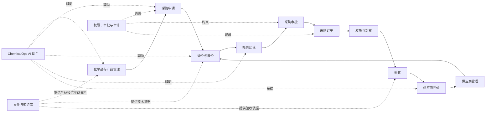
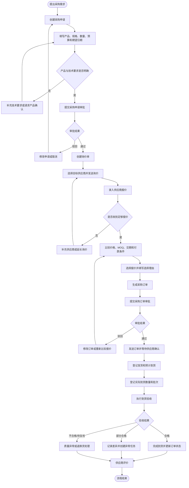
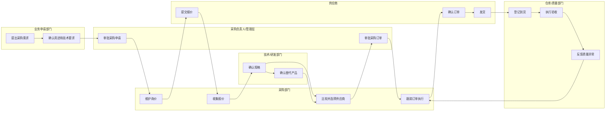
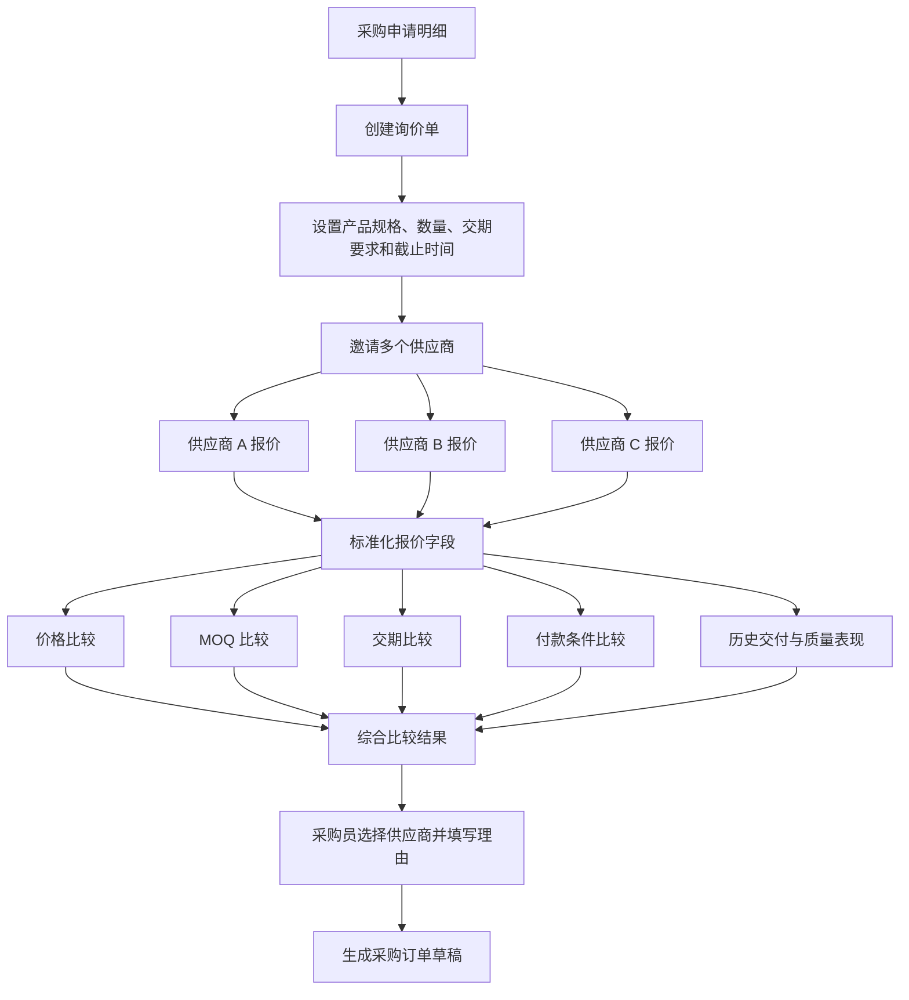
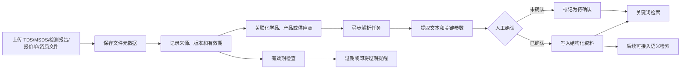
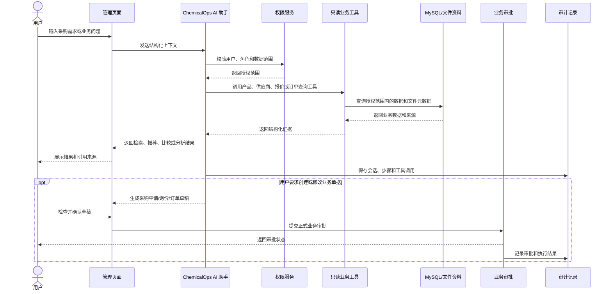
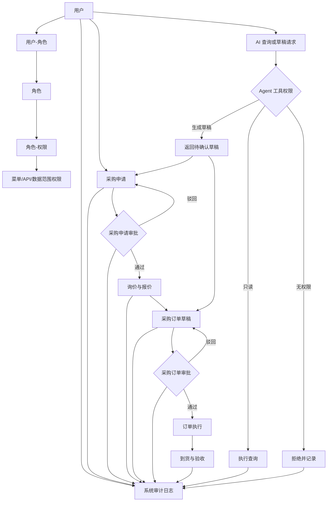
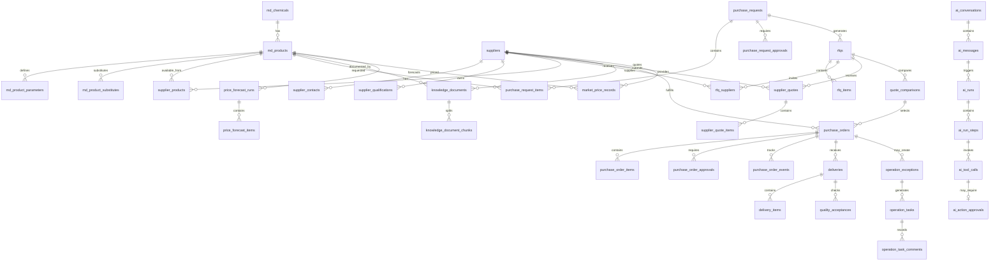

# ChemicalOps 业务流程与业务关系图

> 本文档根据 ChemicalOps 最新需求整理，项目定位为“管理系统为主、AI 为辅”的化工采购与供应商管理系统。
>
> 图表使用 Mermaid 编写，可在支持 Mermaid 的 Markdown 编辑器、GitHub 或文档平台中直接渲染。

## 1. 系统业务总览

ChemicalOps 的核心不是聊天，而是管理化工采购从需求提出到到货验收的完整过程。AI 作为嵌入式助手，帮助用户查询、提取、比较和生成草稿。



## 2. 采购申请到到货验收流程



## 3. 角色协作关系



## 4. 询价与报价比较流程

采购员可以将多家供应商的报价集中到一个询价单中，以统一维度进行比较。



## 5. 文件与知识库流程



文件内容存储在 MinIO，业务数据库保存文件元数据、关联关系和解析状态。AI 提取结果必须能够追溯到原始文件。

## 6. AI 辅助业务流程

AI 位于管理页面的辅助区域，可以读取用户有权限访问的业务数据，但不能绕过业务 API 直接修改数据库。



### 6.1 AI 典型使用场景

| 管理页面 | AI 辅助能力 |
|---|---|
| 产品管理 | 按名称、CAS、规格和技术参数检索产品 |
| 产品详情 | 提取 TDS/MSDS 参数，推荐替代产品 |
| 供应商管理 | 总结供应商资质、报价和交付表现 |
| 采购申请 | 从自然语言生成采购申请草稿 |
| 询价管理 | 推荐符合条件的供应商 |
| 报价比较 | 自动总结价格、MOQ、交期和付款条件差异 |
| 采购订单 | 生成订单草稿并检查字段完整性 |
| 运营看板 | 分析逾期、短交、质量和文件异常 |
| 报表中心 | 生成采购分析报告和价格趋势摘要 |

## 7. 权限、审批与审计关系



## 8. 核心业务实体关系



## 9. MVP 页面与业务流程对应关系

| 页面 | 对应业务 |
|---|---|
| 首页采购运营看板 | 采购金额、订单状态、交付异常、供应商表现 |
| 化学品和产品管理 | 化学品、规格、参数、替代关系 |
| 文件与知识库 | TDS、MSDS、检测报告、报价单和资质 |
| 供应商管理 | 供应商档案、联系人、资质、可供应产品 |
| 采购申请 | 需求提出、明细管理和审批 |
| 询价管理 | 询价单和供应商邀请 |
| 报价比较 | 多供应商报价对比和供应商选择 |
| 采购订单 | 订单生成、审批和状态跟踪 |
| 到货验收 | 发货、到货、验收和异常 |
| 供应商评价 | 价格、交付、质量和服务评价 |
| ChemicalOps AI 工作台 | 产品检索、推荐、比较和报告生成 |
| AI 运行和审批页 | AI 工具调用、草稿和审批记录 |
| 审计日志 | 用户操作、文件访问和业务变更追踪 |

## 10. 业务闭环摘要

```text
产品与化学品资料维护
  → 供应商和资质维护
  → 提出采购申请
  → 申请审批
  → 创建询价并收集报价
  → 比较价格、MOQ、交期和供应商表现
  → 选择供应商
  → 采购订单审批
  → 发货与到货登记
  → 验收与异常处理
  → 供应商评价
  → 价格、交付和质量历史沉淀

AI 在各个页面提供检索、提取、推荐、比较和报告辅助；
涉及正式写入的操作必须由用户确认并经过系统审批。
```
