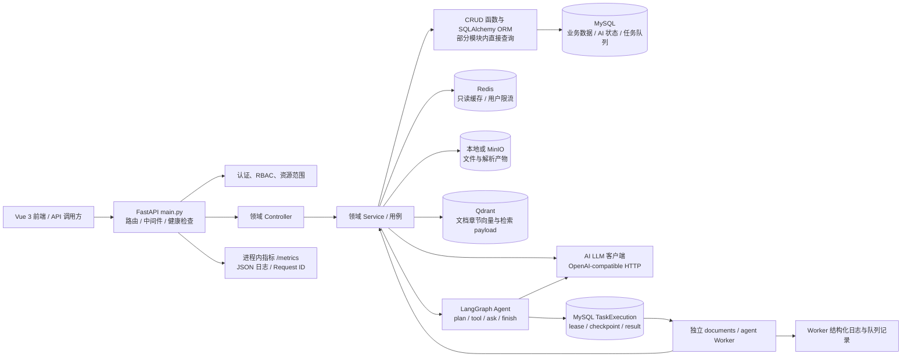

# ChemicalOps 后端工程化升级：第一阶段代码审计

## 审计结论

仓库已实现按领域模块组织的 FastAPI 后端、SQLAlchemy/MySQL、RBAC 与资源范围校验、MySQL 持久任务队列、Redis Cache Aside 与可选 Lua 限流、OpenAI-compatible 多模型 profile、LangGraph 只读 Agent、MinIO/Qdrant 文档知识库，以及 Prometheus 指标和可选 OpenTelemetry/Prometheus/Grafana/Jaeger 配置。上一轮运行验收中已产生真实 LLM/Agent/Worker 指标，并在 Jaeger 查到关联 trace。

本次目标中的若干基础功能并非待从零开发；尚未完成的是生产级边界与可重复证据：领域服务仍自行提交事务；Redis 限流默认关闭且是请求数限流，不是并发许可；模型适配目前限于 OpenAI-compatible，profile、熔断和并发额度是 API 进程/事件循环内状态；Worker 跨主机旧进程无法由当前节点确定性核验；MinIO/MySQL/Qdrant 无跨系统原子事务；缺少覆盖代表性 MySQL 数据、业务 API、队列积压和模型网络的统一性能基线。

本审计依据当前仓库代码、测试、部署配置与已有运行证据。没有在本次执行 pytest、故障注入或压测；历史测试和上一轮本地验收不能推导生产表现。

## 1. 当前架构图

业务表与任务/执行状态以 MySQL 为权威；Redis 当前不承载任务队列或持久会话状态。MinIO/本地文件、MySQL 文档元数据和 Qdrant 向量索引是分开的存储边界，没有跨存储事务。

## 2. 已实现功能及代码位置

| 能力 | 当前实现（代码位置） | 审计判断 |
| --- | --- | --- |
| 应用入口与领域路由 | `backend/app/main.py`；`backend/app/modules/*/controller.py` | 入口集中注册采购、供应商、库存、财务、文件、AI 等路由。领域模块普遍按 `controller.py`、`service.py`、`crud.py`、`model.py`、`schema.py` 划分，但不是强制统一的 Repository/Unit of Work 架构。 |
| Session 与连接池 | `backend/app/core/db.py` | 单个 HTTP 请求依赖创建并关闭 Session；引擎设置 `pool_pre_ping`、连接回收、池大小/溢出和慢 SQL 摘要日志。依赖只负责关闭，不统一 commit/rollback。 |
| 业务事务 | 各模块 `service.py`，例如 `purchase_requests/service.py`、`inventory/service.py`、`finance/service.py`；队列 `task_queue/service.py` | 不少服务函数自行 `commit()`，失败分支自行 rollback；也有调用方拥有事务、子函数 flush 的队列模式。提交边界需按用例逐个梳理，当前不能仅从目录结构推断所有模块遵循同一事务规则。 |
| 身份认证与 RBAC | `backend/app/core/auth.py`；`backend/app/modules/system/{controller,service,crud,model}.py` | `get_current_user` 校验身份，`require_permission()` 校验权限码；角色/权限通过用户角色关联读取。资源行级范围由领域服务继续实施，而非只有路由权限。 |
| 资源权限与数据隔离 | `backend/app/modules/ai/agent_tools.py`；`backend/app/modules/inventory/service.py`；`backend/app/modules/files/service.py`；各采购/供应商/财务服务 | Agent 询价按发起人或角色收窄，库存复用可访问仓库范围，附件下载同时检查文件访问级别及关联业务资源。用户/供应商/部门等隔离逻辑分布于领域代码。模型中未看到统一租户维度；不要把当前权限结构表述为已完成多租户隔离。 |
| Redis 缓存 | `backend/app/core/cache.py`、`redis_client.py`；`backend/app/modules/products/controller.py` 的商品详情；`backend/app/modules/ai/agent_tools.py` 的商品候选；`conversation_store.py` 的用户会话历史 | 已实现 Cache Aside、Pydantic JSON 校验、TTL、命名空间版本键、提交后失效、失效失败告警/指标和 Redis 故障时读缓存回源。只读缓存范围有限；写事务中绕过缓存。缓存命名空间按主数据空间/历史空间隔离，身份敏感的会话 key 包含用户和会话标识。 |
| Redis 原子限流 | `backend/app/core/rate_limit.py`、`redis_client.py`；`backend/app/modules/ai/controller.py`；文档任务入口 | 使用 Lua 固定窗口计数，按用户及 AI/文档类别分开限额；Redis 不可用时返回 503，避免分进程内存限流造成集群绕过。它限制窗口请求数，不限制同时运行数；当前限流开关默认关闭。 |
| 持久任务队列 | `backend/app/modules/task_queue/{model,service,worker,adapters,execution,processes}.py`；`scripts/run_task_worker.py` | MySQL `TaskExecution` 保存状态、attempt、lease、心跳、checkpoint、fencing token 与错误码；claim 使用行锁 `SKIP LOCKED`，心跳按 token 更新，finish 检查租约。可重试任务有最大次数配置和 30/120 秒退避。Worker 有队列并发配置及独立进程监督。 |
| Agent 执行 | `backend/app/modules/ai/agent_runtime.py`、`agent_tools.py`、`agent_prompt.py`、`schema.py` | 通过 LangGraph `StateGraph` 编排受约束的只读工具；工具参数由 Pydantic 约束，执行服务端核验对象、权限与证据。任务/轨迹/checkpoint 写入 MySQL。编译处未传入持久化 LangGraph checkpointer；持久恢复由应用自有任务快照承担。 |
| 模型调用与治理 | `backend/app/modules/ai/{gateway,llm}.py`；配置在 `backend/app/core/config.py` | 支持命名 model profile、OpenAI-compatible HTTP 调用、profile fallback、有限重试、超时、同步 JSON Schema、SSE、熔断及进程内按用户/模型并发 semaphore；流式已有输出首 token 后不重试的保护。仍只支持 `openai_compatible` provider；熔断/semaphore 不跨进程；token usage 仅作为进程内指标，不能视为持久成本账本；流式 usage 依赖上游支持并需启用。Tool Calling 兼容矩阵需单独验证，当前 Agent 走自定义受约束动作协议与工具执行，不等于已实现供应商通用 Tool Calling。 |
| 文档解析与对象存储 | `backend/app/modules/files/{controller,service,parser,mineru,scanner}.py`；`backend/app/modules/jobs/technical_documents.py` | 普通文件支持扩展名/MIME/文件签名/大小校验与安全扫描，存储支持本地及 MinIO/S3；解析覆盖多种文件类型及 MinerU。文件对象和 MySQL 元数据分阶段写入，不构成原子事务；解析有 stale 状态恢复入口。 |
| 知识库与向量同步 | `backend/app/modules/doc_kb/{service,vector_store,retrieve}.py`；`scripts/parse_tds_msds.py`、`scripts/embed_sections.py` | MySQL 保存文档章节，Qdrant 存向量及检索 payload；检索在向量失败时有桥接查询回退。向量写入代码使用 generation/条件写入避免旧写覆盖，并要求支持条件写入的 Qdrant 版本。系统级“已发布文档+权限版本+索引代次”的一致状态仍需按具体数据模型继续核查，不能等同为跨系统原子同步。 |
| 日志、指标、追踪与健康 | `backend/app/core/{observability,telemetry,task_metrics}.py`、`backend/app/main.py`、`deploy/docker-compose.observability.yml`、`deploy/observability/` | 有 JSON 日志、Request/Trace ID、API/DB/Redis/LLM/Agent 指标、队列 MySQL 快照、Prometheus `/metrics`、Grafana 看板、OTLP/HTTP OTel instrumentation 及 Jaeger Compose。Worker 任务带 W3C context，Agent/工具/LLM 建立子 span；上一轮验收查到 API、Agent、Worker、LLM 关联 trace。LLM/API/Agent 指标仍是进程内累计值；任务队列指标来自共享 MySQL 快照。`.env.example` 默认关闭 OTel，需配置并重启才能导出。 |
| 自动化测试与 CI | `tests/`；`.github/workflows/ci.yml`；`pytest.ini` | 覆盖 Redis、任务队列、权限、文档/RAG、AI、流式输出、故障注入等；CI 包含数据库迁移升级、compileall、依赖与代码扫描、pytest 和 smoke load。部分 Redis 真服务测试受 `TEST_REDIS_URL` 控制；本次未执行 CI 或测试。 |
| 本地依赖部署 | `deploy/compose.yaml`、`deploy/docker-compose.{redis,qdrant,minio}.yml`、`deploy/README.md` | Redis/Qdrant/MinIO 有本地 Compose 配置；Redis 示例关闭持久化，适合作为可重建缓存/限流基础设施，而非持久业务队列。Compose 文件中的组件不等于已验证的生产 HA 部署。 |

### Redis 已有样本的正确解读

`docs/evidence/redis-validation.json` 记录了 5,001 条合成产品、内存 SQLite、本机 Redis、单线程 100 次 CAS 精确查询：缓存组 99 次命中、1 次未命中，SELECT 由 300 次降至 3 次；该样本的平均耗时分别约 2.20ms 和 1.36ms，P95 分别约 3.03ms 和 2.04ms。该数据可复现其测试条件下的缓存行为，不代表 MySQL/生产负载结果，也不能作为业务效率提升指标。详细范围见 `docs/Redis接入与验证.md`。

## 3. 关键风险与技术债

以下“风险”由对应实现边界推导；未声称发生过线上故障。

| 优先级 | 风险/债务 | 代码依据与影响 |
| --- | --- | --- |
| P0 | Worker 恢复对远程主机旧进程无法做确定性存活验证 | `task_queue/worker.py::recover` 仅当 checkpoint 的 host 等于本机时查询 PID；无 PID 时也作为 stopped。若 host 不同且 lease 过期，代码会进入隔离失败路径而不重试，保守地避免重复跑，但需要告警和人工恢复流程。fencing token 能阻止旧执行提交队列状态，不能撤销已发出的外部副作用。 |
| P0 | Agent 任务恢复与业务副作用的 exactly-once 边界需要验证 | `agent_runtime.py` 自定义 checkpoint 和 `task_queue` lease/fencing 能保护任务状态；模型调用结果、工具成功、checkpoint 落库之间仍有进程崩溃窗口。只读工具降低业务副作用风险，但外部模型可能重复计费。新增写工具前必须有领域幂等键、确认快照和副作用后检查点设计。 |
| 已排除 | 幂等回放与撤权组合风险 | 对照 `core/idempotency.py::dispatch` 与 `system/service.py` 后，用户角色变更会递增 `token_version`，角色权限/状态变更会调用 `_invalidate_role_members()` 递增成员 token_version；幂等中间件会检查该版本，因此已存在撤权后的旧 token 回放防护。保留回归测试以防未来变更破坏该保证。 |
| P1 | AI 异步请求在外部等待期间持有同步数据库事务/连接 | `ai/service.py::chat_for_user` 与 `stream_chat_for_user` 先调用 `conversation_store.ensure_conversation()`（查询或 flush 新会话），再 await 意图模型、文档 embedding/模型和响应模型；相关数据库事务直到后续显式 commit 或请求结束才结束。`get_db()` 在 endpoint 结束时才 close。高并发或上游慢时会让数据库连接被模型/网络等待占用，并可能让新会话插入事务长时间未提交。需要把数据库读写分成短事务，在外部 await 前提交/结束事务，且避免在异步路由中执行可能阻塞事件循环的长数据库操作。 |
| P2 | 幂等记录过期后没有后台清理路径 | `core/idempotency.py` 只在同一 actor 再次使用同一个 key 时删除过期记录；`sys_idempotency_records.expires_at` 有索引，但在应用和脚本中未发现定期清理器。大量使用一次性 key 时，记录会在逻辑过期后继续留在 MySQL，造成表与索引持续增长。 |
| P1 | 事务所有权不统一 | `get_db()` 只 close；多个领域 service 直接 commit。调用链跨模块时若子服务先提交，外层不能再整体回滚。重构时需围绕业务用例界定单一事务所有者，优先从跨域写入和队列/业务状态同事务用例开始。 |
| P1 | Gateway 多进程治理及模型兼容性 | `gateway.py` 已有命名 profile、fallback、熔断、用户/模型并发 semaphore，但状态按 API 进程/事件循环隔离；只接受 `openai_compatible`，且不同模型的 Tool Calling、JSON Schema、SSE 兼容性没有统一 contract 矩阵。对请求已到达上游但响应中断的情况，重试可能重复计费；当前不能承诺 exactly-once。 |
| P1 | LLM Token 成本账本不足 | `_record_usage()` 将上游返回的 usage 记入进程内 metrics，不持久化到按用户/请求维度的用量账本，也没有成本单价/账单核对。流式 usage 取决于 `stream_usage` 和上游 SSE usage chunk。 |
| P1 | 指标多实例聚合与告警闭环 | OTel/Prometheus/Grafana/Jaeger 已接入并有本地 trace 验收；但 API/LLM/Agent 指标是进程内 registry，多 API 实例须逐实例抓取或实现聚合。队列状态/耗时是共享数据库快照/窗口均值，不等价于原生 histogram。还需核对告警规则、通知与故障处置闭环；不能把本地链路验收写成生产监控保障。 |
| P1 | 数据访问边界并非强制 | 有 `crud.py` 的模块同时也有 Service/Agent 工具直接导入跨模块 ORM model 与服务函数。普通查询容易将 SQL、权限范围和用例逻辑混合，后续拆分要从高风险跨域事务、热点查询和 AI 资源访问开始，不宜机械创建全量 Repository。 |
| P1 | 多租户隔离不能由缓存前缀替代 | 缓存使用 app_env/版本/space/digest，AI 历史身份参与 key；当前 schema 主要是部门/供应商绑定而未见统一 tenant_id。若未来扩展多组织，需在数据访问和缓存身份上加入租户范围并做跨租户回归，不能只改 Redis key。 |
| P2 | 缓存失效采用命名空间版本推进 | 产品/化学品/单位任一 ORM 写操作会使 `product_catalog` 整体切换版本，正确性简单但写频繁时命中率可能受影响。绕过 ORM 的原生 SQL/外部脚本不会触发 Session 事件，旧值依赖 TTL/手工失效。需用真实 MySQL 读写比评估，不建议无数据就换成复杂失效机制。 |
| P2 | 任务调度能力暂不包含显式优先级与公平性 | `claim_next` 按 `created_at,id` 排序；数据模型没有 priority 字段。长队列/突发 AI 任务下需观测等待时间并评估按队列分开并发配额、优先级和配额公平性。 |
| P2 | 外部存储与 MySQL 不具备原子提交 | 文件服务先存对象再保存元数据的失败窗口、MySQL/Qdrant 的分阶段索引需依赖补偿、可重跑与状态对账。已有 hash、generation 和 stale parse 等措施，但仍应通过故障注入覆盖对象成功/DB失败、DB成功/向量写失败和迟到写。 |
| P2 | 性能基线覆盖仍不完整 | 有 Redis/SQLite CAS 微基准、MySQL+Redis 商品详情 API 200 次/并发 10 的单机报告，以及本地模型/LLM 指标验收；但尚无同一业务场景下完整冷/热对照、代表性 MySQL 数据、Worker 积压与模型网络分项的统一报告。已有报告不能推导生产容量或普遍优化比例。 |

## 4. 推荐改造方案与优先级

### P0：先补可靠性边界和审计证据

- 维持 MySQL 队列，不替换 RabbitMQ/Celery。补足租约恢复的主机可达性/进程监督契约、隔离告警和可操作状态；明确恢复状态机与旧 Worker fencing 行为。
- 为队列状态转移、执行错误、租约过期、隔离状态建立统一可查询指标/日志，并做“worker 崩溃后可重领”与“无法证实旧进程停止时不自动重跑”的测试。
- 逐条梳理 Agent 任务崩溃点和非幂等边界；当前只读工具不应因未来能力规划被当成现成的业务写幂等保证。

### P1：补齐统一模型服务与事务边界

- 在 `backend/app/modules/ai/llm.py` 外形成 Provider/Model 配置与统一请求协议，先保留现有 OpenAI-compatible HTTP 实现作为默认适配器；不要让 Agent/业务服务选择厂商 SDK。
- 在现有 profile、超时、有限重试、熔断、fallback 和并发控制上补充模型能力 contract、错误分类与 request/attempt 关联；如需多实例全局配额，再评估 Redis 共享限额。仅对可安全重放的调用重试，不承诺 Exactly Once。
- 对流式取消使用上下文资源关闭；规范 `usage` chunk、finish reason、structured output、tool call 的兼容能力。对供应商差异通过 Mock contract tests 验证，真实模型测试单独手动/受控执行。
- 用用例级事务边界逐步收敛 commit。队列 enqueue 与业务变更应由同一事务持有者提交；被调用的领域服务使用 flush，数据库事务中不等待模型或对象存储网络调用。

### P2：扩展现有 Redis 与观测，不重复建设

- 商品详情/目录与热点只读结果继续使用已有 Cache Aside 机制；先审计还有哪些高频只读接口确有收益，再逐个接入。明确权限过滤在缓存前后的位置，禁止将库存/报价等易变或权限相关结果直接缓存。
- 维持 Redis 限流故障 503 行为；增加并发任务控制时复用 Worker 配额/专门信号量，不以请求限流替代运行并发控制。
- 已有指标、Prometheus/Grafana、OTel/Jaeger 和跨进程 trace；下一步校准错误率/任务状态/TTFT/Token 口径，补上告警与通知处置，并为多 API 实例定义指标聚合策略。
- 为真实业务 API、MySQL 代表性数据、缓存冷热、队列积压和受控模型请求建立独立可复现负载基线；分别报告测试环境、并发、数据集、服务版本、模型和网络条件。

## 5. 改造优先级、范围及测试计划

| 阶段 | 当前状态 | 目标与建议改动 | 主要代码位置 | 测试计划 / 放行证据 |
| --- | --- | --- | --- | --- |
| 阶段一：审计 | **本次完成（静态审计）** | 固化架构现状、风险、已有测试与实施顺序；不改业务代码。 | 本文；审计依据见上表路径 | 交叉核对代码、CI、配置及现有测试定义；本次未运行测试/压测。 |
| 阶段二：Redis 缓存与限流补强 | **部分实现** | 已有 Cache Aside、TTL、写后失效、Lua 固定窗口限流；限流默认关闭。基于已有基准补热点只读接口、确认权限隔离和缓存失效覆盖；完善冷/热对照及 DB 查询、P50/P95 数据。 | `core/cache.py`、`core/rate_limit.py`、`core/redis_client.py`、`products/controller.py`、`ai/agent_tools.py`、`ai/conversation_store.py`、`config.py` | `tests/test_redis_features.py` 有 Redis 集成/故障、事务失效、并发限流、用户隔离覆盖定义；本次未运行。分别保留 SQLite 微基准与 MySQL+Redis API 报告，记录版本、记录数、并发、环境及冷热状态；不得把单机报告外推到生产。 |
| 阶段三：统一 LLM Gateway | **核心治理已实现，兼容与用量口径待补** | 保持 profile、超时、有限重试、熔断、fallback、并发与 SSE 实现；补 provider 能力 contract、可重试/可能重复计费边界及可追踪的用量账本。 | `ai/{gateway,llm}.py`、`core/config.py`、`ai/routing.py`、`ai/agent_runtime.py`、`ai/service.py` | 现有 Mock 测试覆盖部分超时/状态码/SSE/结构化输出和熔断/并发路径；本次未运行。逐模型验证 Tool Calling、JSON Schema、流式和 usage 支持矩阵；真实模型集成与默认 pytest 分开，记录模型/网络条件。 |
| 阶段四：MySQL 任务可靠性 | **队列机制已实现，需完成全场景运行验证** | 保留现队列；优先验证崩溃恢复、跨主机隔离、checkpoint 与外部副作用窗口、告警和人工处置；目前按队列 FIFO，无优先级/跨队列公平调度。 | `task_queue/{model,service,worker,adapters,execution,processes}.py`、`ai/agent_runtime.py`、`jobs/technical_documents.py`、`scripts/run_task_worker.py` | 扩展/运行 `tests/test_task_queue_supervision.py`、`test_task_queue_processes.py`、`test_task_queue_delivery.py`、`test_database_task_worker.py`、`test_agent_queue_runtime.py`：双 Worker claim、崩溃/心跳丢失/取消、租约过期、重试上限、跨主机隔离、fencing、checkpoint 与副作用窗口。记录故障注入的任务最终状态和是否重放。 |
| 阶段五：可观测性与压测 | **基础观测已实现并有本地链路验收；性能/告警闭环未完成** | 保留已接入的指标、OTel、Prometheus/Grafana/Jaeger；补多实例指标策略、告警处置和覆盖业务 API/队列的可复现压测。 | `core/{observability,telemetry,task_metrics}.py`、`core/db.py`、`main.py`、`task_queue/*`、`ai/llm.py`、`ai/agent_runtime.py`、`scripts/run_load_test.py`、`deploy/observability/`、`.github/workflows/ci.yml` | 已有 `tests/test_observability.py`、`tests/test_failure_injection.py` 定义及真实模型/trace/API load evidence；本次未运行测试。负载分别覆盖业务 API、缓存冷热、任务入队/积压、LLM Mock 和 Agent Mock；受控真实模型另行执行。报告 QPS、P50/P95/P99、错误率、连接池、队列等待、命中率、查询数、TTFT/Token，并记录测试条件。 |

### 性能数据采集口径

每个比较至少固定数据集及版本、API/查询输入、并发和持续时间、硬件/容器限制、数据库与 Redis 版本、缓存冷热状态。P50/P95 应按成功请求单独计算并同时报告错误率；数据库查询数使用 SQLAlchemy 事件或数据库统计采集。LLM 测试需把模型推理时间与客户端/网络时间区分，模型 Mock 结果不能代表真实模型性能。阶段二开始前应重新运行 Redis 基线；已有 JSON 样本只作为历史测试基准，不外推。

## 6. 现有测试与评估入口

| 主题 | 现有测试/脚本 |
| --- | --- |
| Redis 缓存与限流 | `tests/test_redis_features.py`（包含真实 Redis 可选集成；配置 `TEST_REDIS_URL` 才启用） |
| 任务领取、恢复与进程监督 | `tests/test_task_queue_delivery.py`、`tests/test_task_queue_supervision.py`、`tests/test_task_queue_processes.py`、`tests/test_database_task_worker.py`、`tests/test_task_queue_config.py` |
| Agent Runtime 与队列 | `tests/test_agent_runtime.py`、`tests/test_agent_queue_runtime.py`、`tests/test_agent_task_evaluation.py` |
| LLM SSE 与 AI 基础 | `tests/test_ai_llm_stream.py`、`tests/test_ai_service.py`、`tests/test_ai_structured_output.py`、`tests/test_ai_routing.py` |
| 文档解析/向量/故障 | `tests/test_file_parser.py`、`tests/test_file_parse_recovery.py`、`tests/test_technical_document_pipeline.py`、`tests/test_document_vector_fencing.py`、`tests/test_doc_rag.py`、`tests/test_failure_injection.py` |
| 权限和隔离 | `tests/test_rbac_separation.py`、`tests/test_ai_query_isolation.py`、`tests/test_supplier_portal_api.py`、`tests/test_files_api.py` |
| 幂等回放权限边界 | `tests/test_idempotency_api.py` 当前覆盖同请求回放、请求体冲突、必需策略和过期 key 复用；`tests/test_rbac_separation.py` 覆盖权限变更对现存 token 的即时影响，但二者尚未组合验证“先成功写入、撤销权限、再以相同 key 回放”。 |
| 指标与并发 | `tests/test_observability.py`、`tests/test_concurrency.py`、`tests/test_row_lock_guards.py` |
| CI 与负载脚本 | `.github/workflows/ci.yml`、`scripts/run_load_test.py`、`scripts/queue_reliability_metrics.py` |

以上是代码中存在的测试入口，不代表本次审计已执行，也不代表所有集成场景均已覆盖。

## 7. 审计范围说明

检查了应用入口、核心配置/数据库/认证/幂等/缓存/限流/可观测性模块，以及主要业务模块、AI/Agent、任务队列、文件/知识库/调度等实现；同时核对 Redis/可观测性运行说明、迁移目录、Compose 配置、测试清单、CI 与已有验收证据。未在本阶段运行测试、故障注入或压测。并发正确性与故障恢复判断基于代码和已有测试定义；运行证据仅采用仓库内明确保存的结果及上一轮本地观测验收，不外推为生产表现。
