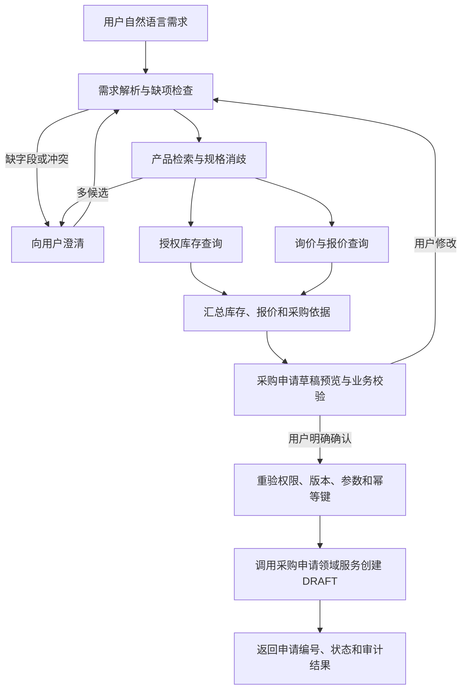

# 采购 Agent 建设路线图与多智能体方案

## 1. 目标与范围

建设一个面向采购人员的场景化 Agent：用户用自然语言提出采购需求，系统逐步澄清产品和数量等信息，查询授权范围内的库存与报价，生成有依据、可复核的采购申请草稿；用户确认后，系统通过现有采购业务服务创建 `DRAFT` 申请。

Agent 负责需求理解、信息整理、受控工具编排和草稿建议。业务状态、权限、数量/金额规则、幂等和事务由后端领域服务负责。审批、正式下单、库存过账和付款保留在各自正式业务流程中，不因聊天确认而自动取得这些动作的授权。

图片中的“Requirement、Product、Market、Quotation”可作为目标能力分解，不代表这些专门 Agent 或行情预测当前已经实现。

## 2. 当前基础与边界

| 能力 | 当前基础 | 本计划中的定位 |
| --- | --- | --- |
| 自然语言业务查询 | Text2SQL 使用白名单 `QueryPlan`、ORM 查询和权限校验 | 继续用于授权范围内的汇总和明细查询，不开放模型原始 SQL |
| 采购只读 Agent | 已有产品检索、询价明细定位、库存查询、报价比较四个只读工具 | 复用工具契约、对象消歧、来源轨迹和权限重检 |
| 多步骤任务 | Agent 有 `plan/execute` 控制循环；另有多意图只读任务拆解、依赖执行和部分结果 | 复用现有任务模型和执行基础，不将多意图拆解误称为多个自主 Agent |
| 采购申请建议 | `/purchase-request-draft/preview` 可整理候选字段并校验，但不创建或提交申请 | 在此基础上增加确认快照及确认后创建草稿 |
| 异步执行和恢复 | 默认 MySQL 持久任务队列、独立 Worker 和任务执行快照/checkpoint | 先验证现有恢复边界；只有需求和故障验证证明不足时才引入额外持久 Checkpointer |
| 正式业务写入 | 采购、订单、库存等领域接口各自维护业务规则与授权 | Agent 写工具仅调用领域服务，不直接写 ORM 或绕过正式状态流转 |

当前实现细节以 [Agent 只读任务运行说明](Agent只读任务运行说明.md)、[采购 Agent 业务规则与验收用例](Agent采购MVP业务规则与验收用例.md)、[AI 查询图表设计](AI问答图表设计.md) 和后端代码为准。

## 3. 是否采用 Multi-Agent

### 决策

**首期不建设多个能自由对话、自由选工具或互相委派的自主 Agent。**首期采用“单一采购 Supervisor + 显式工作流节点/受控专家步骤”的分层编排。实现上，需求理解、产品匹配、库存/报价查询、方案汇总可以先是同一 Agent Runtime 下的独立节点或有 Schema 的组件，不必各自成为独立 Agent 服务。

项目已经有单任务 `plan/execute` 和多意图拆解。把现有步骤拆成四个有独立记忆、开放式工具权限的 Agent，会增加状态同步、重复调用、费用、越权和故障恢复的难度，却未必增加业务价值。

### 后续需要时采用的类型

当市场分析、产品技术匹配等工作出现独立的数据源、明确的专业边界或可并行的长任务时，可采用：

> **Supervisor–Specialist（主管/专家）模式，使用有向工作流进行顺序或受控并行编排；最终写入通过单独的确认节点和确定性领域服务完成。**

候选专家职责如下。它们是未来可拆分的职责，不代表当前已有对应 Agent。

| 角色/节点 | 职责 | 可用数据和工具 | 不应拥有的能力 |
| --- | --- | --- | --- |
| Requirement Analyst | 提取物料、规格、数量、单位、用途、预算、期望日期；标记缺项和冲突 | 用户输入、会话上下文、结构化 Schema | 不猜产品 ID、数量、预算或用途；不写业务数据 |
| Product & Inventory Specialist | 检索产品目录，处理多候选消歧，查询用户可访问的库存 | 产品目录、现有只读库存工具 | 不扩大仓库范围；不预留或扣减库存 |
| Market & Quotation Specialist | 定位询价，核验报价有效性和可比条件，整理来源及价格区间 | 现有询价/报价只读工具；未来经批准的数据服务 | 不定标、不承诺供应、不把不可比报价强行排序 |
| Proposal Composer | 汇总已验证的需求和证据，生成采购方案与申请草稿预览 | 前序结构化结果和来源引用 | 不增加证据未支持的事实；不能审批或下单 |
| Confirmation / Write Handler | 展示确定的动作与参数；用户确认后再次鉴权并调用领域服务 | 一次性确认记录、领域服务、幂等记录 | 不能由模型决定“用户已确认”；不能绕过服务端权限/状态检查 |

不要求每个角色都必须调用一个 LLM。确定性强的字段校验、金额计算、库存汇总、报价可比性判断应优先使用后端代码；只有需求理解、歧义解释、证据摘要等语言任务才交给模型。

### 什么时候再拆成多个独立 Agent

满足以下至少一项且单一工作流已难以维护时，再拆分独立专家 Agent：

- 专家依赖不同数据源或知识域，需要不同的独立权限边界。
- 两个或多个只读分析可安全并行，且并行能明显缩短响应时间。
- 单一 Prompt/Schema 难以在独立评测中达到可接受的准确性。
- 不同专家需要不同模型、预算、超时、重试或版本发布节奏。

即使拆分，也采用有界输入/输出 Schema、显式依赖和统一 Supervisor；禁止 Agent 间无限循环或自行创建新 Agent。共享的事实以结构化证据及来源 ID 传递，不以自由文本摘要作为授权或写入依据。

## 4. 目标工作流

库存和报价在对象已核验、权限通过后可并行查询；一旦前置查询存在歧义，就暂停并向用户澄清。每次续跑重新检查权限，并重新查询对写入决策有时效影响的数据。

## 5. 分阶段落地

### 阶段 A：采购助理只读闭环

**复用**现有需求理解、产品目录、库存、询价和报价工具，补齐统一的端到端任务体验。

- 从自然语言中提取产品、规格、数量、单位、用途、预算、交期和技术要求。
- 缺少创建申请所需字段时逐项追问；产品/询价多候选时由用户选择，不能自动挑第一项。
- 按当前用户权限检索库存和报价，明确数据时间、计量单位、有效期和不可比条件。
- 生成采购建议时区分“系统事实”“用户输入”和“模型建议”，所有库存/报价结论关联到工具证据。
- 先展示采购方案和预览，不写采购申请。

**验收门槛**：字段抽取、对象匹配、工具选择、权限拒绝、证据引用、追问续跑分别评测；模糊规格不得静默选定；工具结果不能被模型改写成不同的数量或价格。

### 阶段 B：确认后创建采购申请草稿

这是首个 Agent 写操作，写入范围仅限可审核的采购申请 `DRAFT`。

- 复用现有采购申请预览 Schema 和业务校验，不另造一套申请规则。
- 预览中展示动作、产品/名称、数量、单位、用途、预算、交期、来源和警告。
- 保存确认快照：用户、动作、参数 hash、业务对象/版本、有效期、一次性确认标识和预览版本。
- 用户对明确预览执行确认后，服务端重查当前用户权限、归属、业务版本、必填字段和状态，再调用采购申请领域服务。
- 用业务幂等键和确认记录防止重复点击、HTTP 重试或 Worker 恢复导致重复创建。
- 记录成功结果、申请编号和审计信息；未确认、撤权、过期、参数变化或版本冲突时拒绝写入并要求重新预览。
- 创建草稿后停止；审批仍进入现有审批流程。

**验收门槛**：未确认无写入；同一确认只创建一份；撤权和过期确认失效；并发确认及 Worker 崩溃恢复不产生重复草稿；取消与确认竞争有确定结果。

**当前验收结果**：隔离 MySQL 验收已通过 5 项，覆盖真实采购申请服务写入申请、明细和审计记录并与确认记录同事务提交；flush 后提交失败时整体回滚；并发确认只创建一份草稿；领域失败后回滚并允许重试；提交成功但响应丢失后重试返回已保存结果。验收脚本为 `tests/test_ai_purchase_draft_mysql_acceptance.py`。该结果未覆盖进程崩溃后的采购确认恢复；确认接口本身同步消费一次性确认快照，后台 Worker 不执行草稿写入。

### 阶段 C：加强运行时与多 Agent 扩展能力

- 为工具统一维护 Schema 版本、风险、所需权限、超时、调用预算、日志和错误分类。
- 为工作流节点定义状态、输入/输出 Schema、重试条件和 checkpoint 版本迁移策略。
- 在模型响应、工具返回、确认和业务提交边界做故障注入，验证任务恢复及迟到响应隔离。
- 已为 Agent 增加单任务累计 Token 上限：调用前预留输入估算和输出上限，按模型 usage 结算；缺少 usage 时保守估算。每次模型调用后将用量保存到任务 payload 和队列 checkpoint，用户续问及任务恢复沿用已有账本。默认值为 `AGENT_MAX_TOTAL_TOKENS=65536`。
- 首先使用现有 MySQL 任务持久化；根据实测恢复需求评估持久 LangGraph Checkpointer。不要仅为贴合图片而增加 PostgreSQL 或双状态源。
- 若专家职责和数据域确实需要拆分，按 Supervisor–Specialist 模式逐个拆分，并以独立评测证明拆分带来的收益。

**验收门槛**：节点恢复不重放已完成副作用；旧 revision 不能覆盖新任务状态；所有 Agent 共享同一权限主体与可追踪的任务 ID；调用次数/模型费用有预算上限。累计 Token 预算和账本持久化已有 Gateway、Runtime、队列 checkpoint 测试；仍需补充“消耗部分预算后 Worker 中断，恢复后不清零且超限前拒绝模型调用”的端到端恢复验收。工具级超时、错误分类及节点恢复边界按实际风险逐项补充故障验收。

### 阶段 D：按业务风险扩展操作

每种新写操作单独评审业务流程，遵循“Agent 准备参数和证据—用户在正式入口确认—后端领域服务执行”的模式。

| 动作 | 建议放行顺序 | 主要控制 |
| --- | --- | --- |
| 修改/撤回未提交的采购申请草稿 | 草稿创建稳定后 | 版本号冲突检测、字段级差异预览、再次确认 |
| 创建询价方案/询价单 | 产品、供应商与邀请规则稳定后 | 供应商范围、报价截止时间、邀请对象复核；调用正式询价服务 |
| 提交采购申请审批 | 仅在用户拥有相应提交权限时，通过现有业务入口 | 提交人权限与状态机校验；不由模型代替审批 |
| 审批采购单 | 不作为首期 Agent 自动操作 | 审批人身份、职责分离、审批意见、正式审批工作流 |
| 正式下单 | 后续专项评审 | 已审批状态、有效中选报价、供应商与数量/价格复核、幂等和外部结果核对 |
| 入库/质检放行 | 后续专项评审 | 到货事实、质量数量、批次和仓库规则；不能依据聊天内容虚构实收数据 |
| 付款或财务过账 | 不纳入早期 Agent 写入 | 财务职责分离、凭证/额度校验、审计及外部支付对账 |

Agent 只能调用受控工具和既有领域服务；不得直接执行任意 SQL、修改 ORM 对象或将一次聊天确认提升为审批授权。

### 阶段 E：行情分析与价格预测

先提供可追溯的历史报价/采购成交汇总、有效期和规格口径说明。将“预测”作为独立后续项目：确认历史数据质量、物料可比性、币种/税费/交付条件、时间覆盖和样本偏差后，做时间外回测并报告误差区间。数据不足时只提供行情摘要，不输出伪精确预测值。

## 6. 横切安全与质量要求

- **最小权限**：每个专家步骤只拿完成任务所需的权限；每次工具调用和写入都以认证用户身份重新鉴权。
- **证据优先**：库存、价格、状态、日期和业务编号来自服务端数据；模型不得生成或改变事实值。
- **输入隔离**：用户文本、知识库文档、供应商资料和模型响应均视为不可信数据，不能覆盖系统规则或工具权限。
- **事务边界**：确认快照、幂等记录、领域写入和业务审计在规定事务边界内提交；模型网络调用不放在数据库事务中等待。
- **不确定写入**：若外部系统结果未知，不自动再次下单或过账；记录不确定状态并通过业务查询或人工核对恢复。
- **可观测性**：记录 task/thread/revision、计划节点、工具名称、参数摘要、证据引用、确认记录、领域服务结果和错误码；不记录密钥及不必要的敏感全文。
- **评测分层**：分别衡量需求字段、产品规格、数据查询、报价可比性、草稿正确性、权限拒绝、确认安全和故障恢复，不用一个总体准确率掩盖风险。

## 7. 推荐首期交付定义

首期交付为“**采购方案生成 + 人工确认后创建待审批草稿**”：Agent 可澄清需求、检索产品、查询授权库存和报价、整理证据并生成申请预览；用户确认后，系统通过现有采购申请服务创建一条 `DRAFT`。Agent 不审批、不正式下单、不登记到货、不执行入库或付款。

技术路线采用**单一 Supervisor + 有向工作流节点**。当前已有的多意图拆解属于受约束的任务分解，不要求包装成多智能体。待独立专家确有边界、并行或独立评测需求时，再增量引入 Supervisor–Specialist 多 Agent；写入始终经过确认节点和确定性业务服务。

## 8. 与现有改造任务的对应关系

实施优先级和依赖应继续维护在 [ChemicalOps 改造任务清单](ChemicalOps-改造任务清单.md)：真实采购领域服务事务与幂等的隔离 MySQL 验收已通过；Agent 运行时、权限/证据边界、分层评测和队列回归已通过当前测试集；累计 Token 预算已实现并通过 Gateway 与 checkpoint 写入测试。接下来优先补充预算在 Worker 中断恢复后的端到端验收，并使用真实标注业务样本评估效果；合成样本只用于流程和规则验证。本文件定义采购 Agent 的目标场景和多智能体决策，不替代相关代码验收或任务状态记录。
