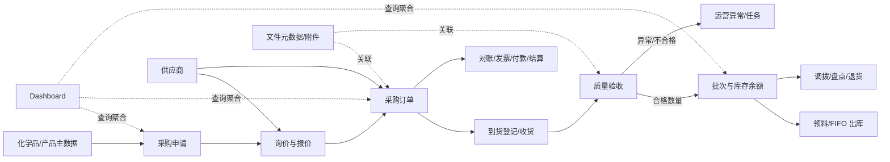
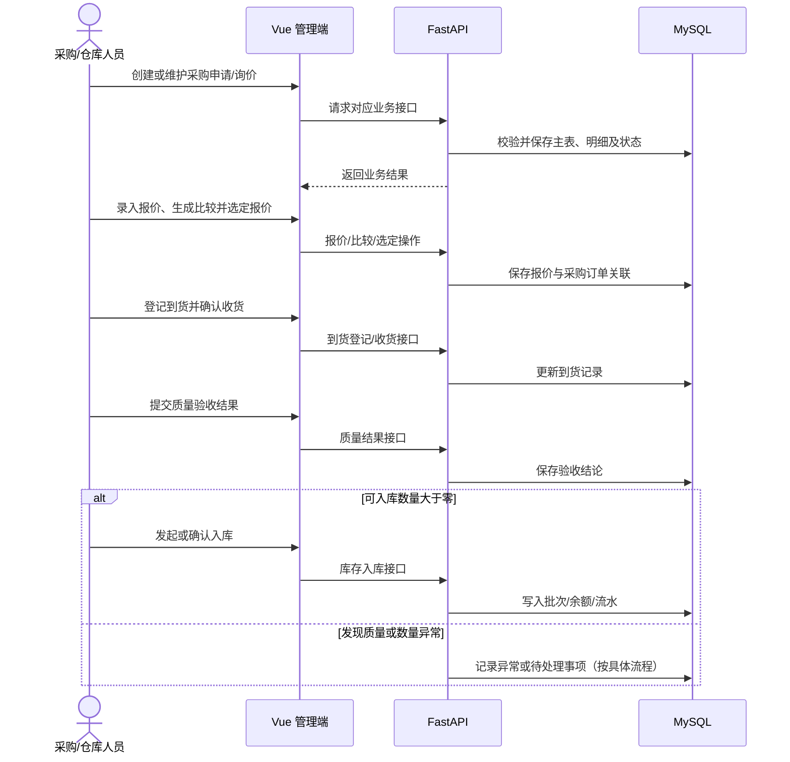
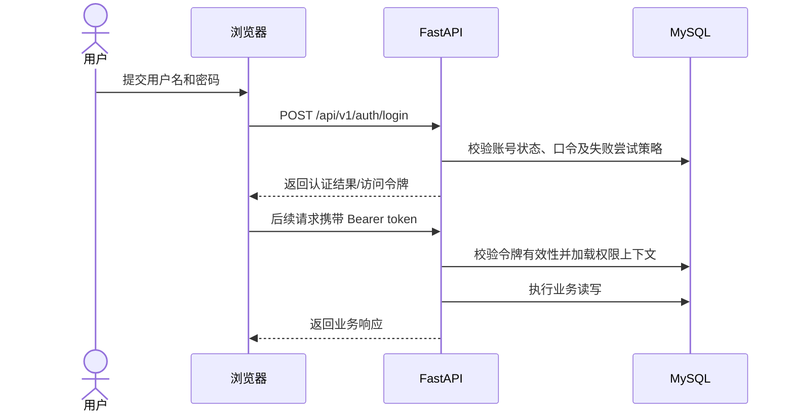
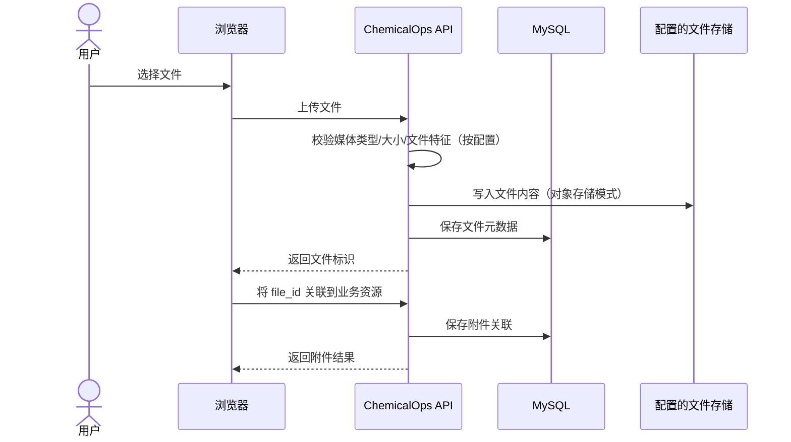

# ChemicalOps 项目简介与业务流程

## 项目简介

ChemicalOps 是面向企业化学品采购运营的管理平台。当前代码由 FastAPI 后端、Vue 3 管理端、MySQL 数据库组成，并可按配置连接 MinIO 对象存储与兼容 OpenAI/DeepSeek 的模型服务。系统以采购、供应商、到货、质量验收、库存、财务和运营处置为主要业务域，并提供系统权限、文件附件、通知、任务及 AI 工作台等支撑能力。

前端位于 `frontend-design/apps/web-chemicalops`；后端入口为 `main.py`，应用代码在 `backend/app`；表结构和迁移分别位于 `database/schema.sql` 与 `database/migrations`。接口文档根据运行时 OpenAPI 整理，完整字段以数据库 DDL 为准。

## 已实现业务范围

| 领域 | 代码可确认的能力 |
|---|---|
| 主数据 | 化学品、产品及单位、供应商资料的新增、查询、修改或停用；具体字段见数据库及接口文档。 |
| 采购 | 采购申请及审批流转；询价、供应商报价录入、报价比较及选定报价；采购订单创建、审批、下单、取消。 |
| 到货与质量 | 到货计划登记、收货确认；质量验收及结果提交；验收报告上传、明细级报告核对、产品检测标准版本和人工复核留痕。 |
| 库存 | 仓库/库位、入库、余额查询、冻结/解冻、流水；领料、调拨、盘点、退货、FIFO 出库与效期预警等端点。 |
| 供应商协作 | 供应商通过独立门户查看本方受邀询价并提交/修订报价，查看正式订单、确认/拒绝订单、更新预计交期、登记发货通知、上传/下载质量资料，以及查看对账、留言、确认或提出争议。数据按登录账号绑定的供应商过滤；发货通知复用到货与收货流程。 |
| 财务 | 对账、发票录入和人工审核、付款申请审批及人工登记已付款、采购结算确认。以上不表示已接入银行或税务系统。 |
| 运营协同 | 异常登记、任务与评论、站内通知、逾期扫描及任务运行记录、Dashboard 查询。 |
| 文件 | 文件上传、元数据查询、下载、关联业务附件。文件二进制内容按配置存储，数据库保留元数据/对象关联。 |
| AI 工作台 | 会话历史与流式对话、化学品资料问答、12 类白名单业务汇总及图表、明确订单号追溯、自然语言筛选、运营晨报及人工确认的采购申请草稿。报价和库存流水开放笔数统计；模型与检索能力依赖外部服务配置。 |
| 业务辅助分析 | 批次影响、财务差异、异常处置、MSDS 章节变化、供应商履约、报价变化、盘点差异、消耗观察和库位提示等只读分析，从相应业务页面打开并显示证据与限制。 |
| Agent 只读任务 | 后端 LangGraph 条件循环支持产品定位、库存查询、询价定位与报价比较四个只读工具；Pydantic 动作、RBAC/资源范围、多候选追问、MySQL 任务轨迹与版本校验续跑/取消已实现；AI 工作台聊天已集成库存/报价任务，直接输入目标即可启动；候选选择在回复内完成、补充条件使用原聊天输入框，支持会话历史恢复、取消及来源展示，202 接口支持立即返回编号与轮询；2026-10-03 新增隔离样本来源/数值场景 30/30 通过；真实模型固定集 16/16 是聊天集成前的历史结果，本轮未重跑；2026-10-04 采购员普通问答后“它”指代丙酮的真实模型测试完成规格选择，库存按当前权限范围返回无余额，报价查询读取本人询价三家记录并正确不排序；运行时回归 28 项通过。确认业务写入仍待开发；2026-10-08 提供可选队列故障恢复，当前默认旧模式，见[运行与验收](Agent只读任务运行与验收.md)、[阶段验收矩阵](evaluation/Agent阶段0-3验收矩阵.md)及[当日指代验收](evaluation/Agent普通问答指代验收-20261004.json)。 |
| 系统管理 | 登录、个人信息/密码、用户、部门、角色和权限管理；登录防护与令牌失效行为由迁移和配置决定。 |

## 演示角色与侧边栏可见性

2026-10-08 可选 RabbitMQ 执行模式已接入技术资料和四个 Agent 异步入口，默认仍为进程内执行。技术资料任务抽屉增加等待执行/等待重试文案与轮询，同 CAS 排队、运行及重试均互斥；阶段按有效源 hash 恢复，稳定章节与条件向量同步只更新目标文档。Agent 保持 202/TaskRead，公开 RUNNING 包含队列等待，WAITING_INPUT 由用户补充后创建新执行代次，取消及当前权限检查继续生效。消息服务和 API/Worker 启动、阶段切换与回滚见 [运行说明](RabbitMQ任务运行说明.md)。本轮真实 CLI 故障恢复使用模型替身，技术资料命令/embedding 恢复使用隔离样本，未重测真实抓取或回答质量；任务抽屉浏览器验收因工具会话错误未完成。

侧边菜单根据账号返回的读取权限码过滤：业务组至少有一个可读页面时显示，组内页面再按各自权限码过滤。供应商门户的询价、订单、交期、发货、质量资料和对账页面分别由 `supplier.portal.*` 权限控制；报价、交期更新、发货提交、质量资料提交、对账回应和留言各自有独立操作码。询价、订单、交期、发货、质量资料和对账 API 均以登录账号绑定的供应商为数据范围，不接受客户端指定供应商身份。运营看板按 2026-10-04 的用户决定对全部 12 类内置演示角色开放，供应商门户用户可以读取全局订单、付款、库存成本、异常与有效期汇总；AI 工作台使用单独的 `ai.workspace.read` 权限，仅对内部演示角色开放。看板权限不提供业务明细或写操作权限。导航可见性不是安全边界，API 仍独立执行登录态、权限和对象范围校验。矩阵记录当前 `scripts/seed_demo_accounts.py` 的演示权限配置，不代表生产租户必须采用相同角色。技术研发演示角色和系统管理员可在“主数据 / 技术资料”按中文名、英文名、别名或 CAS 搜索并选择记录后执行两个独立阶段（CAS 自动带入）：先抓取 MSDS/TDS 原件并保存到 MinIO，用户可预览 PDF 或转为纯文本展示的 HTML 原文；确认来源文件后再单独触发结构化解析、质检、数据库写入和 Qdrant 向量写入。右侧任务抽屉展示任务阶段与输出，失败重试保留原操作阶段，列表预览可并列查看原文件和结构化字段/章节。接口仅允许 TECHNICAL/SYS_ADMIN，且要求 CAS 关联启用化学品。此前爬虫、入参和解析回归 41 项通过；2026-10-04 浏览器确认 CAS 100-42-5 的 TDS PDF 原文与结构化章节可预览，列表和预览不显示质检字段，`vue-tsc` 与生产构建通过。对三个缺少 TDS 的启用化学品执行单 CAS 拉取，抓取流程均未取得可用文件，本轮新对象 MinIO 上传尚未验证；CAS 67-66-3 的结构化解析与 Qdrant 写入已有成功任务记录。多类型拉取会逐项核对 MinIO 文件，缺少任一所选类型时明确标记失败并保留已取得文件信息。本次相关流水线回归 46 项通过。技术研发可办理本人领用申请；入口单列为“研发协作 / 我的领用申请”，申请列表按申请人隔离，表单使用专用的最小库存选项接口，不开放审批、出库执行、调拨、盘点及通用库存台账。AI 工作台与运营总览仍可见。本轮开发库已同步；权限快照与种子配置一致，188 项技术研发越权接口探测通过。接口抽测确认本人领用列表及选项接口返回 200，仓库列表、库存台账、盘点和调拨接口返回 403；执行出库接口拒绝技术研发。浏览器未完成复验：当前本地前端路由返回 404。更新后的 11 类角色合计 1,740 项无权接口探测均返回 403。浏览器已逐账号检查顶层分组，并抽查供应商、质量、技术研发主数据及财务子页/按钮，完整三级页面与详情操作矩阵仍待逐页覆盖，见[接口结果](evaluation/角色接口权限验收-20261004.json)、[菜单抽查](evaluation/角色菜单浏览器抽查-20261004.json)及[技术研发复验](evaluation/技术研发角色权限复验-20261004.json)。

| 演示角色 | 看板 | AI 工作台 | 主数据 | 采购 | 仓储 | 质量 | 财务 | 运营 | 系统 |
|---|---|---|---|---|---|---|---|---|
| 系统管理员 | ✓ | ✓ | ✓ | ✓ | ✓ | ✓ | ✓ | ✓ | ✓ |
| 采购经理 | ✓ | ✓ | ✓ | ✓ | ✓ | ✓ | — | ✓ | — |
| 采购员 | ✓ | ✓ | ✓ | ✓ | ✓ | — | — | ✓ | — |
| 技术研发人员 | ✓ | ✓ | ✓ | — | ✓* | — | — | — | — |
| 仓库收货人员 | ✓ | ✓ | ✓ | — | ✓ | — | — | ✓ | — |
| 质量人员 | ✓ | ✓ | ✓ | — | ✓ | ✓ | — | ✓ | — |
| 质量负责人 | ✓ | ✓ | ✓ | — | — | ✓ | — | — | — |
| 财务查看者 | ✓ | ✓ | ✓ | ✓ | ✓ | ✓ | — | ✓ | — |
| 财务专员 | ✓ | ✓ | ✓ | ✓ | ✓ | ✓ | ✓ | — | — |
| 财务经理 | ✓ | ✓ | ✓ | ✓ | ✓ | ✓ | ✓ | — | — |
| 管理层查看者 | ✓ | ✓ | ✓ | ✓ | ✓ | ✓ | — | ✓ | — |
| 供应商门户用户 | ✓ | — | — | — | — | — | — | — | — |

注：✓ 表示至少显示该业务组中的一个页面；组内仍会按具体读取权限过滤。运营看板对 12 类角色共享公司级汇总，包含已付款金额和库存成本；看板读取权限不授予底层业务明细或操作权限。采购员可读取产品主数据，但不拥有产品主数据写权限。技术研发人员维护化学品、产品规格/检测标准与技术资料，可办理本人领用申请；申请入口显示为“研发协作”，但不提供审批、出库执行、调拨、盘点及通用库存台账。*技术研发角色仅显示个人领用页面，该菜单名称按角色调整。“财务查看者”演示权限集目前没有 `finance.*.read`，所以财务组隐藏。供应商门户包含“我的询价”“我的订单”“交期更新”“发货通知”“质量资料”和“对账协同”：询价仅包含绑定供应商收到的邀请，报价受询价状态及截止时间约束；订单和关联履约/对账记录限定在绑定供应商，交期更新限正式订单，发货提交由后端核对订单剩余数量，质量资料下载校验关联文档的数据归属。对账留言由供应商门户与内部财务对账页面双向查看和追加。列表页统一使用筛选、复选框、状态标签、操作列和分页。AI 工作台的独立 `ai.workspace.read` 用于隐藏供应商入口，后端业务查询仍按具体业务权限控制。供应商浏览器逐页操作和本地演示写入详见[验收报告](evaluation/供应商门户验收-20261004.md)。

功能表述范围依据当前路由、服务和数据结构；不等于已完成生产外部集成或真实业务数据验收。MSDS 章节变化分析只比较同一 CAS 的已解析资料，不认定法规或危害结论变化；专门的 MSDS 生命周期、版本审批和法规合规工作流尚未实现。AI 工作台尚无通用附件问答入口，也不会自动审批、下单、修改库存或付款。本地浏览器已完成供应商六页面代表性操作及真实 MinIO 字节核对；这不代表所有页面状态、响应式布局或生产环境已验收。 |

## 核心业务关系

图表示代码与表结构体现的业务关系，不代表每条流程都自动触发。各业务状态和守卫条件以具体接口实现为准。

## 关键时序

### 采购到库存（概念主链路）

### 登录与带权限请求

### 文件上传及业务附件

## 当前边界与事实来源

- API 实际实现清单以 [接口文档](接口文档.md) 和 `/docs` 为准；页面存在不代表接口或自动化流程已实现。
- 数据库字段、键、索引以 [数据库设计说明](数据库设计说明.md) 为准；外键未定义时，文档会将关系标为逻辑关系。
- AI、MinerU、MinIO、邮件或其他外部服务均受配置和部署条件影响；未配置时不可视为可用。
- AI 已实现能力与后续计划见 [AI 工作台现状与建设方案](业务数据与AI联动路线图.md)；质量报告核对与业务分析进度见 [AI 功能扩展进度](AI功能扩展调研与候选路线图.md)。
- 登录、幂等、迁移备份等具体行为遵循当前环境配置及已应用迁移，不可只凭代码目录推断某运行环境已经升级。
